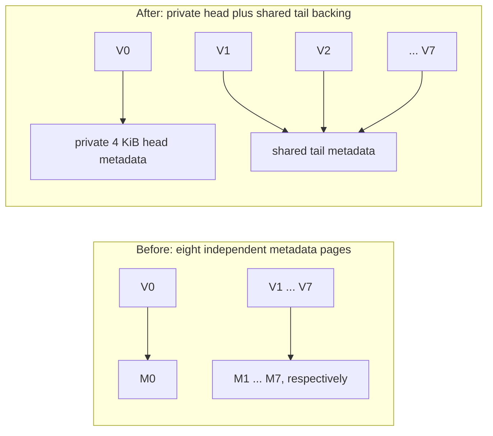
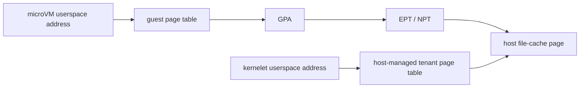

# Sharing the host page cache: what Linux saves, and where kernelets could do better

Kernelets could avoid a microVM's second set of device-page descriptors and its second stage of address translation. They cannot eliminate the host's page metadata, tenant page tables, or the need to make cold data resident. Fault-free access is possible after preparation, but it is not unique to kernelets and does not survive arbitrary reclamation automatically.

<div class="background">

**Kernelets: host and tenant address spaces.** In this repository, a kernelet is a tenant kernel running in the host Linux kernel's address space and kernel mode. Its vOSTD framework mediates host requests, while a trusted host component, the endovisor, manages its resources and tenant userspace mappings. Those userspace programs run on host-managed page tables, without a guest-physical translation stage; sharing the kernel address space does not authorize access to arbitrary host memory. [Kernelet architecture](book/src/accepted-design/why-a-kernel-of-your-own.md), [tenant page tables](book/src/accepted-design/tenant-memory-on-linux-page-tables.md)

</div>

This article studies immutable image layers and a proposed `klet-pmem` interface; it does not describe an implemented device. The analysis is dated **6 November 2026**: the repository targets Linux **6.12**, released mechanisms are checked against **7.3**, and selected development changes against **7.4-rc1**. Kernel.org listed 7.3.1 as stable and 7.4-rc1 as mainline on that date; development support below is not a promise about the next release. [Repository build configuration](prototype/Makefile), [kernel releases](https://www.kernel.org/)

## 1. The expense that remains after sharing file data

Linux's page cache normally holds file contents in RAM so that reads and file mappings can reuse them. A buffered virtual disk can leave one copy in the host and another in guest RAM. DAX removes the guest cache copy for eligible data by accessing the device's memory-like address range directly. [Linux DAX documentation](https://docs.kernel.org/filesystems/dax.html)

DSec identifies two remaining costs of virtio-pmem with DAX: synchronous cold-access mapping/data preparation, and guest `struct page` storage for the whole device range. Its example is a 128 GB device requiring 2 GB of descriptors with 4 KiB pages and 64-byte descriptors. That ratio follows from `64 / 4096 = 1/64`; this article uses binary units explicitly, so **128 GiB requires 2 GiB** under those assumptions. [DSec, section 5.2](https://arxiv.org/html/2609.22978v1#S5.SS2)

There are therefore two separate questions: can Linux represent the device with less physical metadata, and can the access path avoid fault-driven preparation? Large mappings can help with the second without solving the first.

## 2. From physical pages to a virtually mapped descriptor array

### A descriptor describes a page; it does not contain the page

<div class="background">

**Linux: page frames and descriptors.** A page frame is a physical storage unit; its page frame number, or PFN, is its physical address divided by `PAGE_SIZE`. A `struct page` stores management information, such as references, flags, and fields used for file ownership or allocation bookkeeping. Fields are reused for different kinds of page; the descriptor is separate from the contents it describes. [Linux 6.12 descriptor definition](https://raw.githubusercontent.com/torvalds/linux/v6.12/include/linux/mm_types.h)

</div>

With 4 KiB frames and 64-byte descriptors, a 2 MiB data range has 512 descriptors occupying 32 KiB. The descriptor size depends on architecture and kernel configuration; 64 bytes is a worked assumption, not a universal ABI.

Ordinary host RAM already has page descriptors whether its frames are free, allocated to applications, or holding file data. Another sandbox referencing a cached page does not require another host `struct page` for that same frame. It can still require references, index entries, mapping records, and page tables. [Linux physical memory model](https://raw.githubusercontent.com/torvalds/linux/v6.12/Documentation/mm/memory-model.rst)

### Compound pages and folios describe an allocation as a whole

<div class="background">

**Linux: compound pages and folios.** A compound page groups `2^order` consecutive base pages, with a head and tail pages; a 2 MiB group of 4 KiB pages has order 9. A folio is the typed interface for an entire aligned, physically contiguous group, including the one-page case. `page_folio(page)` finds the containing folio, while `folio_page(folio, i)` selects one constituent page. [Linux memory-management API](https://docs.kernel.org/core-api/mm-api.html)

</div>

A `struct page *` may identify a constituent tail rather than the whole allocation. A `struct folio *` makes whole-allocation operations explicit, with its storage overlapping the head and, for large folios, some following descriptor slots. Changing an interface to folios does not by itself release those slots' physical backing.

<div class="background">

**Linux: page-table leaves.** A page-table entry, or PTE, at the lowest level maps one base page in this discussion. The next level is the page middle directory, or PMD; on the x86-64 configuration used here, a PMD entry can either point to a table of 512 PTEs or directly map 2 MiB. These are translation formats, distinct from the kernel's allocation and descriptor formats. [Linux page-table hierarchy](https://docs.kernel.org/6.12/mm/page_tables.html)

</div>

Three properties must remain separate:

| Property | What it changes | What it does not establish |
|---|---|---|
| A huge page-table mapping | One translation covers a larger address range | Fewer descriptor bytes |
| A compound page or large folio | Several base pages are managed together | Deduplicated metadata storage |
| Vmemmap optimization | Physical storage backing descriptors is shared or released | That every DAX path supports it |

### Vmemmap gives descriptors stable virtual addresses

<div class="background">

**Linux: vmemmap.** With `CONFIG_SPARSEMEM_VMEMMAP`, page descriptors occupy a virtually contiguous array in kernel address space. The PFN indexes that array, while kernel page tables determine which physical memory stores the descriptors. Device memory can obtain descriptors through `ZONE_DEVICE` without becoming ordinary allocatable RAM. [Linux memory-model documentation](https://docs.kernel.org/mm/memory-model.html)

</div>

The following expressions illustrate the array arithmetic, rather than a new interface:

```c
descriptor = vmemmap + pfn;
pfn = descriptor - vmemmap;
```

Both conversions use the descriptor's **virtual position**, not the physical address storing its fields. That separation lets Linux preserve descriptor identity while sharing backing storage. [Linux 6.12 conversion macros](https://raw.githubusercontent.com/torvalds/linux/v6.12/include/asm-generic/memory_model.h)

## 3. How Linux deduplicates huge-page metadata

### Eight metadata pages need not have eight physical copies

<div class="background">

**Linux: HugeTLB and transparent huge pages.** HugeTLB is Linux's explicitly managed huge-page facility, with its own allocation pools and lifetime rules. Transparent huge pages, or THP, let Linux use larger allocations and mappings through ordinary memory-management paths; neither “large mapping” nor “THP” implies the HugeTLB-specific metadata optimization described here. [HugeTLB](https://docs.kernel.org/6.12/admin-guide/mm/hugetlbpage.html), [THP](https://docs.kernel.org/6.12/admin-guide/mm/transhuge.html)

</div>

Consider a 2 MiB HugeTLB page with 512 descriptors. Each 4 KiB metadata page holds 64 descriptors, so the logical descriptor range spans eight virtual pages, `V0` through `V7`.

The head and a few early descriptors hold information unique to the allocation. The remaining descriptors need only the repeated tail representation used to find the head. This is a HugeTLB-specific layout property, not a general permission to merge arbitrary `struct page` contents. [Linux 7.3 vmemmap design](https://raw.githubusercontent.com/torvalds/linux/v7.3/Documentation/mm/vmemmap_dedup.rst)

In the 7.3 HugeTLB optimization, the first metadata page has private physical backing, while the remaining virtual pages point to a shared tail page:



The implementation prepares replacement backing, changes the vmemmap page-table entries, synchronizes translations, and releases the displaced physical pages. The logical 32 KiB range survives, but its private backing falls to 4 KiB plus a share of a tail page reused across huge pages of the same order and allocation zone, a Linux grouping of physical memory by allocation constraints. This accounting excludes mapping-page-table costs. [Linux 7.3 HVO implementation](https://raw.githubusercontent.com/torvalds/linux/v7.3/mm/hugetlb_vmemmap.c)

### Virtual identity makes sharing work

The descriptors `vmemmap[n + 64]` and `vmemmap[n + 128]` have different virtual addresses even when they access the same offset in a shared physical metadata page. Array subtraction therefore still returns different PFNs.

Linux 7.3 can also encode a mask in a tail's `compound_info` rather than storing a different head pointer for every allocation. Under the required alignment conditions, applying that mask to the tail descriptor's virtual address recovers its own head; the same stored mask works for multiple allocations of the same order. In this example the descriptor range is 32 KiB, so the operation is conceptually an alignment down to that boundary. [Linux 7.3 compound-page helpers](https://raw.githubusercontent.com/torvalds/linux/v7.3/include/linux/page-flags.h)

Shared tails cannot retain independently mutable state. HVO makes their mappings read-only and keeps unique writable state in the retained area; before returning a HugeTLB allocation to ordinary base-page management, Linux restores independent descriptor backing. It is an explicit allocation/remapping protocol, not automatic copy-on-write on arbitrary metadata writes. [HVO remapping and restoration](https://raw.githubusercontent.com/torvalds/linux/v7.3/mm/hugetlb_vmemmap.c)

### The exact layout depends on version and subsystem

Linux 6.12 HVO instead aliases the other seven metadata pages onto the retained first page, reducing 32 KiB to 4 KiB. This produces “fake head” aliases, which its compound-page helpers recognize; the 7.3 shared-tail illustration must not be read as the exact 6.12 implementation. [Linux 6.12 HVO documentation](https://docs.kernel.org/6.12/mm/vmemmap_dedup.html)

Device DAX already had metadata deduplication in 6.12 and 7.3, but its documented layout retains two metadata pages for this 2 MiB example: 32 KiB becomes 8 KiB. It deduplicates during population rather than freeing populated tails afterward, excludes the device-backed metadata case called altmap, and differs from HVO in tail write protection. [Linux 7.3 Device DAX documentation](https://raw.githubusercontent.com/torvalds/linux/v7.3/Documentation/mm/vmemmap_dedup.rst)

Further shared-tail infrastructure for Device DAX is present in **7.4-rc1**, a development release. It must not be presented as absent from mainline, or confused with the separate, still-proposed FS-DAX allocation work below. [7.4-rc1 Device DAX documentation](https://raw.githubusercontent.com/torvalds/linux/v7.4-rc1/Documentation/mm/vmemmap_dedup.rst), [generic optimization definitions](https://raw.githubusercontent.com/torvalds/linux/v7.4-rc1/include/linux/vmemmap-optimization.h)

## 4. Why these savings do not automatically reach virtual filesystems

### Device DAX and filesystem DAX have different contracts

Device DAX exposes a character device such as `/dev/dax0.0` for direct mapping. Its driver uses the device alignment to set `dev_pagemap.vmemmap_shift`, requesting compound descriptor population. Filesystem DAX instead exposes files whose allocation, mappings, and lifetime are managed by a filesystem. [Linux 7.3 Device DAX driver](https://raw.githubusercontent.com/torvalds/linux/v7.3/drivers/dax/device.c)

Virtio-pmem exports a memory-like device range backed by a host file; it does not require physical persistent-memory hardware. Guest filesystem DAX can then bypass the guest data cache and reach the host-backed pages. DAX `read()` still copies bytes into the caller's buffer; direct sharing of userspace mappings is the relevant zero-copy case here. [QEMU virtio-pmem documentation](https://www.qemu.org/docs/master/system/devices/virtio/virtio-pmem.html), [Linux DAX behavior](https://docs.kernel.org/filesystems/dax.html)

The checked pmem registration path uses `MEMORY_DEVICE_FS_DAX` and `devm_memremap_pages()` without requesting Device DAX's compound metadata layout. Virtio-fs similarly registers its entire shared-memory range as FS-DAX memory. Their initialized capacity therefore still incurs base-page descriptor storage in these paths; selecting large fault mappings does not change that registration policy. [Linux 7.3 pmem driver](https://raw.githubusercontent.com/torvalds/linux/v7.3/drivers/nvdimm/pmem.c), [virtio-fs device setup](https://raw.githubusercontent.com/torvalds/linux/v7.3/fs/fuse/virtio_fs.c)

### A virtio-fs window is reusable address space

<div class="background">

**Virtualization: DAX windows.** Virtio-fs exports host files and supplies a guest physical address window into which host file ranges can be mapped and later replaced. Guest physical address, or GPA, is the address used by the guest's physical-memory view; it is not necessarily a dedicated host RAM allocation. A window can be smaller than the total exported filesystem because its slots are reused.

</div>

The configured shared-memory region is advertised when the device is set up; its file mappings are established afterward. In the checked Linux 7.3 client, `FUSE_DAX_SHIFT = 21` makes the default slot 2 MiB. A slot is an allocation unit for file-to-window mappings, not a promise of a huge guest or host translation. [FUSE DAX implementation](https://raw.githubusercontent.com/torvalds/linux/v7.3/fs/fuse/dax.c)

For window capacity `W`, descriptor storage is approximately `W/64` under our assumptions: a 2 GiB window costs 32 MiB, whether every slot is occupied or not. Smaller windows cause more replacement activity; larger windows pay more capacity metadata. Host file-cache residency remains a separate cost.

The 2022 Alibaba article describes this same trade-off and per-inode DAX selection, reporting that small files can waste slots and trigger expensive window reclamation. Its useful implication is to choose DAX selectively and size the window for the workload; selecting fewer DAX files does not release descriptors for an already registered window. These are window-replacement concerns, distinct from host physical-memory reclamation. [Alibaba virtio-fs article](https://developer.aliyun.com/article/863752)

## 5. What is released, and what is still being changed

The following distinctions prevent several apparent “metadata reductions” from being counted twice:

| Mechanism | Verified status and scope | Physical-memory consequence |
|---|---|---|
| HugeTLB vmemmap optimization | Released; layouts above differ between 6.12 and 7.3 | Deduplicates descriptor backing for eligible HugeTLB allocations |
| Device DAX tail deduplication | Released in the checked 6.12/7.3 paths; further shared-tail work in 7.4-rc1 | Reduces eligible device descriptor backing, not every FS-DAX device |
| Larger DAX PTE/PMD mappings | Existing mapping mechanism | Reduces translation entries and possible mapping faults, not capacity descriptors |
| Altmap / `memmap_on_memory` | Existing placement mechanisms with subsystem-specific restrictions | Moves metadata into device or newly added memory; consumes that capacity |
| Deferred page initialization | Existing initialization policy | Delays initialization work; not equivalent to releasing or deduplicating backing |
| Lazy private FS-DAX metadata | September 2026 proposal, discussed through October | Avoids private backing until the relevant metadata needs mutation |

Altmap reserves storage for descriptors on the represented device; hotplug's `memmap_on_memory` can similarly use the added RAM. This can relieve pressure on existing RAM without reducing total storage consumed, and must not be assumed to work for an arbitrary read-only virtio-pmem image. Deferred initialization also leaves eventual metadata requirements in place. [Memory-model placement](https://docs.kernel.org/mm/memory-model.html), [Linux 7.3 memory hotplug](https://raw.githubusercontent.com/torvalds/linux/v7.3/Documentation/admin-guide/mm/memory-hotplug.rst), [Linux 7.3 initialization code](https://raw.githubusercontent.com/torvalds/linux/v7.3/mm/mm_init.c)

### Proposed FS-DAX backing materialization

Muchun Song's **3 September 2026 v1**, “Reduce struct page overhead for FS-DAX pmem,” initially maps descriptor storage to a shared read-only template. Before a DAX fault exposes a PFN to userspace, it explicitly materializes private writable metadata. The series opts in pmem, not virtio-fs generally, and initially restricts registration to a single memory-block-aligned range. [Patch 3: template mappings](https://lkml.iu.edu/2609.0/07574.html), [patch series and discussion](https://lore-kernel.gnuweeb.org/nvdimm/20260903122128.12264-1-songmuchun%40bytedance.com/)

The latest revision verified for this article is that v1, followed by tester fixes and discussion through **29 October**. On 28 October the author said a v2 had not yet been sent and the design was being refactored; this series' shared-template/materialization mode is absent from the inspected 7.4-rc1 `dev_pagemap` interface. This is proposed work, not a released Linux feature. [October discussion](https://lore.landau.one/lkml/20261029030511.12004-1-trilith.zheng%40gmail.com/T/), [7.4-rc1 interface](https://raw.githubusercontent.com/torvalds/linux/v7.4-rc1/include/linux/memremap.h)

The proposal changes **when private backing is allocated**, rather than removing the logical descriptor array. Kernel DAX reads can use the common representation; userspace mappings require materialization before insertion. Reserving vmemmap address space and providing its page tables still cost resources.

The allocation unit matters. One 4 KiB metadata page holds 64 descriptors, representing **256 KiB of device addresses**; materializing one descriptor therefore allocates backing for that whole group. A PMD-sized 2 MiB fault materializes eight metadata pages, or 32 KiB. [Materialization implementation](https://lkml.iu.edu/2609.0/07574.html)

For illustration, mapping 512 adjacent 4 KiB device pages starting on a 256 KiB group boundary requires eight such metadata groups; scattering those pages into 512 different groups requires 512. Both map 2 MiB of data, but the private metadata is respectively 32 KiB and 2 MiB. This is a derived granularity effect, not a reported benchmark.

The cover letter identifies re-sharing private metadata after all dependent mappings and references disappear as a future extension. Consequently the proposed v1 follows **groups ever materialized during the device lifetime**, not necessarily the current live mapping set. A reversible future version could do better, but should be modeled separately. [FS-DAX proposal's follow-up scope](https://lore-kernel.gnuweeb.org/nvdimm/20260903122128.12264-1-songmuchun%40bytedance.com/)

## 6. Preparing mappings can remove faults without removing work

### Guest mappings and second-stage mappings are separate

<div class="background">

**Virtualization: two-stage translation.** With x86 EPT or NPT, a guest virtual address is translated to a GPA by guest page tables, then to host physical memory by second-stage page tables. Missing guest mappings cause guest page faults; missing second-stage mappings cause virtualization exits for the hypervisor to resolve. The VMM's host virtual mapping is backing bookkeeping, not a third hardware stage in this guest translation chain. [KVM MMU documentation](https://docs.kernel.org/virt/kvm/x86/mmu.html)

</div>



FS-DAX can install a 2 MiB PMD mapping when alignment, file extent, mapping size, and permissions permit it; otherwise it falls back to smaller mappings. Guest GPA continuity can satisfy a guest huge mapping even when the host backing cannot support a huge EPT mapping. Host physical continuity and alignment must be evaluated separately. [Linux 7.3 FS-DAX fault implementation](https://raw.githubusercontent.com/torvalds/linux/v7.3/fs/dax.c)

### Equal preparation can make either execution path fault-free

The desired kernelet contract is: acquire valid resident pages, install the final tenant mappings, and retain their backing until revocation. Correctly permitted userspace reads or instruction fetches then need no mapping fault, including on first touch. Cold acquisition can instead block on explicit I/O; zero access faults is not zero preparation time.

MicroVMs can also prepare mappings in advance. Linux 7.3 x86 KVM implements `KVM_PRE_FAULT_MEMORY` for supported two-dimensional paging configurations, and the guest can prepare its own DAX mappings before application execution. The capability must be queried, and preparing second-stage mappings alone does not establish guest userspace mappings or prevent later reclamation. [KVM capability implementation](https://raw.githubusercontent.com/torvalds/linux/v7.3/arch/x86/kvm/x86.c), [second-stage preparation](https://raw.githubusercontent.com/torvalds/linux/v7.3/arch/x86/kvm/mmu/mmu.c)

| Starting condition | Kernelet expectation | Comparable microVM expectation |
|---|---|---|
| Data cold, mappings absent | Explicit acquisition and tenant mapping work | Backing-data acquisition plus guest and second-stage mapping work |
| Data resident, all required mappings prepared | Zero access mapping faults | Zero access mapping faults |
| Data resident, translations absent | Preparation or a fault must install them | Preparation or faults must install the missing stages |
| Backing reclaimed and mappings revoked | Restore before access or refault | Restore before access or refault |

The structural opportunity is to eliminate the second stage and its preparation, not to claim that every microVM must fault once per application access. KVM already integrates host memory changes and pressure into its MMU management; useful reclamation is not a capability unique to the proposed kernelet design. [KVM MMU events and integration](https://docs.kernel.org/virt/kvm/x86/mmu.html)

## 7. A proposed host-page import interface

### Image bytes must match userspace bytes

A device sharing an image file exposes pages at **image-file offsets**. Mapping a file inside that image directly into userspace works only where those bytes already have the required layout, alignment, and protection; compressed content needs decoding, packed tails may share pages with unrelated bytes, and file-end mappings must preserve zero-fill semantics.

For example, Linux 6.12 EROFS marks only eligible regular flat-plain or chunk-based files DAX under its DAX policy, excluding compressed and flat-inline layouts. A kernelet cannot remove those byte-layout constraints by replacing virtio-pmem. A separately shared decoded-file cache is another possible design, but has its own memory and ownership costs. [EROFS DAX eligibility](https://raw.githubusercontent.com/torvalds/linux/v6.12/fs/erofs/inode.c)

Immutability must cover the host backing object, not merely the guest's mount permissions. The attachment needs a stable object/version contract, authorization for each range, and no writable tenant alias of shared content. Private writes belong in a separate copy-on-write layer.

### Import pages by capability rather than trusting physical addresses

<div class="background">

**Linux: the direct map.** On the x86-64 host considered here, Linux already maps ordinary RAM into kernel virtual address space, allowing permitted kernel code to reach a resident page without constructing a VMM mapping first. This direct map is separate from both vmemmap's descriptor array and the tenant's userspace mappings. vOSTD would still need an authorized, lifetime-protected handle before using an imported page through it. [Repository direct-map contract](book/src/accepted-design/the-kernelet-abi.md)

</div>

The following is **proposed Rust-like interface pseudocode**, not an existing repository or Linux API:

```rust
fn acquire_readonly(dev: DeviceId, offset: u64, len: u64)
    -> Result<ReadLease>;
fn map_prepared(space: SpaceId, va: usize, lease: &ReadLease)
    -> Result<MappingId>;
fn unmap_release(mapping: MappingId) -> Result<()>;
```

`acquire_readonly` would validate attachment bounds, acquire up-to-date host cache folios, and return an opaque generation-bearing lease. `map_prepared` would authorize the tenant range, establish read-only or appropriately executable PTEs, and register every mapping before reporting success. A lease keeps backing valid; it must be revocable or released for reclamation.

The host page cache already provides lookup and reference-taking mechanisms, while reading an absent or stale folio requires the appropriate filesystem read/completion path. A reference alone is not evidence that bytes are ready to use. Importing these pages would reuse host descriptors, without registering a second, capacity-sized guest PFN universe. [Linux 7.3 file-cache acquisition](https://raw.githubusercontent.com/torvalds/linux/v7.3/mm/filemap.c)

### The prototype supplies only part of this mechanism

The repository already maps tenant pages eagerly into host-managed tenant page tables, but its mapping service accepts private grant frames and rejects large-page requests. `klet_space_insert` enforces grant ownership, while `klet_prot_to_pgprot` rejects the large-page flag. Its `VM_PFNMAP` mappings deliberately bypass normal Linux reverse-map/reclaim handling; this is not an existing reclaimable host-file mapping service. [Mapping implementation](prototype/linux/endovisor/space.c)

vOSTD also maintains its own frame references and relies on the host not independently removing its mappings. Its unmap path reads entries, invokes host unmapping and TLB flushing, waits for readers, and then drops references. Imported read-only handles, invalidation-aware walkers, cache indexes, and a host-authoritative revocation registry would require revisions beyond relaxing the grant check. [Frame ownership](prototype/vostd/src/mm/frame.rs), [tenant unmapping](prototype/vostd/src/mm/vm_space.rs), [accepted lifetime assumptions](book/src/accepted-design/what-vostd-adds-on-top.md)

## 8. Reclamation makes the fault-free guarantee conditional

### Revocation must cover every way a page can still be used

<div class="background">

**Linux: reclaim and reverse mappings.** Reclaim frees physical backing only after users can no longer access it and references preventing release are gone. Reverse mappings locate process mappings of a page; TLB invalidation removes cached translations, while lifetime synchronization protects kernel readers that may already hold pointers. Removing a userspace PTE alone does not complete all of those jobs. [Linux reclaim implementation](https://raw.githubusercontent.com/torvalds/linux/v7.3/mm/vmscan.c)

</div>

A proposed revocation protocol needs these steps:

1. Mark the lease revoking and reject new mappings or kernel borrows of its generation.
2. Coordinate affected tenant execution and page-table walkers; prevent races with mapping, fork, and teardown.
3. Remove every userspace alias and invalidate the corresponding TLB translations.
4. Wait for in-flight direct-map readers and other users to finish, then remove kernelet cache ownership and release backing references.
5. Let host reclaim proceed; later acquisition returns a new generation and may use different physical pages.

This is a protocol outline, not a proof. The host must not wait for tenant cooperation while holding locks the tenant needs, and must retain a way to enforce revocation or terminate a noncooperating sandbox. Merely adding a cache shrink callback would not establish those properties.

All holders matter. If ten sandboxes share a host folio, revoking one sandbox may free its bookkeeping but no data; the folio is reclaimable only when every remaining holder allows release. Existing KVM invalidation machinery shows why host/tenant coordination is possible, while also supplying a strong baseline for comparison.

### Policy A: restore on the next access

After revocation, a later access faults and reacquires backing before rebuilding its mapping. Resident prepared mappings remain fault-free, and unused pages can remain reclaimed indefinitely. This supports demand-driven residency but explicitly gives up the absolute guarantee after eviction.

### Policy B: restore before resuming affected execution

The host could suspend affected execution, reclaim backing while it remains suspended, then reacquire pages and reinstall mappings before resuming. This can preserve a zero-access-fault contract over a defined execution interval. It trades faults for suspension, I/O, and mapping work.

With arbitrary uninstrumented userspace loads, restoring only a guessed working set cannot guarantee zero faults. The design must restore every revoked mapping reachable during that interval, restrict which mappings are reachable, or accept refaults. Restoring everything before each resume can erase the residency benefit and thrash under pressure; stopping one thread is insufficient if another can access the same mappings.

A microVM can also be paused and prefaulted, so this policy is not itself a kernelet advantage. A kernelet might coordinate at finer granularity through its shared host APIs, but useful granularity, bounded suspension time, and deadlock-free enforcement remain design questions.

## 9. An analytical budget for the possible savings

### Capacity, mapping history, and live holdings are different variables

Let `N` be the sandbox count, `P = 4096 B`, `d = 64 B`, and `S` a pmem device's advertised capacity. For sandbox `i`, let `W_i` be its virtio-fs window capacity, `T_i` its distinct live image bytes mapped, `A_i` its bytes currently held by cache leases, and `E_i` the number of descriptor-backing groups ever materialized.

The following budgets count selected image-path costs, not whole-VM memory:

```text
ordinary FS-DAX device descriptors:   d * ceil(S / P) per guest
ordinary virtio-fs descriptors:      d * ceil(W_i / P) per guest
proposed lazy FS-DAX private backing: P * E_i per guest
kernelet import bookkeeping:         b * Q_i + c * R_i + F_i
```

The lazy formula adds shared-template and mapping infrastructure separately; each group covers 256 KiB under our assumptions. `Q_i` counts held-page or held-folio records, `R_i` counts mapping/revocation records, `b` and `c` are their sizes, and `F_i` includes fixed per-device or per-sandbox state. These are design variables, not measured kernelet costs.

The straightforward per-base-page design has `Q_i = ceil(A_i/P)`; range or folio records might reduce it, while sparse mappings and aliases can increase `R_i`. There is no sound “zero kernelet metadata” assumption. The prototype's own reference-count arrays also illustrate why using host descriptors does not eliminate local ownership state.

### Data and page tables must be counted separately

Shared data residency is the union `U` of host cache bytes retained by all sandboxes, rather than the sum of their overlapping holdings. Host RAM descriptors are system-wide provisioning already associated with those frames; adding another user of the same folio does not allocate another copy. This does not make cache indexes, PTEs, or extra copies of decoded data free.

For dense aligned x86 mappings using 8-byte PTEs and 4 KiB pages, leaf page-table storage is approximately `mapped_bytes/512`. Thus a single 1 GiB userspace mapping needs 2 MiB of leaf tables, and mapping those bytes into ten processes generally needs ten such sets. Upper levels and sparse-layout rounding add costs.

Guest userspace tables belong in both designs' budgets. MicroVMs additionally need second-stage tables for distinct mapped GPAs, and the VMM may need host file-mapping PTEs; those counts need not equal guest process aliases. Huge mappings can reduce these terms independently, subject to each stage's constraints.

### Worked examples expose when the gap narrows

Assume **100 sandboxes**, each exposing the same **128 GiB** image, holding and mapping the same **1 GiB** contiguous image interval once. Choose 2 MiB-aligned image offsets, tenant virtual ranges, and GPAs, which also satisfy the 256 KiB metadata-group alignment. Assume 4 KiB leaf mappings at all relevant stages and a backing layout that permits direct sharing.

The table is a scenario calculation, not an implementation measurement.

| Cost | Conventional virtio-pmem FS-DAX | Lazy FS-DAX proposal, interval materialized once | Proposed kernelet |
|---|---:|---:|---:|
| Shared host image data | 1 GiB | 1 GiB | 1 GiB |
| Extra guest device descriptor backing | 200 GiB | 1,600 MiB, plus template/infrastructure | None for a second device PFN array |
| Tenant userspace leaf tables | 200 MiB | 200 MiB | 200 MiB |
| Second-stage leaf tables for that interval | 200 MiB | 200 MiB | None |
| Import bookkeeping | Guest filesystem/DAX bookkeeping remains | Guest filesystem/DAX bookkeeping remains | Depends on `Q_i`, `R_i`, and record sizes |

The rows are not a whole-VM total: they omit host VMM PTEs, guest kernel/direct-map tables, and second-stage mappings for descriptor RAM itself. Under the same dense 4 KiB assumption, the conventional case's 200 GiB of descriptor RAM alone could require another 400 MiB of second-stage leaf tables.

To size the last row, suppose a proposed kernelet needs **32 bytes per held 4 KiB page** before mapping records and fixed state. That is 8 MiB per sandbox, or 800 MiB across 100; it is smaller than 1,600 MiB of contiguous lazy FS-DAX backing, but does not prove the complete kernelet design is smaller. A 64-byte per-page record would already equal that lazy descriptor term before its extra records.

Compare virtio-fs with the right capacity variable: **2 GiB windows** cost only 32 MiB each, or **3,200 MiB across 100 guests**, not 200 GiB. Increasing the common window to 8 GiB raises that descriptor term to 12,800 MiB; changing the exported image capacity alone need not increase it.

Sparse access and mapping history change the lazy case. One mmap-materialized 4 KiB page in each of 512 distinct 256 KiB groups requires 2 MiB of private descriptor backing, despite only 2 MiB of mapped data; once materialized, those groups remain private in v1. An eventual reversible implementation could release them after dependent uses disappear.

For contiguous fully materialized mappings, the descriptor term therefore changes from roughly `N*S/64` to roughly `sum(T_i)/64` only if historical materialization has not exceeded current mappings. Against a future reversible implementation with that favorable footprint, a kernelet's opportunity depends on smaller ownership records and avoiding second-stage translation costs, not on reclaiming the original full capacity bill.

No byte estimate establishes a latency improvement. Eager preparation may map bytes never accessed, and large mappings or compact records may benefit the microVM baseline too. The useful comparison must count the same prepared ranges, userspace aliases, residency interval, and revocation policy.

## 10. Verdict: a credible advantage with a demanding lifetime contract

**Kernelets have a credible opportunity to do better for large immutable images with sparse use.** Against the checked conventional virtio-pmem FS-DAX path, they could avoid a 64-byte descriptor per 4 KiB of advertised device capacity: **2 GiB per 128 GiB device per sandbox**, before replacement bookkeeping. Against virtio-fs, the corresponding opportunity is tied to window size: **32 MiB per 2 GiB window**, not the whole exported image.

**The advantage becomes conditional as Linux improves.** Proposed lazy FS-DAX backing can reduce the descriptor bill to materialized groups, and reversible backing would narrow it further toward live use. A kernelet must then beat that smaller term with its lease/cache/revocation design; the worked 32-byte record scenario saves only 8 MiB per densely held GiB before additional records, rather than automatically saving the whole device-capacity bill.

**One translation stage is a structural difference; zero access faults is a prepared-state property.** Kernelets can avoid a microVM's second-stage tables and preparation, but both designs can execute against resident prepared mappings without mapping faults. Neither can allow arbitrary accesses to genuinely reclaimed backing without restoring it beforehand or taking faults.

The repository demonstrates eager mapping of private grant frames, not the proposed cache-import device. Realizing the opportunity requires authorized immutable-page import, layouts suitable for direct mapping, compact ownership records, host-enforced revocation, synchronization with vOSTD walkers and direct readers, and a chosen restoration policy. Where decoded copies, sparse aliases, long-lived leases, or restore-before-resume thrashing dominate, the expected benefit can shrink or disappear.
