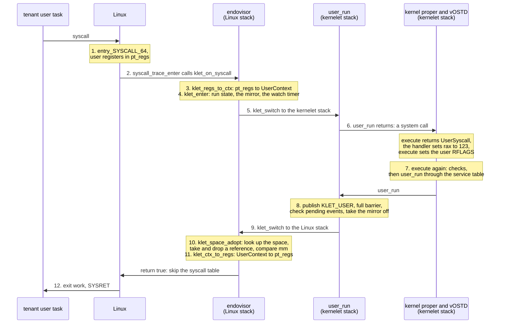
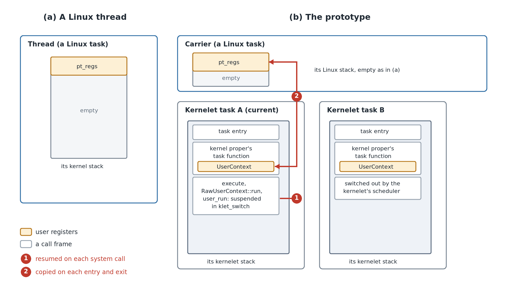
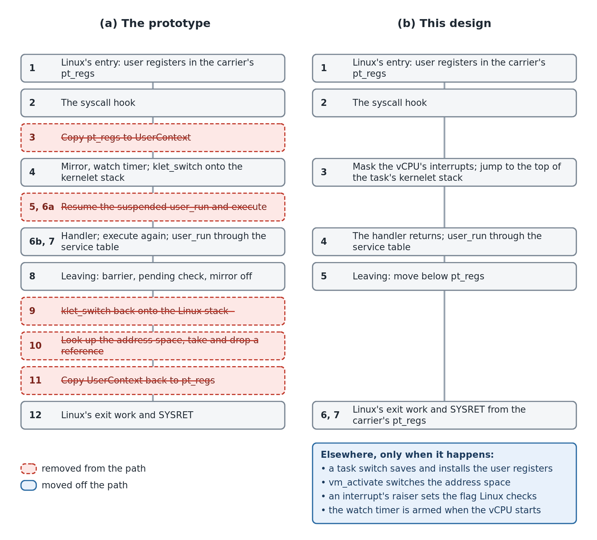
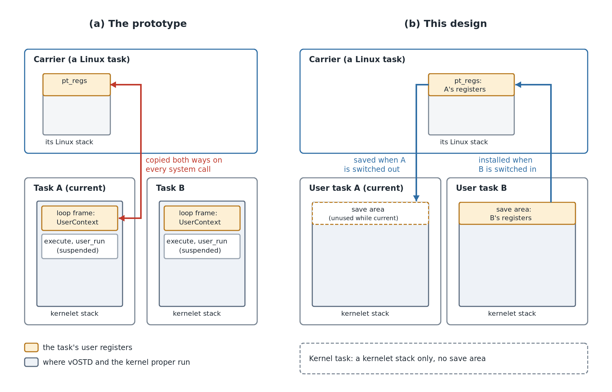
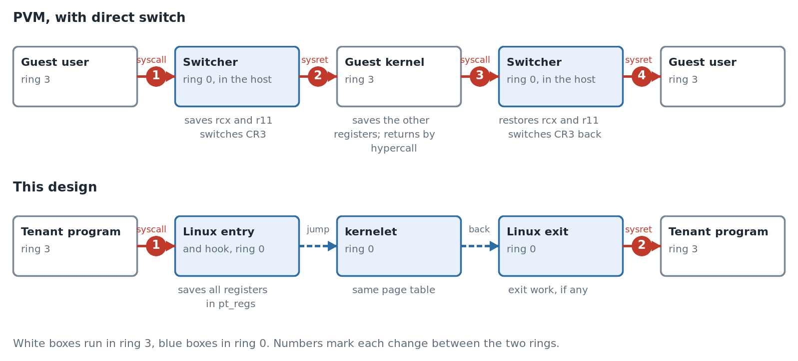
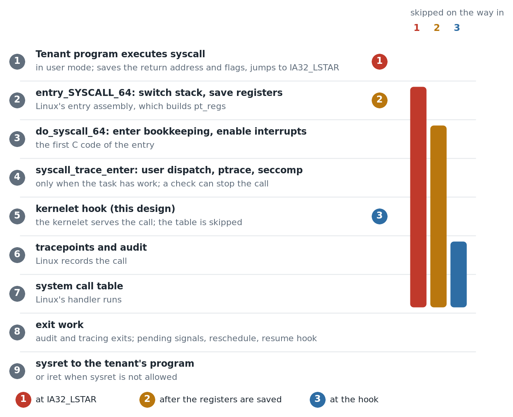

# 2026-10-31 Reduce syscall overhead

- Status: Draft
- Author(s): Plucky923
- Discussion: Not yet available.
- Affected chapters: [Carrier hooks and patch overview](../accepted-design/carrier-hooks.md), [The first kernel we will run](../accepted-design/the-first-kernel-we-will-run.md), [Two stacks](../accepted-design/two-stacks.md), [Into user mode and back](../accepted-design/into-user-mode-and-back.md), [The kernelet ABI](../accepted-design/the-kernelet-abi.md), [Tasks and virtual CPUs](../accepted-design/tasks-and-virtual-cpus.md), [Tenant memory on Linux's page tables](../accepted-design/tenant-memory-on-linux-page-tables.md), [Virtual interrupts](../accepted-design/virtual-interrupts.md), [What it costs](../accepted-design/what-it-costs.md), and [Why a kernel of your own](../accepted-design/why-a-kernel-of-your-own.md).
- Implementation or experiments: Not yet implemented.

## Summary

On the prototype, a system call whose handler only returns a constant takes 125.1 ns, compared with 56.4 ns for native `getpid`. The extra time is the handoff between Linux and the kernelet. This proposal makes vOSTD follow Linux's execution model at that handoff: events go to a handler that returns before user execution resumes, and user registers stay in the carrier's `pt_regs` until another user task needs it. **A system call then takes 63.7 ns, 6.3 ns more than native `getpid`,** and Linux's task stacks stay unchanged.

## Problem and motivation

On the prototype, a system call whose handler only returns a constant takes 125.1 ns, compared with 56.4 ns for native `getpid`. The difference is 68.7 ns.

### Background: one system call today

The figure shows one system call through the prototype. Step numbers match those in the timing table below. The [appendix](#appendix-the-prototypes-mechanisms) explains the mechanisms.



### Where the cost is

We collected one 10 ms trace per boot across five boots, using Intel PT from the host. The traces cover about 450,000 system calls. The table reports each step's median time.

<div class="background">

**x86: Intel Processor Trace.** The processor records branch outcomes, with cycle counts at selected branches. A decoder uses this record and the binaries to reconstruct the executed instructions. Timing is available only at branches with cycle counts. Tracing adds no instructions to the code, but traced runs took 1.2% to 1.6% longer than untraced runs. Some steps occasionally took much longer than usual. The table uses medians to reduce the effect of these slow samples.

</div>

| Step | What runs | Instructions | Cycles | Time (ns) |
|---|---|---:|---:|---:|
| 1 | Linux's entry, up to the check of the syscall work bits | 64 | 42 | 12.7 |
| 2 | The work bit, the call of the hook, and the hook's first checks | 18 | 9 | 2.7 |
| 3 | The hook's last checks, and the copy from `pt_regs` to `UserContext` | 43 | 15 | 4.5 |
| 4 | `klet_enter`: the run state, the mirror, the watch timer, and `klet_switch` saving and loading registers | 65 | 24 | 7.3 |
| 5 | From `klet_switch`'s return to `user_run`'s return on the kernelet stack | 3 | 16 | 4.9 |
| 6a | The kernel proper tells what the run returned | 10 | 16 | 4.8 |
| 6b | The handler stores 123, `execute` sets the user flags and calls `RawUserContext::run` | 5 | 25 | 7.4 |
| 7a | `RawUserContext::run`'s checks: the current task, overflow checks, held spin locks | 26 | 6 | 1.7 |
| 7b | Two dependent loads of the service table, and the jump to `user_run` | 3 | 24 | 7.3 |
| 8 | `user_run`: publishing `KLET_USER`, the barrier `lock addl`, the pending check, and taking the mirror off | 24 | 28 | 8.4 |
| 9 | `klet_switch` back onto the Linux stack, and `klet_enter`'s return | 23 | 7 | 2.1 |
| 10a | The hook calls `klet_space_adopt`, which calls `klet_space_get` | 26 | 16 | 5.0 |
| 10b | `lock cmpxchg` on the space's reference count | 5 | 32 | 9.7 |
| 10c | The liveness check, the `mm` comparison, the call of `klet_space_put` | 15 | 2 | 0.6 |
| 10d | `lock decl` on the same count | 1 | 23 | 7.0 |
| 10e | The returns to the hook | 6 | 2 | 0.6 |
| 11 | The hook's check after the run, and the copy from `UserContext` back to `pt_regs` | 52 | 15 | 4.5 |
| 12a | Linux's exit work | 63 | 19 | 5.8 |
| 12b | Restoring the user registers, and SYSRET | 23 | 52 | 15.8 |
| — | User mode, from SYSRET to the next `syscall` | | | 13.3 |
| | Total | 475 | 373 | 126.1 |

The step medians sum to 126.1 ns. Without tracing, we measured 125.9–128.4 ns per call in the same boots.

The Linux–kernelet handoff costs **78.5 ns** (steps 2–11). **This proposal focuses on the syscall handoff overhead caused by the different execution models of Linux and the kernelet.**

#### Two kernels' models meet at the handoff

Linux gives each task its own kernel stack and saves user registers there in `pt_regs`. No kernel call remains suspended while the task runs in user mode. **In the prototype, kernelet tasks share a carrier's Linux stack; each task keeps `execute` suspended on its own kernelet stack and stores user registers in a separate `UserContext`.** Each syscall requires register copies between these representations and resumes the suspended call chain to reach the kernel proper.

**The resumption steps take 9.7 ns; register copying and adjacent hook checks take about 9 ns.** These two groups of steps total about **18.7 ns**. They do not isolate the full cost of adapting the two execution models.



*A Linux thread (a) and the prototype's carrier (b) during user execution. **Red numbers mark the two costs below: resuming calls (1) and copying registers (2).***

1. **Resuming the suspended call: steps 5 and 6a, 9.7 ns.** Each system call resumes `user_run` on the kernelet stack. Control returns through `execute` to the kernel proper, which checks the return reason ([Appendix](#appendix-the-prototypes-mechanisms), `execute` and Two stacks). These steps execute 13 instructions. The stack switch itself costs little.
2. **Copying the registers: steps 3 and 11, about 9 ns.** The hook copies 18 registers from Linux's `pt_regs` to the kernelet's `UserContext`, then copies them back before returning to user mode. These copies and the hook's checks execute 95 instructions in about 30 cycles.

#### Other costs and engineering optimizations

- **Address-space checks (step 10, 22.9 ns).** On each return, the prototype looks up the requested address space and takes and drops a reference to it. It then compares that space with the current one. The benchmark has one task, so the address space does not change. This design switches the address space in `vm_activate` and defers cleanup that can sleep. The return path then does none of this work.
- **Event ordering (part of step 8).** `user_run` publishes `KLET_USER` and then checks for pending virtual interrupts. A full memory barrier (`lock addl`) keeps these two steps in order. This design sets Linux's notification flag for each virtual interrupt, in any carrier state. `user_run` then needs neither the check nor the barrier.
- **Build settings (steps 6b and 7a).** The prototype builds the image as a shared library. Calls between crates then go through the global offset table, and integer-overflow checks stay on. The `release-lto` profile makes a position-independent executable with direct calls and no overflow checks.
- **Service-table call (step 7b, 7.3 ns).** The image can contain only relative relocations and cannot import symbols ([The endovisor UAPI](../accepted-design/the-endovisor-uapi.md)). The kernelet therefore calls `user_run` through a service table, with two dependent loads and an indirect jump. This design keeps this call.
- **The mirror and watch timer.** This design keeps both. Their optimization is outside this proposal.

## Proposed change

### Design overview



*One system call through the prototype (a) and this design (b). Steps on the same row do the same job. **This design removes the red steps from the system-call path.** The blue box lists work that runs only on a task switch, an address-space change, a virtual interrupt, or vCPU startup.*

### The kernelet user task



***Stacks and saved user registers** in the prototype (a) and this design (b). The blue arrows show a later switch from A to B.*

**A carrier keeps its own Linux stack, and each task has its own kernelet stack.** On each entry from user mode, Linux saves the user registers in `pt_regs` at the top of the carrier's Linux stack. While a user task is current on the carrier, these are that task's registers. The kernelet runs each task's code on the task's kernelet stack.

**While a user task stays current on the carrier, its registers stay in `pt_regs`.** The handler reads and writes them there through a handle that vOSTD lends it. For a system call, an exception or a kernel event that does not switch tasks, **vOSTD copies no registers at the handoff**. This design thus removes the two copies in item 2.

**vOSTD copies user registers only at a task switch.** **When another user task needs `pt_regs`**, vOSTD copies the previous task's registers from `pt_regs` to a save area at the top of that task's kernelet stack. It then copies the incoming task's registers from its save area into `pt_regs` before the task's code continues. A kernel task has no user registers, so vOSTD saves or installs nothing for it.

### The vOSTD interface

In the prototype, the kernel proper calls `execute`, which stays suspended on the kernelet stack while user code runs. In this design, **vOSTD controls user execution and calls the kernel proper's handler for each event**: a system call, an exception or a kernel event. The handler returns before the task re-enters user mode. vOSTD owns the path between user mode and the handler, so it can change that path without changing the handler.

**One handler serves all tasks.** It holds no state of any task. Each task keeps the state that lasts across events, and the handler borrows that state on each call.

*Proposed: vOSTD's interface for user events.*

```rust
/// Multiple vCPUs may call this shared handler concurrently, each call for a
/// different task.
pub trait UserEventHandler: Sync {
    /// Handles one event of the current task; returns when done. It may sleep
    /// or be preempted.
    fn handle(&self, event: UserEvent, task: &CurrentTask, user: &mut UserMode);
    /// Asked before every return to user mode: whether the task ends.
    fn should_exit(&self, task: &CurrentTask, user: &UserMode) -> bool;
    /// Returns true if a virtual interrupt received in user mode left work
    /// for the kernel proper. Otherwise, vOSTD skips `handle`.
    fn has_kernel_event(&self, task: &CurrentTask, user: &UserMode) -> bool { false }
    /// Called with virtual interrupts masked just before user mode, to load
    /// the task's floating-point and segment state.
    fn pre_user_run(&self, task: &CurrentTask, user: &UserMode, guard: &DisabledLocalIrqGuard) {}
}

#[derive(Clone, Copy, PartialEq, Eq)]
pub enum UserEvent { Syscall, Exception, KernelEvent }
```

**The handler is a static, so vOSTD calls it without a lookup on each event.** The kernel proper marks the static with `#[ostd::user_event_handler]`. This macro generates the entry points that vOSTD calls directly:

*Proposed: the hundred-line kernel's handler.*

```rust
struct Hello;

impl UserEventHandler for Hello {
    fn handle(&self, event: UserEvent, task: &CurrentTask, user: &mut UserMode) {
        if event == UserEvent::Syscall {
            let vm_space = task.data().downcast_ref::<Arc<VmSpace>>().unwrap();
            handle_syscall(user.context_mut(), vm_space);
        }
    }
    fn should_exit(&self, _: &CurrentTask, _: &UserMode) -> bool { false }
}

#[ostd::user_event_handler]
static HELLO: Hello = Hello;
```

`TaskOptions::new_user(context)` specifies the initial user registers, and `spawn` creates and starts the task. `init(f)` registers a callback that vOSTD runs once on the new task, before its first entry into user mode. **`init` does the one-time work that must run on the new task.** Objects that later events need belong to the task, as its data or its local data.

**vOSTD passes each callback the current task and a `UserMode`.** `UserMode` gives access to the task's user registers in the carrier's `pt_regs` and to its exception state. vOSTD creates this handle and lends it for one callback at a time. The handle is neither `Send` nor `Sync`, so no other task can receive it. `UserContext` keeps the segment fields and privileged flag bits fixed, so the kernel proper cannot make `pt_regs` unsafe for Linux's return to user mode.

A callback may sleep, and other tasks then use the same `pt_regs`. A Rust reference to `pt_regs` would promise the callback exclusive access until the call returns, and these other tasks would break that promise even though vOSTD restores the values. **The callback therefore never holds a reference to `pt_regs`.** The `UserContext` that `UserMode::context_mut` lends holds only the address of `pt_regs`, and each of its methods reads or writes the fields through this address. The kernel proper calls the same methods as before.

Two rules keep this address correct. A task stays on the vCPU where it first runs, so the address stays valid, and the task finds its own values there when it resumes. **`UserContext` is not `Send`**, so the kernel proper cannot keep the lent one beyond the callback or give it to another task.

#### Porting a kernel proper

**The kernel proper replaces its `execute` loop with callbacks.** The event handling code moves to `handle`, and the task's exit check moves to `should_exit`. The setup code that runs once on the new task moves to `init`. Objects that the loop built once and reused, such as the process reference, become task data. As in Linux, the thread then holds a strong reference to its process. **This creates a reference cycle, because the process also holds its tasks.** The reaper breaks the cycle by removing the main thread from the process's task set. The process is then freed later than before, so the work of its destructor moves earlier: process exit cancels the timers, and the reaper sends the pidfd's hang-up event.

*Proposed: Asterinas's user thread from `create_new_user_task`, written against the handler. The wait while the process is stopped and the panic catching are omitted.*

```rust
struct Kernel;

/// Borrows the state that the task holds.
fn context(task: &CurrentTask) -> Context<'_> {
    let thread = task.as_thread().unwrap();
    let posix_thread = thread.as_posix_thread().unwrap();
    Context {
        process: posix_thread.process_ref(),                // held by the thread, as in Linux
        thread_local: task.as_thread_local().unwrap(),
        posix_thread,
        thread: thread.as_ref(),
        task,
    }
}

impl UserEventHandler for Kernel {
    fn handle(&self, event: UserEvent, task: &CurrentTask, user: &mut UserMode) {
        let ctx = context(task);
        let exception = user.take_exception();
        let user_ctx = user.context_mut();
        match event {
            UserEvent::Exception => {
                ctx.thread_local.set_orig_syscall_ret(None);
                handle_exception(&ctx, user_ctx, exception.unwrap())
            }
            UserEvent::Syscall => {
                ctx.thread_local.set_orig_syscall_ret(Some(user_ctx.syscall_ret()));
                let res = ctx.posix_thread.ptrace_may_stop_on_syscall(&ctx, user_ctx);
                if !matches!(res, PtraceStopResult::Interrupted) {
                    handle_syscall(&ctx, user_ctx);
                    ctx.posix_thread.ptrace_may_stop_on_syscall(&ctx, user_ctx);
                }
            }
            UserEvent::KernelEvent => {
                ctx.thread_local.set_orig_syscall_ret(None);
            }
        }
        if ctx.thread.is_exited() {
            return;                                         // the loop's check before signals
        }
        handle_pending_signal(user_ctx, &ctx);
    }
    fn should_exit(&self, task: &CurrentTask, _: &UserMode) -> bool {
        task.as_thread().unwrap().is_exited()               // the loop's exit check
    }
    fn has_kernel_event(&self, task: &CurrentTask, _: &UserMode) -> bool {
        context(task).has_pending()                         // was a hook of `execute`
    }
    fn pre_user_run(&self, task: &CurrentTask, _: &UserMode, guard: &DisabledLocalIrqGuard) {
        let thread_local = task.as_thread_local().unwrap();
        thread_local.supp_user_context().before_user_exec(guard);   // was a hook of `execute`
    }
}

#[ostd::user_event_handler]
static KERNEL: Kernel = Kernel;

TaskOptions::new_user(user_ctx)
    .init(|task, _| {                                       // was before the loop
        let ctx = context(task);
        let child_tid_ptr = ctx.thread_local.set_child_tid().get();
        if is_userspace_vaddr(child_tid_ptr) {
            let _ = current_userspace!().write_val(child_tid_ptr, &ctx.posix_thread.tid());
        }
        if ctx.posix_thread.tid() == FIRST_POSIX_TID {
            crate::init::on_first_process_startup(&ctx);
        }
    })
    .data(thread)
    .local_data(thread_local)
    .spawn()
    .unwrap();
```

### The handoff protocol

**An event enters the kernelet through a Linux hook and leaves through a new Linux entry point.** The kernelet never returns to the hook.

#### In: from the hook to the handler

The syscall hook masks virtual interrupts, switches to the current task's kernelet stack, and enters vOSTD with the event type. vOSTD reads the vCPU record, finds the current task and reads the event state. **Virtual interrupts stay masked until these reads finish.** If a virtual interrupt switched to another task before these reads, that task's own events could overwrite the event state in the record. vOSTD then unmasks virtual interrupts and calls the kernel proper's handler. For a kernel event, it calls the handler only if `has_kernel_event` returns true. The resume hook uses the same path for exceptions and virtual interrupts.

#### Out: from the handler to user mode

*Proposed, simplified: vOSTD's entry for a user event.*

```rust
extern "C" fn user_event_entry(raw_event: u64) -> ! {
    let event = UserEvent::from_raw(raw_event);
    // The hook entered with virtual interrupts masked:
    // no task switch can happen before these reads.
    let task = current_task();
    let mut user = UserMode::for_current_carrier(); // also takes the exception, if any
    unmask_virtual_interrupts();
    if event != UserEvent::KernelEvent || HANDLER.has_kernel_event(&task, &user) {
        HANDLER.handle(event, &task, &mut user);    // the kernel proper's handler returns
    }
    if HANDLER.should_exit(&task, &user) {
        exit_current_task();
    }
    assert_no_guard_held();                     // a guard kept alive with mem::forget
    preempt_if_wanted();                        // the scheduler's chance before user mode
    let guard = mask_virtual_interrupts();
    HANDLER.pre_user_run(&task, &user, &guard);
    user_run()                                  // never returns
}
```

After the handler returns, vOSTD runs the checks and callbacks in the code above and calls `user_run`. **`user_run` leaves through `kernelet_return_to_user`, which moves to the carrier's Linux stack and starts a call chain below the saved `pt_regs`.** Linux runs its exit work on this chain and returns to user mode.

### Task switch

**Each vCPU records which user task owns its carrier's `pt_regs`.** vOSTD copies registers only when the incoming task is a user task other than the owner. It saves the owner's registers to the owner's save area, installs the incoming task's registers, and makes that task the owner. For a switch to a kernel task, or back to the owner, vOSTD copies nothing.

vOSTD makes these copies in `after_switching_to`. This function runs on the incoming task's stack with virtual interrupts masked, **before the task's own code continues**, so the task always finds its registers in `pt_regs`.

- **First run.** `TaskOptions::new_user` writes the task's initial registers to its save area, and the first switch to the task installs them. A vCPU without an owner has nothing to save.
- **Owner exit.** The exiting owner's registers are never needed again. vOSTD clears the record before it frees the task's stack, so no later switch writes to the freed save area.

**A task stays on the vCPU where it first runs.** Asterinas's scheduler has no load balancing. Its `select_cpu` chooses a CPU by load only for a new thread, and afterwards returns the thread's last CPU. This design therefore does not move a task between vCPUs.

Three parts of this design rely on the rule:

- **Lazy saving.** A switched-out task's registers may still be in its vCPU's `pt_regs`.
- **Sleeping callbacks.** A callback that sleeps may still hold a reference to those registers.
- **vCPU lookups.** vOSTD code that finds the current vCPU's record and then uses it assumes that the task has not moved.

Every scheduler injected into vOSTD must keep this rule, and vOSTD checks it with a debug assertion when it switches to a task. **Because Asterinas does not balance load yet, this design adopts the rule to keep the implementation simple.** Load balancing would first need to save a task out of its old carrier's `pt_regs` and to make these lookups safe against a move.

### Invariants

- **Register owner.** While a user task runs, in the kernel or in user mode, it owns its vCPU's `pt_regs` ([Task switch](#task-switch)).
- **No reference to `pt_regs`.** No kernel code holds a Rust reference to `pt_regs`. The kernel proper reaches it only through the methods of `UserContext`, and vOSTD's switch path copies it through raw pointers. The lent `UserContext` cannot leave its callback ([The vOSTD interface](#the-vostd-interface)).
- **vCPU binding.** A task stays on the vCPU where it first runs. Every scheduler keeps this rule, and vOSTD asserts it.
- **Safe registers.** `pt_regs` always holds values that are safe for a return to user mode, and `orig_ax` is -1 when Linux's exit work runs ([Implementation and integration](#implementation-and-integration)).
- **No suspended handler.** No handler call stays suspended while its task runs in user mode, and the task enters user mode with no lock or guard held. The handler holds no state of any task.
- **Masked entry.** vOSTD reads the current task and the event state with virtual interrupts masked ([In](#in-from-the-hook-to-the-handler)).
- **One live chain on the Linux stack.** Below `pt_regs`, the carrier's Linux stack holds at most one live call chain. The hook's chain and the exit chain never return, and vOSTD does not switch tasks while a service runs.

## Alternatives and tradeoffs

### One Linux task per kernelet task

Each kernelet task runs on a Linux task of its own, with its own Linux stack and `pt_regs`.

- Gain: **No register copy at a task switch, and no shared Linux stack.**
- Cost: **A kernelet task switch becomes a Linux sleep and wakeup.** Linux's scheduler then decides when the woken task runs. Each sandbox also needs one Linux task per tenant thread.

### Per-task Linux stacks

Each user task gets its own Linux stack. Linux saves the task's user registers in `pt_regs` on that stack, and `UserContext` refers to them in place. When the scheduler switches to a user task, the endovisor makes the task's Linux stack the carrier's stack: it replaces `task_struct.stack` and the stack top.

- Gain: **It is fast.** A system call copies no registers and takes 63.5 ns, 5.8 ns more than native `getpid` ([Validation and evidence](#validation-and-evidence)). A task switch copies none either, and a task may move between vCPUs.
- Cost: **It breaks a Linux invariant, changes Linux invasively, and uses more memory.** Linux expects a task's kernel stack to stay the same for the task's life, and uses it to locate `pt_regs`, check stack bounds and walk the stack. Each Linux stack takes 16 KiB.

### Switcher at `IA32_LSTAR`

[PVM](https://ranger.uta.edu/~jrao/papers/sosp23.pdf) (Huang et al., SOSP 2023) runs secure-container guests in hardware ring 3 inside a VM leased from a cloud provider. **It points `IA32_LSTAR` at a short assembly switcher in the host kernel, so a guest `syscall` reaches the guest kernel without the hypervisor's exit handler.** PVM calls this a *direct switch*.

<div class="background">

**x86: `IA32_LSTAR`.** This model-specific register stores the entry address for 64-bit system calls. **When user code executes `syscall`, the processor enters ring 0 at this address.** The kernel sets the register with the privileged `wrmsr` instruction, normally once at boot.

</div>

A kernelet can do the same: while a carrier runs, `IA32_LSTAR` points to a switcher, and the carrier's `syscall` skips Linux's system-call entry.



*One system call under PVM's direct switch and under this design. Numbers mark each change between ring 3 and ring 0.*

- Gain: **Linux's system-call entry code stays unchanged, and ordinary tasks continue to use it.**
- Cost: **The switcher must redo the required work of Linux's entry and exit code.** It also skips seccomp, ptrace, audit and syscall tracing for carrier calls. Each switch to or from a carrier writes `IA32_LSTAR`, which causes a VM exit when Linux runs in a VM whose hypervisor traps the write.

### Switcher in Linux's entry code

After `entry_SYSCALL_64` saves the registers, new assembly code checks the current task's syscall work bits before Linux's C entry code runs. **If only the kernelet's bit is set, the code jumps to the switcher.** Otherwise Linux takes its C path, where enabled checks such as seccomp and ptrace run before the kernelet hook.

- Gain: **A carrier with only the kernelet's work bit set skips Linux's C entry code.** A switch to or from a carrier writes no `IA32_LSTAR`, so it causes no VM exits.
- Cost: **Every task runs two extra loads, a comparison and a branch on each system call.** The switcher must redo the required work of Linux's C entry and exit code.



*One system call, step by step. Positions 1 and 2 are the two switchers above; position 3 is this design's hook. Each bar shows the Linux steps that a position skips on the way in.*

**This design keeps the hook in `syscall_trace_enter`, after user dispatch, ptrace and seccomp.** Linux still runs its enabled checks before the hook, the entry assembly stays unchanged, and no switch writes `IA32_LSTAR`. Linux's C entry code and exit work stay on the system-call path, so this position skips the least Linux code of the three. The two switchers must redo required Linux work, such as enabling interrupts and checking for pending work, and follow its changes across Linux versions and configurations. An earlier trace without the mirror measured about 20 ns across Linux's entry, the call to the hook and the exit work. The switcher in Linux's entry code would keep part of this work, and **its net saving is not measured**.

## Implementation and integration

### Linux

- **Add `kernelet_return_to_user`.** It runs the exit work that the carrier's last entry still owes, then returns with SYSRET or IRET under the same checks as `do_syscall_64`. After a task switch, this exit work can belong to a system call of another task. The checks then fall back to IRET when the installed registers do not allow SYSRET.

### Endovisor

- **Event entry.** The hook masks virtual interrupts, switches to the current task's kernelet stack below its save area, and never returns. This replaces `klet_switch`.
- **Services.** A service runs on the carrier's Linux stack and returns to its call site on the kernelet stack. While a service runs, the endovisor delivers no upcall, so vOSTD does not switch tasks.
- **Address of `pt_regs`.** The endovisor publishes the address of the carrier's `pt_regs` in the vCPU record.
- **Reset of `orig_ax`.** Before each return to user mode, the endovisor sets `orig_ax` to -1. Otherwise a user value of `rax`, restored by `rt_sigreturn` or installed from another task, could look like a restart code.

<div class="background">

**Linux: `orig_ax` and system-call restart.** On a system call, Linux saves the call number in the `orig_ax` field of `pt_regs`. For an interrupt or an exception, it stores -1. If a signal is pending, `orig_ax` is not -1, and `rax` holds a restart code such as `-ERESTARTSYS`, Linux may restart the call before it returns to user mode. It then puts the call number back in `rax` and moves `rip` back over the `syscall` instruction.

</div>

### vOSTD

- **`UserContext` with two forms.** A `UserContext` either owns its registers, as one from `UserContext::default()` or `clone` does, or holds the address of `pt_regs`, as the one that `context_mut` lends does. `UserMode` takes this address from the vCPU record at event entry. In the second form, every method reads and writes through raw pointers and returns values; no method creates a reference to `pt_regs`. `general_regs` and `general_regs_mut` return an object that holds a copy, and the one from `general_regs_mut` writes the copy back when it is dropped.
- **No `Send`.** `UserContext` does not implement `Send`. Asterinas creates and uses each `UserContext` within one task, so it does not need `Send`. If a caller turns out to need it, `UserContext` can implement `Send`, and the lent one can check in debug builds that the current task owns it.
- **Replaced context.** If the handler replaces the lent `UserContext` with an owned one, vOSTD writes the owned registers into `pt_regs` after the handler returns.
- **Save area and owner.** Each user task reserves a save area the size of `pt_regs` at the top of its kernelet stack, and the first entry and every event entry start below it. Each vCPU records the owner of its `pt_regs`. `after_switching_to` copies the register set when the owner changes, and `exit_current` clears the record before it frees the owner's stack.
- **Default scheduler.** vOSTD's FIFO scheduler records the vCPU where a task first runs and wakes the task there. The switch path checks in debug builds that each task runs on that vCPU.
- **Fixed fields.** Every write keeps the segment fields and privileged flag bits fixed, in both forms of `UserContext` and when vOSTD installs a task's registers. `set_rflags` keeps only the bits in `RFLAGS_USER`, the bits that Linux lets a debugger set plus `ID`, and always sets `IF` and bit 1.

<div class="background">

**x86: user-mode return state.** `CS` selects the code segment, `SS` selects the stack segment, and `RFLAGS` contains status and control bits. This design fixes the following values for return to 64-bit user mode:

| Field | Fixed value | Purpose |
|---|---:|---|
| `CS` | `0x33` | Select the 64-bit user code segment. |
| `SS` | `0x2b` | Select the user stack segment; `RSP` supplies the stack address. |
| `RFLAGS.IF` | `1` | Allow maskable hardware interrupts in user mode. |
| `RFLAGS.IOPL` | `0` | Prevent the kernel proper from raising user I/O privileges. |

The segment values and flag definitions come from Linux v6.12's [segment header](https://github.com/torvalds/linux/blob/v6.12/arch/x86/include/asm/segment.h) and [flags header](https://github.com/torvalds/linux/blob/v6.12/arch/x86/include/uapi/asm/processor-flags.h).

</div>

*Experimental implementation (`syscall-opt` worktree), `prototype/vostd/src/arch/cpu/context.rs`: `UserContext::set_rflags`.*

```rust
/// Sets rflags: only the bits a user program may hold are taken, and the
/// interrupt flag and bit 1 are always set.
#[inline(always)]
pub fn set_rflags(&mut self, rflags: usize) {
    self.rflags = (rflags & RFLAGS_USER) | RFLAGS_FIXED;
}
```

For example, `set_rflags(0)` stores `0x202`, with `IF` and bit 1 set. `set_rflags(3 << 12)` also stores `0x202`: the requested `IOPL = 3` is cleared.

**Update the Accepted Design chapters listed under Affected chapters together with the corresponding prototype changes.**

## Validation and evidence

**We measured this design and [per-task Linux stacks](#per-task-linux-stacks) in one run, with the same Linux configuration.** Both share the handler and the return path. A QEMU/KVM guest runs patched Linux 6.12 with two vCPUs pinned to separate host cores. The kernelet uses one vCPU and one user task, and its handler returns a constant. Each configuration boots five times in shuffled order.

### The time of one system call

**The table reports the mean of the five per-boot averages; range gives the smallest and largest.** Each ratio uses the native time on that design's Linux build. The prototype's row comes from another run.

| Setting | Time (ns) | Range (ns) | Ratio to native |
|---|---:|---:|---:|
| Native `getpid` | 57.5 | 57.3–57.8 | 1.00 |
| The prototype | 125.1 | 123.9–125.9 | 2.22 |
| Per-task Linux stacks | 63.5 | 63.1–63.8 | 1.10 |
| This design | 63.7 | 62.7–65.6 | 1.11 |

**This design and per-task Linux stacks take the same time; their ranges overlap.** The times include Linux's own entry and exit work, which this proposal does not change.

### Functional checks

**On the final implementation of this design, system calls and task scheduling work correctly.**

- **System calls.** A task gets the right arguments and results and keeps its other registers, also when its handler sleeps.
- **Scheduling.** Several user tasks share a vCPU, block, wake and switch through kernel tasks without losing their registers. Each task wakes on the vCPU where it first ran.

## Open questions

- **Floating-point and segment-base state across task switches.** `pt_regs` holds only the general registers. Linux keeps the FPU registers and the FS and GS bases in the CPU, and saves them only when it switches the carrier out or, for the FPU, when kernel code uses it. While kernelet code runs, a task's FPU state can therefore be in the CPU or in the carrier's `thread.fpu`. A kernelet task switch must save and load this state in agreement with Linux, which marks a saved FPU state with `TIF_NEED_FPU_LOAD` and reloads it before user mode.

## Decision and follow-up

Pending review.

## Appendix: the prototype's mechanisms

A system call of a tenant program passes through these mechanisms of the prototype.

- **Kernelet.** The tenant's kernel, linked into one image: the **kernel proper**, written in safe Rust, and **vOSTD**, the framework under it that provides OSTD's interface on Linux.
- **Carrier.** A Linux task that runs one virtual CPU of the kernelet. The tenant program runs on it in user mode ([Carriers](../accepted-design/carriers.md)).
- **Endovisor.** The Linux module that serves kernelets. The syscall hook and every `klet_*` function in the figure belong to it.
- **Syscall hook.** Our Linux patch adds this hook to the system-call entry. Linux calls it for each system call of a carrier, after seccomp. The hook gives the call to the kernelet, and Linux skips its own system-call table ([Carrier hooks and patch overview](../accepted-design/carrier-hooks.md)).
- **`execute`.** OSTD's interface for running user code. The kernel proper calls it in a loop. `execute` enters user mode and returns when the program makes a system call or raises an exception, or when an event for the kernel proper arrives. The kernel proper handles the event and calls `execute` again ([Into user mode and back](../accepted-design/into-user-mode-and-back.md)). The loop of the hundred-line kernel:

  *Simplified from `prototype/kernels/hello/src/lib.rs`: `create_user_task`.*

  ```rust
  let mut user_mode = UserMode::new(create_user_context());
  loop {
      let return_reason = user_mode.execute(&DummyUserHooks);
      let user_context = user_mode.context_mut();
      if ReturnReason::UserSyscall == return_reason {
          handle_syscall(user_context, &vm_space);
      }
  }
  ```

- **Two stacks.** A task's Linux kernel stack is empty each time the task returns to user mode. `execute` returns only at the program's next system call, so its frames must stay on a stack while the program runs. Each kernelet task therefore runs on a kernelet stack of its own. `klet_switch` switches between two kernel-mode contexts: the hook's, on the carrier's Linux stack, and the current kernelet task's, on that task's kernelet stack. While the kernelet runs, the hook's context waits. While the program runs, the task's context waits inside `execute` ([Two stacks](../accepted-design/two-stacks.md)).
- **`UserContext`.** The kernelet's copy of a task's user registers. On each entry into the kernel, Linux saves the user registers in `pt_regs`, at the top of the carrier's Linux stack. The hook copies them from `pt_regs` into the task's `UserContext`, and copies them back before the carrier returns to user mode ([Into user mode and back](../accepted-design/into-user-mode-and-back.md)).
- **Service table.** The kernelet image imports no host symbols. It calls the endovisor only through a table of function pointers that it receives when it starts. One entry is `user_run`, the service that enters user mode ([The kernelet ABI](../accepted-design/the-kernelet-abi.md)).
- **Virtual CPU record.** Memory that the carrier and the kernelet share, one for each virtual CPU. It holds the pending virtual interrupts and the address space that the kernelet last activated with `vm_activate`. Each tenant process has its own address space, a Linux `mm`. The carrier switches to the activated address space on its way to user mode ([Tasks and virtual CPUs](../accepted-design/tasks-and-virtual-cpus.md), [Tenant memory on Linux's page tables](../accepted-design/tenant-memory-on-linux-page-tables.md)).
- **Virtual interrupts.** The kernelet's own interrupts: a timer tick, or a request from another virtual CPU. To raise one, the endovisor sets a pending bit in the virtual CPU record. Kernelet code checks this bit before the carrier returns to user mode. If the carrier is already in user mode, the endovisor also tells Linux to give the carrier to the kernelet at its next entry into the kernel. Linux does this through the endovisor's **resume hook**. These two paths leave a gap. Kernelet code has already checked the bit, but the carrier is not yet in user mode, so the endovisor does not tell Linux. An interrupt raised in this gap would wait until the watch timer's next tick, up to 1 ms. The prototype closes the gap with a memory barrier (step 8) ([Virtual interrupts](../accepted-design/virtual-interrupts.md)).
- **The mirror and watch timer.** The prototype uses these mechanisms to coordinate with Linux's scheduler; the timer also delivers virtual timer ticks. Their implementation is described in [Sharing a processor politely](../accepted-design/sharing-a-processor-politely.md).
