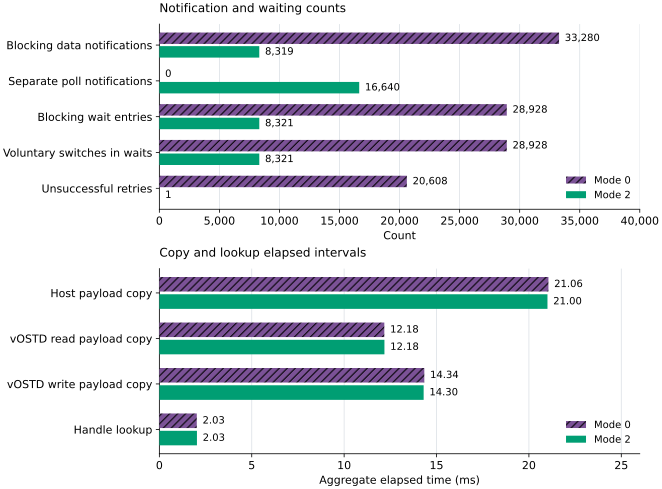
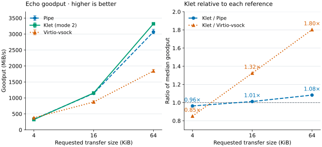
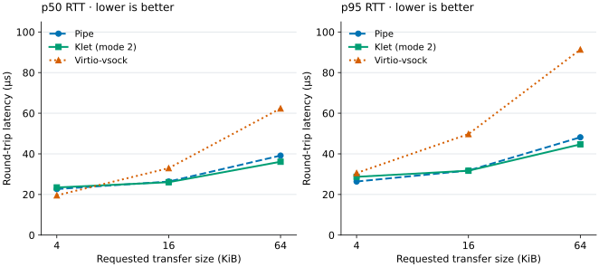
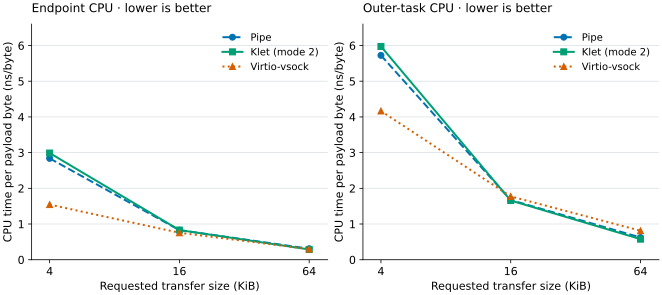
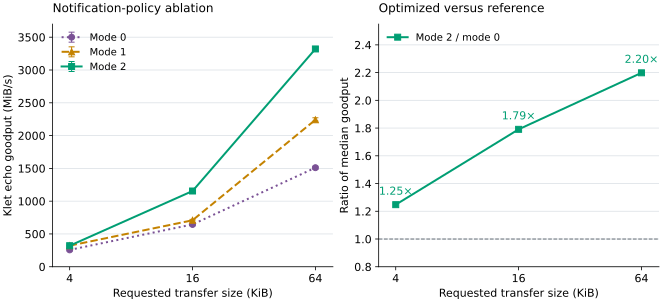

# 2026-11-06 Kernelet Vsock

- Status: Under review
- Author(s): Codex, from the maintainer's klet-vsock proposal
- Discussion: [Review outcome](#decision-and-follow-up); initial findings in `prototype/bench/vsock/reviews.txt` and optimization findings in `prototype/bench/vsock/optimization-reviews.txt`.
- Affected chapters: [The kernelet ABI](../accepted-design/the-kernelet-abi.md), [Tasks and virtual CPUs](../accepted-design/tasks-and-virtual-cpus.md), [Stopping a kernelet](../accepted-design/stopping-a-kernelet.md), and [What vOSTD adds on top](../accepted-design/what-vostd-adds-on-top.md).
- Implementation or experiments: [Integrated experiment](#implementation-and-integration) and [validation](#validation-and-evidence).

## Summary

**Klet-vsock is a socket-style channel whose endpoints use the same stream storage.** It connects host applications to kernelet applications, or applications in two kernelets, without emulating a device between them. A connection has two bounded rings, one for each direction. A trusted host-side endovisor service, the *broker*, owns the storage and grants bounded reservations to vOSTD. Safe kernel-proper code accesses those reservations only through vOSTD, without access to its peer's heap.

The proposal covers connection establishment, data transfer, notification, and connection lifetime. Avoiding intermediate payload copies is one benefit of this arrangement. Removing virtqueue processing and the hardware virtualization boundary may also reduce work, but does not eliminate synchronization, service calls, wakeups, or scheduling.

Here, *zero transport copies* means that data stays in one ring between the application's write and its peer's read. Ordinary application-to-ring and ring-to-application copies remain. The source audit and integrated experiment support this storage mechanism. The measurements below compare the resulting implementation with pipes and real virtio-vsock; they do not establish application-to-application zero-copy I/O or a universal performance ranking.

## Problem and motivation

### What the existing prototype provides

The accepted baseline has console output but no general socket channel between sandboxes. A runtime could use a channel to talk to an agent in its kernelet, and two cooperating kernelets could use one to exchange a request and its response. Both uses need connection identity, bounded buffering, flow control, and a defined response to peer death.

The kernelet setting offers a different starting point from a VM. The kernel proper is safe Rust, and vOSTD mediates the memory it can reach. A new trusted abstraction can therefore authorize access to a particular communication allocation without mapping a peer's application memory or transferring its frames.

### How virtio-vsock carries a stream

<div class="background">

**Virtio: queues and notifications.** A *virtqueue* is a set of descriptors and completion records in guest memory. Descriptors name payload buffers; they are not necessarily another place into which payloads are copied. The driver makes buffers available and the device backend marks them used. Notifications tell the other side to inspect those records, and can be suppressed or batched. The vsock device uses transmit, receive, and event queues. See the [Virtio 1.2 specification, sections 2.6–2.8 and 5.10](https://docs.oasis-open.org/virtio/virtio/v1.2/virtio-v1.2.html).

</div>

Vsock gives a guest a socket endpoint named by a context identifier, or CID, and a port. The socket layer presents a byte stream while its virtio transport exchanges headers, payload descriptors, credit updates, and connection-control packets. Credit reports how much receive space remains; it prevents an eager sender from overrunning a slower receiver.

<div class="background">

**Linux: socket buffers.** Linux's `sk_buff`, often shortened to *skb*, holds packet metadata and references payload storage. A scatterlist describes one or more memory ranges to a driver. Submitting that scatterlist can make existing payload storage available to a device without first copying it into a separate queue allocation. These distinctions matter when counting copies.

</div>

For a concrete reference, consider ordinary copying stream I/O between a Linux 6.12 guest and a Linux host using `vhost-vsock`, without `MSG_ZEROCOPY` or packet capture, on a receive path that does not coalesce packets. The [guest transport](https://github.com/torvalds/linux/blob/v6.12/net/vmw_vsock/virtio_transport.c) submits scatterlists referring to socket-buffer storage. The [vhost backend](https://github.com/torvalds/linux/blob/v6.12/drivers/vhost/vsock.c) copies payloads between those guest buffers and host socket buffers. The [common socket transport](https://github.com/torvalds/linux/blob/v6.12/net/vmw_vsock/virtio_transport_common.c) supplies the application's send and receive copies.

The reference paths have the following payload copies. Arrows labeled *application* cross an application's memory boundary; arrows labeled *transport* move payload between endpoint storage.

```text
guest application
    -- application copy --> guest skb, referenced by TX descriptors
    -- transport copy ----> host skb
    -- application copy --> host application

host application
    -- application copy --> host skb
    -- transport copy ----> guest skb, posted as an RX buffer
    -- application copy --> guest application

klet application A
    -- application copy --> directional ring, owned by the broker
    -- application copy --> application B
```

Thus the illustrated non-coalescing Linux host/guest path has one required forwarding copy per direction, not the initially hypothesized pair of socket-buffer-to-virtqueue and virtqueue-to-socket-buffer copies. A guest-to-guest relay can introduce additional movement, but requires its own specified route. The old book's switch also has a different copy path, discussed below. The common receive path can additionally copy tiny payloads into a previously queued skb when its coalescing conditions hold. This optional endpoint coalescing copy and Linux's send-side zero-copy support are reasons not to generalize the diagram to every vsock operation.

### Work beyond payload copies

<div class="background">

**Virtualization: exits and interrupt delivery.** A hardware VM exit transfers execution from guest code to the hypervisor. Returning from the kernel hypervisor to a userspace device model is a separate transition. Virtqueue records are ordinary guest-memory accesses; a device doorbell may instead use memory-mapped I/O, or MMIO, or port I/O, or PIO. KVM can handle registered doorbells through `ioeventfd`, and inject interrupts through `irqfd`, reducing userspace involvement. See the [KVM API, `KVM_IOEVENTFD` and `KVM_IRQFD`](https://www.kernel.org/doc/html/v6.12/virt/kvm/api.html).

</div>

Klet-vsock does not need a guest/device boundary for communication between kernelets on the same Linux host. It can publish stream data and wake an endpoint directly through the endovisor. This removes the reason for a virtio doorbell or injected device interrupt on that path; it does not make each notification free.

| Work | Linux 6.12 virtio/vhost reference | Proposed klet-vsock | Evidence or limit |
|---|---|---|---|
| Payload movement | Application copies plus a vhost transport copy | Application copies through a single directional ring | Source inspection of the specified paths |
| Queue bookkeeping | Headers, descriptor chains, used entries, and credit messages | Ring positions and reservations; free space provides credit | Implemented mechanism; relative cost unmeasured |
| Boundary transitions | Device kicks can require a hardware exit; in-kernel handling avoids a userspace round trip | Ordinary trusted services and their stack switches | Architectural distinction, not a measured speedup |
| Notification | Suppressible device kicks, backend work, and guest interrupts | Publish, then notify registered blocking demand and independent poll subscribers | Implemented carrier waits; task-level virtual interrupts remain planned |
| Scheduling | Guest tasks, vCPUs, and backend work | Kernelet tasks and Linux carriers | Fewer layers may help; placement and waiting policy still matter |

These rows identify mechanisms, not additive estimates of speedup. A doorbell exit, backend wakeup, and interrupt can belong to the same notification path, so counting all three as independent per-operation penalties would mislead. Likewise, a batched queue need not notify on every packet. Cheaper interrupt delivery remains a premise to investigate rather than a result established by the bulk-transfer experiment.

### Notification paths in the reference and proposal

The Linux reference has distinct guest-to-host and host-to-guest notification paths. These traces describe the copying path above; suppression and available work can remove individual notifications or scheduling steps.

1. **Guest to host.** The guest transport publishes descriptors and may kick the TX queue. A required MMIO/PIO doorbell can exit to KVM; a registered `ioeventfd` signals the in-kernel backend without returning to a userspace device model. The vhost worker drains descriptors in `vhost_vsock_handle_tx_kick`, copies into host socket storage, and delivers the packet to the host socket layer. The socket's data-ready callback wakes a blocked host reader. Completing guest TX descriptors may also notify the guest that send storage is reusable.
2. **Host to guest.** The host transport queues an skb for vhost send work. The backend copies into a guest-posted receive buffer, marks that descriptor used, and may signal the guest through the queue's call eventfd. KVM's interrupt route injects the guest interrupt and wakes a sleeping vCPU when required. The guest callback `virtio_vsock_rx_done` schedules receive work, which drains used entries, queues received data on its socket, and wakes its application. It replenishes receive buffers and may notify the backend again.

The [Linux 6.12 vhost backend](https://github.com/torvalds/linux/blob/v6.12/drivers/vhost/vsock.c), [guest callbacks](https://github.com/torvalds/linux/blob/v6.12/net/vmw_vsock/virtio_transport.c), and common socket transport provide these steps. This is not a claim that each transfer takes a userspace-emulation round trip or that every injected interrupt forces an additional hardware exit. Backend scheduling, interrupt acceleration, and a running versus sleeping vCPU affect the actual path.

The implemented klet path is shorter to describe: reserve, copy, commit, then wake a Linux wait queue. A host reader or blocked carrier becomes runnable through Linux's scheduler, which may itself need a remote-CPU reschedule notification. There is no broker worker forwarding the payload, and no emulated device interrupt. This experiment does not use a klet virtual interrupt for readiness; its kick-IPI counters must not be interpreted as a measurement of a faster interrupt path.

## Proposed change

### A connection and its storage

A connected socket owns a capability to two rings. Sending writes directly into the outgoing ring; receiving reads directly from the incoming ring. For that direction, the sender's output storage and the receiver's input storage are the same allocation.

```text
endpoint A                       endpoint B
    write --> [ ring A to B ] --> read
    read  <-- [ ring B to A ] <-- write
                  |
       broker owns both allocations
```

The initial interface is a reliable, ordered, full-duplex byte stream. It preserves byte order, not message boundaries: writing `"ab"` and then `"cd"` may be read as `"abcd"`. Partial reads and writes are normal, including when a reservation reaches the physical end of a ring. The prototype gives each ring 64 KiB, independently of application transfer size.

<div class="background">

**Concurrency: bounded rings.** A ring reuses a fixed allocation by treating its end as followed by its beginning. The producer advances a write position and the consumer advances a read position. Their unsigned difference is the number of committed, unread bytes, bounded by capacity. A producer must not overwrite unread bytes, and a consumer must not see bytes before the producer publishes them. Asterinas's [ring buffer at revision `dfd0fc3`](https://github.com/asterinas/asterinas/blob/dfd0fc375c14551c07fa3914e32195f7c1fcfef2/kernel/libs/ring-buffer/src/lib.rs) separates producer and consumer capabilities and uses acquire/release operations for that publication.

</div>

The proposal adopts capability separation, but does not share Asterinas's `Arc<RingBuffer>` directly between images. Each image has private writable state, and its heap is reaped when its carriers die. Cross-image reference counts or destructors in such a heap would not establish the lifetime of shared storage. The broker instead owns the allocation and indexes; vOSTD supplies the trusted `RingBuffer` access primitive.

### Socket lifecycle and reachability

The interface follows socket operations rather than requiring a new application communication model. A server creates a socket, binds a local port, listens, and accepts a distinct connected endpoint. A client creates a socket and connects to a CID and port. Both then transfer bytes, optionally shut down a direction, and close.

```text
unbound -- bind --> bound -- listen --> listener
unbound or bound -- connect --> connected
listener -- accept --> a new connected endpoint
connected -- shutdown(write) --> send half closed
any state -- close or sandbox death --> closed
```

The runtime authorizes reachability using sandbox-descriptor capabilities. By default a kernelet may reach neither the host nor another kernelet. A runtime holding both sandbox descriptors may permit that pair; permission to reach the host is separate. Connection setup derives the source identity from the calling carrier, never from a caller-supplied source CID.

The prototype assigns monotonically increasing 64-bit CIDs during a module lifetime, with CID zero reserved for its host adapter. These are experimental identities, not the standard vsock CID numbering. Ports are nonzero 32-bit values.

Host bindings are separated by creator effective UID, and connections additionally require matching creator UIDs and runtime permission. The host's socket descriptor is transferable authority once created; this is not a network namespace or security-module policy implementation.

The listening queue bounds connections awaiting acceptance. Each successful connection allocates a separate server endpoint for that queue. `connect` completes when that endpoint is queued; it need not wait for the server application to call `accept`.

Connection setup reports unreachable, denied, or temporarily unavailable endpoints explicitly. Missing listeners fail with `ECONNREFUSED`; denied reachability fails with `EACCES`. An empty accept or full backlog waits, or returns `EAGAIN` for a nonblocking request.

Closing a listener resets its pending connections. A backlog-blocked connector then retries and gets `ECONNREFUSED` when that listener is gone or dying.

Blocked setup operations follow the caller's cancellation mechanism. An interrupted host accept or connect uses Linux's restart-or-`EINTR` syscall behavior, with no partially accepted endpoint installed. A killed carrier leaves through the existing service termination path. Closing a host descriptor in another thread does not itself cancel an in-flight call holding a file reference; signal interruption is the cancellation path for a blocked host accept.

### Application interfaces

The experiment extends vOSTD with `Socket` and `RingBuffer`, using an owner-scoped numeric handle in the image ABI. Safe kernel-proper code cannot construct a handle for a peer or obtain a raw ring address. The trusted service returns an address only to vOSTD, which uses it internally for a bounded copy.

*Proposed usage of the experimental interface; this is not an OSTD API on a machine:*

```rust
let mut listener = ostd::vsock::Socket::new()?;
listener.bind(1234)?;
listener.listen(8)?;
let mut stream = listener.accept()?;

let mut destination = vm_space.writer(user_address, requested_bytes)?;
let received = stream.buffer().read(&mut destination)?;
```

The write side takes a `VmReader` and the read side a `VmWriter`. This lets the tenant's translated frames be copied directly to or from ring storage, without allocating a staging `Vec`.

All broker operations, including `Socket::drop`, require a sleepable context. Dropping under a spin lock or with interrupts masked triggers the existing sleeping-contract assertion.

The test kernel denies unsafe Rust and uses these interfaces for its data syscalls. Its control syscalls use scalar arguments rather than Linux `sockaddr` layouts; existing `AF_VSOCK` binaries are not yet supported.

<div class="background">

**Linux: readiness waiting.** `poll` waits until a descriptor can make progress without blocking; `epoll` keeps registered interests for repeated waits. Level-triggered notification reports a condition while it remains true. Edge-triggered users drain operations until `EAGAIN` before waiting for another change. A process can therefore wait for data without having a blocked `read`, which matters for notification accounting.

</div>

The host has the same lifecycle through small wrappers in `prototype/host/runtime/klet-vsock.h`. The experimental adapter creates stream file descriptors through the endovisor and implements bind, listen, connect, accept, and shutdown as control operations. Connected descriptors support `read`, `write`, and `poll`. This is a prototype placement of socket-style operations, not a commitment to that adapter as the final Linux socket integration.

### Reserve, copy, and publish

Each data operation proceeds in three steps. The following example sends 4 KiB from A to B while space remains in A's outgoing ring.

1. **Reserve.** vOSTD asks the broker for up to 4 KiB. Under a metadata mutex, the broker checks the endpoint, shutdown state, and free space, then reserves a contiguous span. This reservation, also called a *lease*, grants exclusive producer access to those bytes until commit or cancellation. It returns that span's address and length to vOSTD and unlocks.
2. **Copy.** vOSTD copies directly from A's application reader into the reserved span. The broker holds no lock, and B cannot yet consume those bytes.
3. **Publish.** vOSTD commits the copied prefix. Under the metadata mutex, the broker advances the write position, clears the reservation, and notifies waiters. B can now reserve that committed prefix, copy it to its application, and commit consumption.

The reverse path uses the other ring and the same protocol. Between two kernelets, the producer's vOSTD writes the allocation that the consumer's vOSTD later reads. For a host endpoint, the file operation uses `copy_from_iter` or `copy_to_iter` on that same allocation, outside the metadata mutex. No backend forwards payload from one ring into another.

The invariant is `0 <= published - consumed <= capacity`, interpreted with wrapping unsigned counters. A write reservation covers free bytes after the published position; a read reservation covers committed bytes after the consumed position. Reserved read bytes cannot be reused until consumption commits. A partial application-memory fault commits only the successfully copied prefix; a fault before the first byte cancels the reservation and returns `EFAULT`.

The prototype serializes metadata with one broker mutex. Unlocking after publication and locking before a peer reserves supplies the ordering between payload stores and payload loads; service calls and the opaque copy routine preserve compiler ordering. Ring positions are not writable by safe kernel-proper code. This implementation is deliberately simpler than a lock-free shared-index protocol, and makes no lock-free performance claim.

### Waiting and notification

A notification should announce possible progress, rather than merely announce that an endpoint touched a ring. Reserving bytes publishes no data or free space. The initial implementation nevertheless woke the global queue after every successful reserve and commit, often waking a reader before the producer had copied or published anything. The measured ablation below evaluates removing that unnecessary work.

The optimized policy separates blocking operations from poll subscribers. Each ring has a consumer-waiter count and a producer-waiter count, both protected by the broker mutex. Blocking operations use a global wait queue and generation counter. Poll and epoll register on a separate global queue whose lifetime is the module's, so their callbacks never refer to a freed connection-owned wait queue.

A blocking data request follows these steps:

1. Snapshot the generation **before** testing the condition under the metadata mutex. Death can notify without that mutex, so taking the snapshot afterward could absorb the only notification.
2. If the operation must wait, increment the appropriate ring's demand count before releasing the mutex. A send uses its outgoing ring; a receive uses its incoming ring.
3. Join the Linux wait only while the saved generation still matches. A commit between unlocking and wait-queue registration is therefore visible even if the task was not asleep when notified.
4. Reacquire the mutex and decrement the registered count on every return, including interruption and death. Recheck the condition before reserving or registering again.

A commit consults **both** demand counts on its ring after releasing the lease. If either is nonzero, it advances the blocking generation and wakes the blocking queue. If both are zero, no blocking request for that ring is in the protected check-to-wait interval; a later request sees the newly committed state under the mutex. This still uses a global queue when a wake is needed and makes no per-connection scalability claim.

Every successful commit independently notifies the poll queue. A process waiting only in epoll has no blocked read or write for the demand counters to count. Shutdown, close, connection/backlog changes, and death retain broad notification; the kill helper advances the generation and wakes both queues without taking a mutex or inspecting connection state.

A zero-byte commit can enable progress even without changing a ring position. For example, one writer can hold a lease while a second waits despite available space; cancellation must release that second writer. Likewise, cancelling an admitted write after write shutdown can enable peer EOF. These cases explain why the policy checks both waiter classes and retains notifications on cancellation, rather than using only empty/full transitions or a positive byte count.

The counters track registered demand, not lifetime references. An active host file operation or image carrier pins its endpoint and connection through the unlock/wait/relock interval. The implementation does not cache a peer endpoint across that interval or reap image handles earlier than the existing all-carriers-gone point.

The experiment parks the calling Linux carrier in the service. The service prologue removes the mirrored host preemption count, and vOSTD checks the existing rule against sleeping under a spin lock or with virtual interrupts disabled. A producer can be descheduled while holding a reservation without retaining a host lock; its peer may eventually fill or empty the bounded ring and wait, but unrelated connections remain usable.

This carrier-wait implementation has a scheduling limitation: one blocked socket task parks every other kernelet task on that vCPU. It demonstrates correct communication for the one-task endpoints used here, but is not the final scheduler integration. A production task-level path should register a readiness subscription, recheck readiness, and park only the calling kernelet task on a vOSTD wait queue.

### Planned task-level readiness

Task-level readiness would publish a bounded event and notify a registered target vCPU. A broker-owned subscription must validate the endpoint and hold the target carrier reference; safe code must not obtain another sandbox's carrier pointer. The current vCPU-kick service is scoped to the calling sandbox, so this requires a new broker delivery path.

The existing kick mechanism shows the work that delivery can still require. `klet_do_vcpu_kick` in `prototype/linux/endovisor/carrier.c` sets a pending bit, wakes an idle carrier, requests resume processing in tenant user mode, and calls `klet_kick_remote` for a carrier running kernelet code on another CPU. The remote path in `prototype/linux/endovisor/sched.c` uses an inter-processor function-call interrupt to request an immediate watch-timer firing.

The watch callback can redirect running image code into the vOSTD upcall when guards and stack headroom permit. During a critical section the bit remains pending for a guard drop or interrupt unmask. A carrier blocked in an unrelated Linux service cannot run the handler until that service returns; a readiness bit does not cancel arbitrary host waits. See [kicking another vCPU](../accepted-design/tasks-and-virtual-cpus.md) and [virtual-interrupt delivery](../accepted-design/virtual-interrupts.md).

The current `run_handlers` treats `VIRQ_LINES` as a rescheduling request; it does not drain channel events or wake socket tasks. The planned path must add that dispatch, a bounded event queue with an overflow policy, and a lost-wakeup-proof registration protocol. Cheaper task-level interrupt delivery remains unmeasured by this experiment.

### Shutdown, death, and storage lifetime

Graceful shutdown handles each direction separately. A normal write shutdown stops new send reservations and lets any already admitted send finish. The peer drains its committed bytes before reading EOF; an outstanding unpublished send delays EOF until it commits or cancels. Read shutdown stops receiving and causes peer writes to fail.

Close and forced death end the connection with different outcomes. Closing a connected endpoint releases its ownership of the connection; the other endpoint can drain committed bytes before EOF. Forced sandbox death produces a reset after any already committed incoming bytes have drained. A reserved but unpublished prefix is not delivered.

Death has two stages because a carrier may still be inside a reservation. Marking a sandbox dying makes its endpoints unavailable and wakes all broker waiters without taking the broker mutex. Only after every carrier is gone does the broker remove that sandbox's endpoints, abandon its reservations, and release their connection references. No kernelet destructor or peer acknowledgement is required.

The surviving endpoint retains the connection allocation throughout this process. It can finish an already reserved copy even after its peer's heap and address spaces have been reclaimed. Closing the survivor then frees both rings. The broker stores no pointer into a peer heap, and no Linux lock is held while the image can be evicted.

An endpoint abandoned with `mem::forget` consumes a bounded handle until its sandbox ends. A stalled peer can stop progress on its own connection and retain its share of channel storage, but cannot acquire unbounded memory through that connection or leave a host lock owned by code that no longer runs. Host userspace faults may likewise stall one reserved copy; they occur outside the global metadata lock.

### Resource bounds and accounting

The experiment caps the broker at 128 endpoints and independently at 64 live connections, each owner at 16 endpoints, and each listening backlog at eight. Pending accepted endpoints count toward these limits. Each connection has two 64 KiB rings, so the independent connection limit bounds payload storage at 8 MiB even if each retained connection has only one surviving endpoint. This is a payload bound, not a total physical-memory bound: the current combined allocation can round up to 256 KiB per connection, allowing up to 16 MiB for connection allocations, plus endpoint and allocator metadata. Allocation failure or exhausted limits returns an error.

<div class="background">

**Linux: memory control groups.** A memory cgroup accounts and can limit the memory charged to a group of tasks. An accounted allocation remains accounted while its storage lives, even if the allocating task exits; removing a cgroup can cause Linux to reparent charges. This matters for a connection retained by a surviving peer: ownership of the channel object and the lifetime of its accounting charge must both be specified.

</div>

Channel allocations are separate from the sandbox heap and use accounted Linux allocations in the connecting task's context. A connection initiated by a carrier is therefore charged to that carrier's memory cgroup; host-initiated storage is charged to the host caller. A surviving endpoint may retain this allocation after its original charging sandbox exits. The storage remains accounted until it is freed, with Linux handling cgroup-removal reparenting; this is a shared-channel lifetime, not a frame transfer into the surviving sandbox's grant. The experiment does not enable and validate per-cgroup memory limits; its demonstrated safety bound is the broker's explicit fixed allocation limits.

The initial permission table is also bounded at 16 entries per sandbox. It has no revocation or compaction of dead-peer entries yet. Long-lived services needing repeated peer replacement require that extension, rather than unlimited growth or silent reassignment of a stale CID.

## Alternatives and tradeoffs

### Keep the current prototype

The current console path remains sufficient for teaching kernels that only print output. Keeping it avoids a new trusted interface and shared-object lifetime rule. It does not provide bidirectional sockets, peer communication, or the flow control that a runtime agent needs. Klet-vsock should therefore remain an optional extension rather than changing console semantics.

### Reuse virtio-vsock

Virtio-vsock preserves existing guest drivers and socket applications. Its transport already addresses framing, credit, device reset, and notification. Implementing that device path may be the better integration choice when compatibility dominates.

Klet-vsock trades that reuse for a smaller channel-specific data path and explicit access to common storage. It introduces a trusted broker, safe framework interfaces, and lifetime rules that virtio's separation ordinarily avoids. The measurements below compare a specified modern virtio/vhost configuration with this prototype. They do not isolate every transport cost, and the prototype's global mutex can still become a bottleneck under concurrent load.

### The old book's ownership-transfer extension

The old book's Chapter 12.1, *Channels*, starts from a stronger restriction: sandboxes share no memory. Its switch copies through endovisor storage and preserves the guest's existing vsock driver. The section **The ownership-transfer extension** instead proposes moving a whole allocation grain out of the sender's grant and into the receiver's grant. An archived excerpt and provenance in `prototype/bench/vsock/historical-channels.txt` preserve the exact section used for this comparison, at revision `e817415a511d9ff61a4d8aaa97582d26a80bca64` of the old book.

That move requires proving that the sender no longer maps the transferred frames, updating ownership and grant tables, and telling the receiver about its newly owned memory. It also changes the sender's assumption that its grant only grows. The historical section reports earlier mechanism timings, but those used different workloads and prototypes; they are not measurements of this proposal.

| Question | Historical frame move | Klet-vsock shared rings |
|---|---|---|
| What crosses? | Ownership of a whole grain | Authority to access bounded stream spans |
| Where does storage live? | Sender grant, then receiver grant | Broker allocation throughout the connection |
| What prevents continued sender access? | Mapping removal and ownership checks | Reservation and publication rules |
| What payloads fit? | Transfer-granularity constraints | Arbitrary byte-stream lengths with partial operations |
| What must teardown preserve? | The new owner's frames and correct accounting | A live peer's connection reference and reserved spans |
| What compatibility is retained? | Existing vsock path, with a negotiated extension | New vOSTD API and experimental host adapter |

The two designs remove different work. A frame move can avoid copying an already populated, suitably sized buffer, at the price of ownership bookkeeping and mapping changes. A shared ring avoids intermediate transport movement, but ordinary application reads and writes still copy. It should not inherit the frame-move experiment's performance claims or be presented as application-buffer ownership transfer.

### Shared indexes or direct borrowed slices

A lock-free single-producer/single-consumer ring could move metadata work out of the broker and use acquire/release atomics, following Asterinas's abstraction. It would still need lifetime management, publication discipline, and safe serialization when multiple tasks share a socket. A raw `Arc` spanning independently reaped image heaps does not supply those properties.

Giving safe kernel-proper code borrowed ring slices could also allow data to be generated or parsed in place. That needs an API preventing references from surviving consumption, close, or revocation, and a policy for indefinitely retained borrows. The experiment keeps spans inside vOSTD's copy operations to avoid expanding that contract prematurely.

## Implementation and integration

The implementation consists of `prototype/vostd/src/vsock.rs`, `prototype/linux/endovisor/vsock.c`, `prototype/kernels/vsock/src/lib.rs`, and `prototype/host/runtime/run-vsock.c`. The experiment adds one image service, `vsock`, with a fixed-layout request. ABI version 7 distinguishes images built for it from older service tables. The service exposes socket control and ring reservation/commit operations, while vOSTD wraps handles and addresses behind safe types. Existing kernels do not need to call the extension.

The endovisor broker integrates with the existing termination path: an atomic wake at kill, then endpoint reaping before sandbox heap destruction. Notification modes and optional diagnostic hooks are configured separately from the safe data API. The host adapter uses a separate experimental UAPI header, `prototype/linux/endovisor/uapi/klet-vsock.h`, leaving established ioctl definitions intact. The test kernel uses the existing image loader and tenant-memory APIs; the benchmark uses real tenant syscalls rather than substituting a kernel-only loop.

The request pointer is a deliberate extension to the accepted ABI: this service writes results into a vOSTD-owned stack request as well as returning a scalar status. It does not authorize writes to arbitrary kernel-proper pointers.

If accepted, the ABI chapter must document that output region alongside the service and its sleeping contract, the lifetime chapter should describe broker-owned shared allocations, and the scheduling chapters should specify readiness delivery. Asterinas socket integration would replace or adapt the transport beneath its socket layer; it is not implemented by merely linking this library. Accepted Design remains unchanged by this proposal except for any mechanical excerpt consistency required by an ABI update.

## Validation and evidence

### Correctness and reproducibility

Run the functional experiment and book checks from the repository root:

```sh
make -C prototype vsock
make check
make build
```

For a fresh matched comparison or diagnostic run, choose a new output label:

```sh
make -C prototype vsock-compare VSOCK_LABEL=trial-m0 VSOCK_OPT=0
make -C prototype vsock-compare VSOCK_LABEL=trial-m1 VSOCK_OPT=1
make -C prototype vsock-compare VSOCK_LABEL=trial-m2 VSOCK_OPT=2
make -C prototype vsock-profile VSOCK_LABEL=profile-m2 VSOCK_OPT=2
```

The comparison requires accessible KVM and vhost-vsock devices and three available physical cores. Its runner reuses the existing Linux build, starts its own QEMU and host echo process, pins their threads, and terminates them on completion or failure. It changes no host-global scheduling or KVM parameters. Recorded evidence is retained under `prototype/bench/vsock/`; the replay checker and run commands are listed in its README. The figures are generated from those retained measurements by `book/tools/plot-vsock.py`, with reproduction instructions in that README.

The correctness suite exercises host-to-tenant echo, independent kernelet peers, a host listener, authorization, wraparound, partial user-memory faults, backpressure, shutdown, death, and survivor recovery. It runs in each notification mode. Position-dependent 4,093-byte functional transfers force partial operations; the minimum 4 KiB restriction below applies to performance data, not correctness or control messages.

Notification-specific checks establish blocking demand on held TX and RX leases, then release those leases normally or with zero-byte cancellation. Separate poll/epoll-only cases cover receive publication, full-to-writable consumption, and zero-byte cancellation with no matching blocking data demand. Level-triggered and edge-triggered receive tests drain to `EAGAIN` before another event. A write-shutdown test requires zero-prefix cancellation to enable peer EOF.

Signal tests interrupt registered host readers and writers without automatic syscall restart and inspect balanced demand. The writer case additionally demonstrates later communication; the reader case verifies subsequent teardown. Other tests kill an image waiting in the broker, release a full backlog through controlled accepts, and run two independent concurrent echo connections. Per-thread deadlines turn lost progress into test failures. These are targeted interleavings, not exhaustive multi-caller or multi-CPU stress.

The bounded-delay tests observe an admitted reservation and registered demand, but arbitrary descheduling can still remove an intended later overlap. The existing death-during-copy check kills the peer of a host producer; it does not evict an image holding its own unpublished span. Source-level lifetime reasoning and that remaining test gap are kept distinct. Unload checks require zero live channel endpoints, connections, heap blocks, stacks, and carrier records, with no kernel warnings.

### Profiling and the reviewed optimization

Profiling is separate from performance measurement. The optional broker counters record lookup comparisons, operation attempts, notification calls, wait entries, observed voluntary switches, and unsuccessful retries. vOSTD records reserve, copy, and commit intervals for an isolated peer. Timings are elapsed intervals including preemption, not CPU execution time; endpoint intervals overlap and must not be added as a partition of round-trip time.

The initial diagnostics pointed to avoidable notification work. Handle lookup scanned about 126 entries per call, but its measured elapsed interval was small relative to commit intervals. Copying itself did not account for the full gap to pipes. Many waits resumed only to find the operation still unavailable, consistent with the reserve and unrelated-consumption notifications in the source.

Three independent reviewers assessed the optimization plan **before implementation**. Their conditions preserved generation-before-condition ordering, registration through mutex reacquisition, both commit paths, zero-prefix cancellation, independent poll delivery, and broad atomic-safe terminal wakeups. The implementation and expanded tests were subsequently checked against those conditions.

| Mode | Policy | Purpose |
|---|---|---|
| 0 | Initial notifications on reserve and commit; original shared wait queue | Contemporary baseline |
| 1 | Suppress reserve notifications; retain the original queue and all commit notifications | Isolate reservation suppression |
| 2 | Also separate poll notification and gate blocking commit wakes on ring demand | Optimized policy |

Modes are read-only for a module lifetime. Modes 0 and 1 keep the original poll/block queue path; mode 2 changes queue separation and demand gating together. The mode-2 versus mode-1 result therefore identifies that package, not each constituent's individual cost. Copies, service count, handle representation, carrier parking, and per-page memory protection remain unchanged.

The retained 64 KiB tenant-echo diagnostics each execute 4,096 timed and 64 warmup round trips. They show a large reduction in unsuccessful retries without changing copied volume.

<figure class="diagram">

<figcaption>64 KiB tenant-echo diagnostics from separate instrumented runs. Each run has 4,096 timed and 64 warmup round trips; lookup timing covers 16,646 calls. Elapsed intervals include preemption and are not a CPU-time partition.</figcaption>
</figure>

The optimized run still has about two waits per round trip, consistent with its serialized request/reply dependency. It does not promise to remove useful sleeping. Read-side commit elapsed time drops from 41.32 to 1.43 ms, while write-side commit stays around 41–44 ms; wakeup-related scheduling can move work between these intervals. The unchanged copy and lookup intervals strengthen the case for targeting notifications before changing memory protection or handle representation.

These counts cover each isolated diagnostic case, including setup, warmups, transfers, and teardown. A notification count is a call at an instrumented site, not a count of hardware interrupts or tasks that actually ran. Fewer retries plus the uninstrumented ablation support the notification policy as an improvement; they do not attribute the complete elapsed commit interval to wakeup CPU cost.

### Comparison setup and workloads

The comparison uses one actual KVM VM and no nested virtualization. The same Linux 6.12 guest process calls each transport on guest CPU 1. Pipe, klet, and direct-API peers run on guest CPU 0; the real virtio peer runs on the outer Linux 6.8.0-100-generic host through `vhost-vsock`. Guest CPU 1 maps to physical core 1, while guest CPU 0, the outer peer, and the vhost worker use physical core 0. QEMU housekeeping uses physical core 2; the selected data cores are not SMT siblings (two hardware threads of one physical core).

This topology keeps the caller and physical data cores common while making the hardware boundary real. It also leaves an unavoidable difference: the virtio peer runs outside the VM with a different host kernel, while the other peers run inside the test Linux. The results compare these configured implementations, not isolated transport instructions or identical native-host deployments. A patched native host would be needed to remove that difference without nesting.

<div class="background">

**PCI: message-signaled interrupts.** MSI-X lets a PCI device signal interrupts by message writes, with separate interrupt vectors that software can place on particular CPUs. A legacy shared interrupt line can impose a different routing and processing path. Enabling MSI-X and checking actual delivery avoids evaluating virtio against an unnecessarily constrained legacy configuration.

</div>

Virtio uses a modern PCI device with MSI-X in the test kernel. The runner records the actual guest CID, QEMU command, per-thread affinities, and guest IRQ lines. Data-queue interrupt affinity is requested on guest CPU 1 and checked through effective affinity and before/after delivery counts. That establishes interrupt delivery placement; subsequent callback/workqueue execution is not independently profiled. Earlier exploratory legacy-interrupt results are excluded from the reported comparison.

Every directional pipe and ring has capacity 64 KiB. Both virtio endpoints set and read back 64 KiB receive credit through the 64-bit `SO_VM_SOCKETS_BUFFER_*` options at level `AF_VSOCK`. Credit capacity is not a bound on all internal virtio allocations. Ordinary copying stream I/O is used throughout; the benchmark does not enable `MSG_ZEROCOPY`.

Each case warms up for 64 round trips, then measures 8,192 round trips at a requested transfer size of 4, 16, or 64 KiB. Partial transfers are completed, and a changing sequence word plus full payload comparison checks every reply. Bytes count both directions. The result is serialized **echo goodput**, not saturated one-way stream throughput; p50 and p95 are round-trip latencies.

Each boot rotates pipe, klet, virtio, and direct-API order over seven repetitions at every size. Two boots per mode reverse the policy order: 0, 1, 2, 2, 1, 0. Tables report medians over 14 per-case measurements, with ranges retained in the evidence. Physical CPU frequency, SMT-sibling activity, and unrelated host load are not controlled; the recorded governor is `powersave`. Counterbalancing and observed spread help assess drift but do not establish statistical independence or universal rankings.

The direct-API peer is a separate diagnostic. It echoes from a kernel task with kernel buffers, omitting tenant syscalls and page-table walks while retaining the host caller's syscalls, ring copies, broker calls, and carrier waits. It must not be presented as two userspace applications or as an isolated measurement of syscall cost.

### Results and CPU accounting

**Optimized klet-vsock beats the measured virtio path at 16 and 64 KiB, while virtio wins at 4 KiB.** At 16 KiB, klet-vsock is close to the pipe reference; at 64 KiB it slightly exceeds it. Pipes are a useful comparison, not a mathematical upper bound: their locking, page layout, and scheduling differ from a single shared ring.

The transfer-size plots use a logarithmic horizontal axis at the measured 4, 16, and 64 KiB sizes. Lines connect those measurements to guide the eye; they do not predict performance at unmeasured sizes.

<figure class="diagram">

<figcaption>Mode-2 echo goodput: medians of 14 measurements per case, with whiskers showing the observed minimum and maximum, not confidence intervals. The right panel shows ratios of medians; 1× means equal goodput.</figcaption>
</figure>

Klet goodput ranges over all 14 measurements are 310.7–326.1, 1,128.5–1,168.0, and 3,290.8–3,338.7 MiB/s respectively. The retained summary gives every transport's range. These spreads support the observed large-transfer separation in this setup; they are not confidence intervals for other machines or workloads.

<figure class="diagram">

<figcaption>Mode-2 round-trip latency. Each point is the median of 14 per-case p50 or p95 values, rather than a percentile obtained by pooling all round trips.</figcaption>
</figure>

<figure class="diagram">

<figcaption>Median CPU time per both-direction payload byte in mode 2; both panels use the same scale. The scopes overlap and must not be added.</figcaption>
</figure>

The CPU panels require different interpretations, described next. For example, lower virtio endpoint CPU at 16 KiB does not include its asynchronous backend.

Endpoint CPU sums the common caller and echo peer. For virtio, that peer is the outer-host process; asynchronous vhost work is absent from this endpoint sum.

The outer-task metric additionally covers the monitored virtualization processes. It sums QEMU's other thread runtimes, the identified vhost thread separately, and the outer peer/control process. On this host vhost belongs to QEMU's thread group, so its TID is excluded from the first sum to avoid double counting.

The two CPU metrics describe different scopes and must not be added together. Guest execution is already included in QEMU CPU, and virtio peer CPU is already included in the outer peer component. Neither sum is all-machine CPU accounting: unrelated host work and some asynchronous kernel work can remain unattributed.

Outer CPU windows include a small control interval around the guest measurement. They begin before the acknowledgement that releases the guest's timer and end after its completion token; raw records retain both wall intervals.

Outer-task CPU includes the configured VM's idle-polling cost. KVM's unchanged default halt-polling maximum is 200,000 ns, which can consume CPU while a guest vCPU would otherwise idle. This metric therefore measures monitored configured-system cost, rather than transport-only CPU. No idle baseline is silently subtracted.

### Optimization benefit and remaining costs

The contemporary ablation supports retaining mode 2 as the experiment's default. Mode 1 already helps by suppressing reservation notifications; mode 2 brings the larger transfers close to or above pipe goodput. At 4 KiB, mode 2 does not improve median goodput over mode 1, but its p95 RTT falls from 37.77 to 28.69 µs.

<figure class="diagram">

<figcaption>Notification-policy ablation: median klet goodput over 14 measurements per case, with observed-range whiskers. The right panel compares mode 2 with mode 0; queue separation and demand gating are evaluated together.</figcaption>
</figure>

The direct-API peer reaches 324.8, 1,181.0, and 3,484.0 MiB/s in mode 2. Its advantage over the tenant peer is about 1%, 2%, and 5% respectively. This focused comparison does not identify tenant syscall overhead as the dominant remaining cost for these bulk sizes; it changes both syscall entry and application-memory access, and still includes the common host caller.

Remaining work includes useful wait/scheduling latency, payload copies, service transitions, and tenant-memory access. Their precise marginal costs are not isolated here. The global metadata mutex also remains a scaling concern, although the two-connection correctness test is not a contention benchmark. Further optimization should begin with workload-specific profiling rather than removing ownership checks, memory protection, or necessary notifications.

The Makefile selects mode 2 for channel experiments after these checks. The broker's manual module-load default remains mode 0 so an explicit `klet_vsock_opt=2` is required outside that harness. This keeps the reference policy available and makes the selected policy visible in every run's metadata and unload line.

The first experiment's slower-than-pipe results remain in `prototype/bench/vsock/results.txt` and its original serial log as history. They motivated this work but are not the paired optimization baseline: the contemporary mode-0 measurements use the same harness, kernel configuration, and placement as modes 1 and 2.

The source-level copy audit remains separate evidence. vOSTD copies directly between a tenant reader/writer and a reserved ring span, and host file operations access the same storage. Reserve and commit change metadata rather than forward payload to another buffer. Publication counters establish exercised volume, not dynamically measured copy counts.

### Criteria for maintainer review

The proposal is ready for discussion when its correctness checks pass, cleanup returns tracked resources, source inspection supports the copy and lifetime claims, and independent reviewers have no unresolved blocking objections. An optimization is retained only with valid notification semantics and a reproducible matched benefit; a universal win over pipes or virtio is not required. Production acceptance would additionally need the planned task-level readiness, deployment policy, socket-layer integration, and further concurrency validation.

## Open questions

### TODOs and planned extensions

- Replace carrier parking with task-level readiness subscriptions and a bounded event-delivery protocol; validate lost wakeups, cancellation, and peer death there.
- Decide final Linux socket integration and add compatibility with existing socket applications and `AF_VSOCK` addressing where appropriate.
- Integrate an Asterinas socket transport and define behavior for concurrent readers and writers on shared socket descriptions.
- Add message-preserving channels, corresponding to `SOCK_SEQPACKET`, if workloads need them; framing is not implicit in the initial stream rings.
- Measure scaling under multiple active connections before selecting per-connection locks, lock-free indexes, or additional notification batching. The implemented demand gating does not remove the global metadata mutex.
- Add accepted-peer address queries and permission revocation, cleanup of dead permission entries, policy hooks, and network-namespace semantics.
- Decide resource charging for long-lived shared allocations and per-sandbox byte quotas beyond the prototype's fixed global bounds.
- Test safe in-place generation or parsing only after specifying reservation lifetimes and retained-borrow policy.
- Force eviction of a kernelet producer while it owns an unpublished span, and exercise counter rollover. The current delayed-copy test kills the peer of a host producer; it does not establish that first case.
- Use the focused channel-API evidence to investigate remaining copy, service, and tenant-transition costs. Isolate task-level interrupt delivery separately; keep sub-4-KiB performance claims outside the measured workload.

## Decision and follow-up

The proposal remains **Under review**, ready for maintainer discussion rather than accepted into Accepted Design. The shared-storage mechanism is practical in the integrated prototype. Its benefit depends on workload size and notification policy: the optimized implementation is near the measured pipe reference and faster than the specified virtio deployment for larger transfers, while the 4 KiB virtio result is better.

Independent reviews covered both the initial proposal and the later notification optimization. The initial two adversarial review rounds fixed an early-EOF race, bounded connection storage, corrected the virtio copy account, and strengthened notification explanations. Their reports remain indexed in `prototype/bench/vsock/reviews.txt`. The subsequent optimization went through three independent design reviews before implementation; their conditions, implementation inspection, matched evidence, and full-page reviews are indexed in `prototype/bench/vsock/optimization-reviews.txt`. The final independent soundness, evidence, and writing reviews concluded with no blocking objections after the prose corrections.

Validation includes the expanded correctness suite in every notification mode, six matched comparison boots with 504 measurements, and separate instrumented diagnostics. The existing 12-test regression suite, book checks, and HTML build also pass; their output is retained with the evidence. These checks establish a bounded prototype result, not production readiness or a measured advantage for task-level virtual-interrupt delivery. The TODOs above record the remaining integration and validation work.
