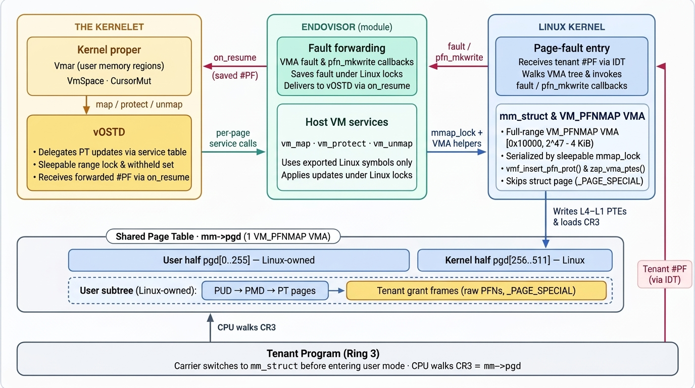
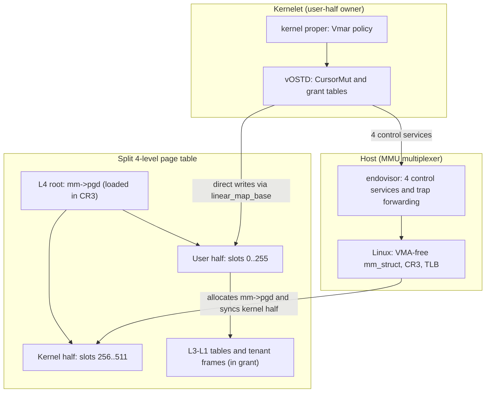
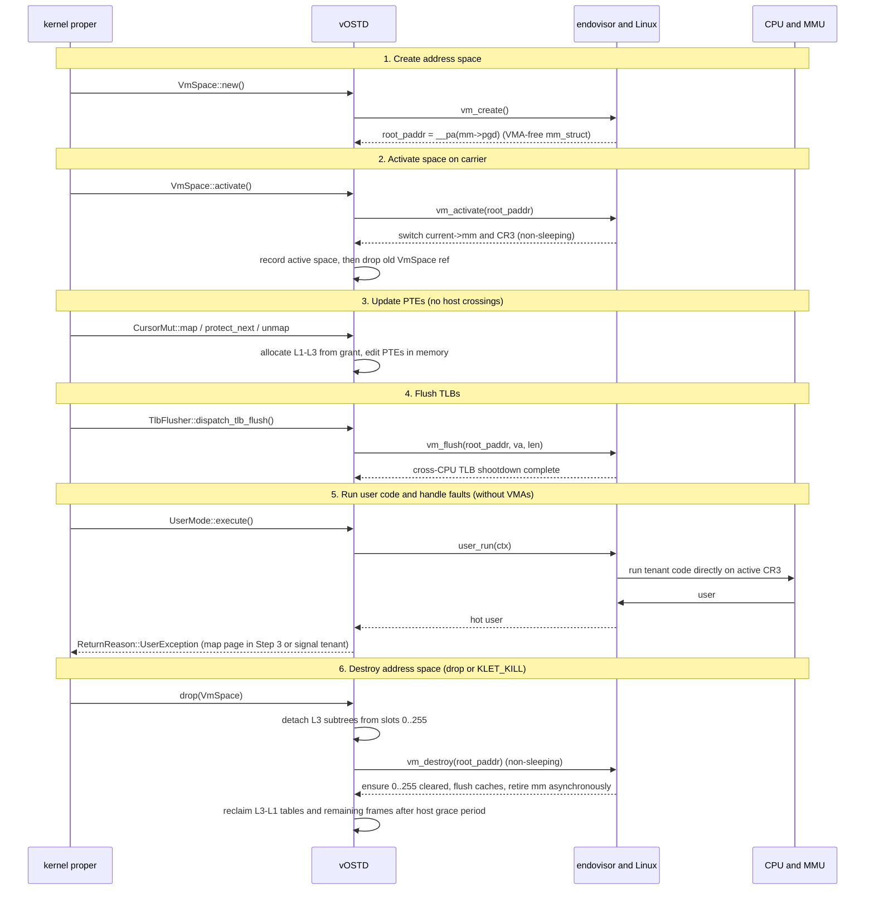
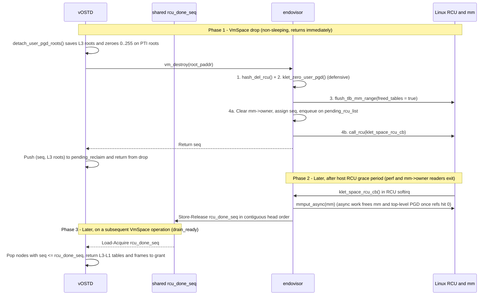
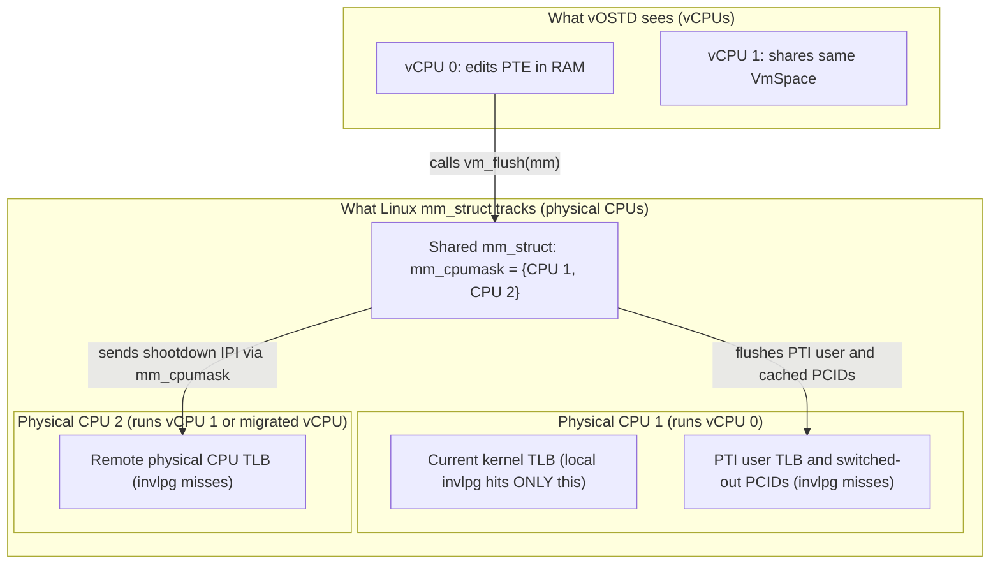
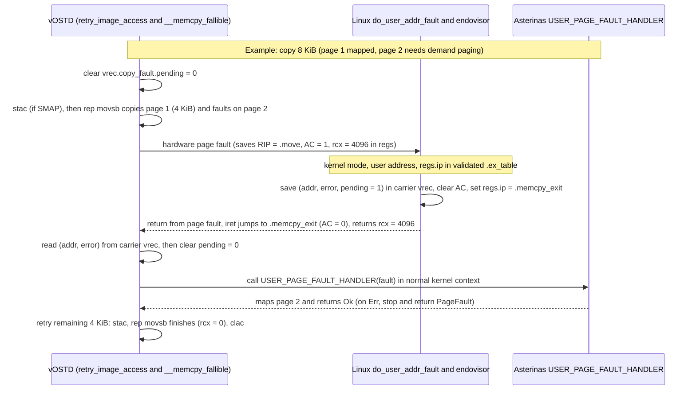

# 2026-11-13 Direct page-table updates in vOSTD

- Status: Draft
- Author(s): Plucky923
- Discussion: Revised from the initial `2026-11-13` batched-services draft; design alternatives appear under [Why we split `mm_struct`](#why-we-split-mm_struct) and [Alternatives and tradeoffs](#alternatives-and-tradeoffs).
- Affected chapters: [The kernelet ABI](../accepted-design/the-kernelet-abi.md), [Carrier hooks and patch overview](../accepted-design/carrier-hooks.md), [Into user mode and back](../accepted-design/into-user-mode-and-back.md), [Stopping a kernelet](../accepted-design/stopping-a-kernelet.md), [Tenant memory on Linux's page tables](../accepted-design/tenant-memory-on-linux-page-tables.md), [What vOSTD adds on top](../accepted-design/what-vostd-adds-on-top.md), and [What it costs](../accepted-design/what-it-costs.md).
- Implementation or experiments: An early standalone PoC validated the core Direct-mode path and produced the initial measurements in an early Direct-mode benchmark study; integration into `prototype/` and several hardening items (atomic CAS `protect_next`, CET `_PAGE_SAVED_DIRTY`, L1TF PFN inversion, borrowing Linux's `mm->pgd` as L4 root, two-pass `unmap`, and validated `.ex_table` direct user copies) remain pending.

## Summary

The accepted design maps tenant memory through a full-range `VM_PFNMAP` VMA and crosses into Linux for every `map`, `protect`, and `unmap`, pairing OSTD's fine-grained, non-sleepable page-table API with Linux's coarse-grained, sleepable VMA helpers. Because Linux only needs `mm_struct` to multiplex the hardware MMU, this proposal splits `mm_struct` into a **VMA-free host shell** and **vOSTD-managed user page tables**: Linux keeps `mm->pgd`, kernel-half sync (`256..511`), `CR3` scheduling, and `vm_flush` TLB shootdowns, while vOSTD allocates L1–L3 tables from the sandbox grant and edits user slots (`0..255`) and leaf PTEs directly in memory—deleting `VM_PFNMAP`, `SpaceRec` (and the 64-space cap), `withheld`, and `vm_map`/`vm_protect`/`vm_unmap`/`vm_wait`/`vm_wake`.

Two direct simplifications follow. Switching `CR3` immediately in non-sleeping `vm_activate` replaces `copy_regions()` and vOSTD's software RCU layer with direct hardware user copies gated by SMAP and load-time validated `.ex_table` `#PF` fixups. Removing VMA `.fault`/`.pfn_mkwrite` callbacks routes hot user-address `#PF` directly into vOSTD via `on_exception` (like `on_syscall`, with no VMA lookup or `TIF_NOTIFY_RESUME`), while cold traps defer to `on_resume` without POSIX signal draining.

## Problem and motivation

### Why the accepted design maps tenant memory through a VMA

In Asterinas, the kernel proper tracks user memory regions (`Vmar`) and **edits individual page-table entries through OSTD's fine-grained `VmSpace` and `CursorMut` interface**. In a kernelet, each carrier runs as a Linux user task. Linux handles a user task's address-space switches, shared kernel mappings, and cross-CPU TLB flushes through `mm_struct`. So the endovisor pairs each `VmSpace` with one Linux `mm_struct` ([Tenant memory on Linux's page tables](../accepted-design/tenant-memory-on-linux-page-tables.md#the-problem)). A carrier switches to that `mm_struct` before entering user mode, so the processor walks the hardware page table at `mm->pgd`.

<div class="background">

**Asterinas: `VmSpace` and `CursorMut` interface.** In Asterinas OSTD, `VmSpace::cursor_mut()` locks the page-table subtree covering `va` under an atomic-mode guard (`AsAtomicModeGuard`) and returns a `CursorMut` that edits individual page-table entries and transfers `UFrame` reference-counted ownership into and out of PTEs:

```rust
impl VmSpace {
    pub fn cursor_mut<'a, G: AsAtomicModeGuard>(
        &'a self,
        guard: &'a G,
        va: &Range<Vaddr>,
    ) -> Result<CursorMut<'a>>;
}

impl<'a> CursorMut<'a> {
    // Maps one frame at the current slot and advances by one page; panics if already mapped.
    pub fn map(&mut self, frame: UFrame, prop: PageProperty);

    // Clears mappings in `len` bytes, drops each unmapped `UFrame`, and returns the page count.
    pub fn unmap(&mut self, len: usize) -> usize;

    // Finds the next mapped page within `len` bytes and edits its flags/cache policy in place.
    pub fn protect_next(
        &mut self,
        len: usize,
        op: impl FnMut(&mut PageFlags, &mut CachePolicy),
    ) -> Option<Range<Vaddr>>;

    pub fn query(&mut self) -> Result<(Range<Vaddr>, Option<VmQueriedItem<'_>>)>;
    pub fn find_next(&mut self, len: usize) -> Option<Vaddr>;
    pub fn jump(&mut self, va: Vaddr) -> Result<()>;
}
```

</div>

In the accepted design, vOSTD delegates page-table updates through the endovisor's service table, and the endovisor applies them under Linux locks. To implement those services in a kernel module without patching Linux's memory-management code, the endovisor uses Linux's exported symbols (`EXPORT_SYMBOL` or `EXPORT_SYMBOL_GPL`) ([The kernelet ABI](../accepted-design/the-kernelet-abi.md)). **Linux's exported helpers for editing page tables only operate on a virtual memory area (VMA).** An ordinary VMA lets Linux free, swap, or migrate mapped pages through `struct page` without notifying Asterinas, leaving its `Frame` handles stale or dangling. To skip `struct page` management, the endovisor attaches one `VM_PFNMAP` VMA across the whole user range `[0x10000, 2^47 − 4 KiB)`.

With that VMA in place, the endovisor maps granted frames with per-page protections through `vmf_insert_pfn_prot()` and clears entries through `zap_vma_ptes()`. Linux receives tenant page faults, so the VMA forwards them to vOSTD through `fault` (missing entries) and `pfn_mkwrite` (writes to present read-only entries). Because Linux holds locks during those callbacks, they save the fault so the `on_resume` exit hook delivers it to vOSTD after Linux unlocks.

<div class="background">

**Linux: `VM_PFNMAP` and `_PAGE_SPECIAL`.** In an ordinary VMA, Linux manages every mapped physical page through `struct page` (reference counting, freeing, swapping, and migration). Marking a VMA `VM_PFNMAP` tells Linux not to manage its mapped physical pages through `struct page`. Linux writes raw frame numbers and sets `_PAGE_SPECIAL` on each entry so kernel page-table walks skip `struct page` lookups.

</div>



### Linux VMA constraints

Implementing OSTD's page-table API on a Linux VMA creates two root mismatches: granularity and semantics. In Asterinas, `Vmar` is already the virtual-memory-area layer: the kernel proper has already resolved regions and permissions before calling OSTD. **The granularity mismatch therefore forces every single-page OSTD call through an extra, redundant Linux VMA path** (`mmap_lock`, VMA lookup, and VMA helpers), causing the overhead below, while the semantic mismatch imposes two core constraints.

#### 1. Sleepable VMA helpers clash with non-sleeping cursors

<div class="background">

**Asterinas: `CursorMut` and atomic mode.** `VmSpace::cursor_mut()` requires an `AsAtomicModeGuard` (a preemption, spin-lock, or IRQ guard) and locks the target page-table subtree with spin locks. Because `map`, `protect_next`, and `unmap` edit in-memory entries without sleeping, callers may hold spin locks or disable interrupts around them.

**Linux: sleeping locks and `mmap_lock`.** Sleeping yields the CPU to another thread, so sleeping under a spin lock forces other CPUs to spin or deadlock. Linux's `mmap_lock` is a sleepable reader-writer lock, `vmf_insert_pfn_prot()` can sleep during page-table allocation, and `zap_vma_ptes()` yields at `cond_resched()` points.

</div>

Because `vm_map`, `vm_protect`, `vm_unmap`, and `vm_destroy` take `mmap_lock` and call sleepable VMA helpers, **vOSTD cannot use native non-sleeping page-table locks or destroy address spaces directly on drop**. That forces two extra host-blocking and deferral mechanisms: vOSTD replaces `CursorMut`'s page-table spin locks with a **custom sleepable range lock backed by host `vm_wait` and `vm_wake` futex services**, and because `VmSpace::activate()` in Asterinas can drop the last reference to an old `VmSpace` with interrupts disabled, vOSTD must queue destroyed spaces on a **deferred `retire list`** drained at later sleeping points. As a secondary caveat, sleeping in Linux also narrows OSTD's `AsAtomicModeGuard` contract by forbidding `CursorMut` calls under a spin lock or with virtual interrupts off ([Rule 2](../accepted-design/what-vostd-adds-on-top.md#the-rule-about-sleeping)); current Asterinas `Vmar` paths hold sleepable locks with plain `disable_preempt()` and do not trigger that check, though any future caller relying on OSTD's spin-lock or IRQ-disabled guarantee would be halted.

#### 2. Linux's VMA helpers lack the per-entry semantics `CursorMut` needs

Handing page tables to a Linux VMA strips vOSTD of direct control over both **single-entry operations** and **PTE bit encodings**. To bridge those gaps, the accepted design falls back on **extra page-table walks** and a **parallel side table outside the page table**.

**Operation-semantic gaps (forcing redundant walks).** Linux's exported VMA helpers are built for coarse range management, not OSTD's per-entry `CursorMut` contract:

- **Unmapping (`unmap`) must pre-walk to recover frames.** Asterinas tracks physical-frame lifetimes with `Frame` reference counts, so `CursorMut::unmap()` must retrieve and drop every unmapped frame. Because [`zap_vma_ptes()`](https://elixir.bootlin.com/linux/v6.12/source/mm/memory.c#L1952) clears entries and returns `void`, **vOSTD must walk the page table in software before calling `vm_unmap`** just to collect the frame numbers.
- **Mapping (`map`) must post-walk to verify the write.** [`vmf_insert_pfn_prot()`](https://elixir.bootlin.com/linux/v6.12/source/mm/memory.c#L2403) silently leaves an already-populated PTE unchanged while still reporting success. To confirm the requested frame was actually installed, **the endovisor runs a second page-table walk after insertion** to verify the slot's PFN.
- **Changing permissions (`protect_next`) goes through a range walker.** Because Linux does not export page-table lock helpers to modules, `vm_protect` cannot update one PTE directly and instead invokes the range-walking helper [`apply_to_page_range()`](https://elixir.bootlin.com/linux/v6.12/source/mm/memory.c#L2983) for a single page.

**PTE-encoding conflict (forcing the `withheld` side table).** Because Linux's fault handler interprets entries inside the shared VMA, vOSTD cannot use Asterinas's encoding for mapped no-read (`PROT_NONE`) pages:

<div class="background">

**Asterinas and Linux: no-read (`PROT_NONE`) pages.** A program can call `mprotect(PROT_NONE)` to block all access to a page while keeping its data intact. On x86-64, PTEs have no separate read bit (any entry with `Present = 1` is readable), and `Vmar` stores no physical frame numbers. Asterinas therefore encodes a mapped `PROT_NONE` page directly in the PTE by keeping its frame number with `Present = 0`. Linux's VMA fault handler, however, reads a nonempty, non-present PTE as a swap entry, a NUMA-balancing marker, or a spurious fault.

| 64-bit PTE state | PFN bits (12..51) | Present bit (0) | CPU hardware | Asterinas meaning | Linux VMA fault handler |
|---|---|---|---|---|---|
| Normal mapped page | Frame number | `1` | Translates (always readable) | Mapped readable page | Normal present page |
| Empty slot | `0` | `0` | Raises `#PF` | Unmapped | Calls VMA `fault` callback |
| Nonempty, non-present | Frame number | `0` | Raises `#PF` | Mapped `PROT_NONE` page | Swap, NUMA, or spurious fault |

</div>

Because Linux misinterprets a nonempty, non-present PTE, **vOSTD clears the Linux entry to `0` and stores `PROT_NONE` frames in a separate spin-locked [withheld set](../accepted-design/what-vostd-adds-on-top.md#a-page-without-read-permission)**. Every `map`, `unmap`, `protect_next`, and `query` must then lock and reconcile two separate data structures (the hardware page table and the `withheld` map) to reconstruct a single address space.

**Note on exception delivery.** Relying on the VMA's `fault` and `pfn_mkwrite` callbacks to avoid a trap-entry hook also splits user exceptions across two host paths: in-VMA missing and write-RO faults enter VMA callbacks (which rebuild the x86 error code from Linux flags), whereas out-of-VMA faults, NX fetches, and traps such as `#GP` fall through to POSIX signals that [`on_resume`](../accepted-design/into-user-mode-and-back.md#coming-back-by-an-exception) must drain before Linux kills the carrier. That split is an artifact of using VMA callbacks rather than an unavoidable VMA constraint, and it means removing the VMA sacrifices no clean exception mechanism.

### What that choice costs

That per-page host VMA overhead hits the memory paths behind demand faults, `mprotect`, `fork`, and `munmap`. We measured five-boot medians on one KVM virtual machine (2 vCPUs, 512 MiB RAM, Linux 6.12, 3.19 GHz Ryzen 7 5800H). Three common paths show where the cost lands:

- **Single-page demand fault.** A tenant page fault runs a Linux VMA lookup and the `fault` callback before the kernel proper maps one frame. That `vm_map` call acquires `mmap_read_lock()`, looks up the VMA, inserts the frame under a page-table lock, and verifies the slot. One `map` call takes **447 cycles (140 ns)**, and mapping 512 pages under one cursor takes **472 cycles (148 ns) per page**. Native Linux on the same host finishes a full anonymous fault in **323 ns**, so **one `vm_map` call takes 43% of a native fault**.

- **Large permission change or `fork`.** Large `protect_next` loops and `fork` repeat that per-page host path across every mapped writable page. Protecting 2 MiB read-only and flushing the TLB takes **243,808 cycles (76.3 µs, ~476 cycles per page)**. Copying 64 MiB of copy-on-write page tables (16,384 entries, reusing 256 frames and without task creation) takes **7.85 ms (25.07 M cycles)**. On the same VM, native Linux finishes a full `fork()` of 64 MiB (16,384 private 4 KiB pages, `MADV_NOHUGEPAGE`) in **0.337 ms**. That narrower page-table copy runs **23x slower than native `fork()`**.

- **Large `munmap` and the limit of batching.** Unmapping 64 MiB in one `vm_unmap` call takes **872,480 cycles (0.27 ms, ~53 cycles per page)**, including vOSTD's pre-walk to collect frames. One range call amortizes host crossings and `mmap_read_lock()` across large contiguous regions, so batched host services are a serious alternative. Batching does not remove the host crossing on single-page demand faults, and it leaves both Linux VMA constraints intact.

## Proposed change

### Why we split `mm_struct`

OSTD's page-table interface is per-page and non-sleepable, while Linux's VMA interface is coarse-grained and sleepable. Three intuitive strawman approaches try to fix this mismatch: move region management out of the kernel proper, batch or bridge the two interfaces over a Linux VMA, or drop Linux's `mm_struct`.

- **Strawman 1: move region management to match Linux's VMA model.** Pushing `Vmar` and paging policy below the kernel proper either **bloats the trusted computing base (TCB)** if placed in vOSTD or **removes the tenant's own memory manager** if delegated to Linux.

- **Strawman 2: batch or bridge the two interfaces over a Linux VMA.** Batching PTE updates (either by widening OSTD into explicit range calls such as `map_range` and `protect_range`, which also **forces edits to the kernel proper**, or by buffering updates inside vOSTD) only amortizes large contiguous ranges while **leaving single-page demand faults unbatched and inheriting Linux's sleepable VMA locks and both semantic constraints**. Exporting a custom non-sleepable PTE API from Linux **breaks the minimal-patch goal** and duplicates Linux's memory-management code. Caching updates in a separate software table and syncing them to Linux on first access **adds an extra `#PF` trap to every new page**.

- **Strawman 3: drop Linux's `mm_struct`.** Letting vOSTD own user page tables and `CR3` without `mm_struct` fails because each carrier runs as a Linux task. After preemption or CPU migration, Linux reloads `CR3` from `current->mm->pgd`. Linux syncs the shared kernel half (slots `256..511`) inside `mm->pgd` and tracks which physical CPUs cache translations (`mm_cpumask`) for cross-CPU TLB flushes. Dropping `mm_struct` **breaks carrier scheduling, kernel mappings, and TLB coherence**.

Dropping `mm_struct` fails because Linux bundles two separable roles inside one struct:

1. **Hardware MMU multiplexing.** Linux switches `CR3`, syncs the shared kernel half of `mm->pgd`, and runs cross-CPU TLB flushes.
2. **User virtual-memory management.** Linux tracks VMAs under `mmap_lock`, runs fault callbacks, and allocates user lower page tables.

The kernelet needs Linux for the first role, while `Vmar` and vOSTD handle the second.

*Selected fields from Linux v6.12 [`include/linux/mm_types.h`](https://elixir.bootlin.com/linux/v6.12/source/include/linux/mm_types.h#L790) (with x86 `mm_context_t` in [`arch/x86/include/asm/mmu.h`](https://elixir.bootlin.com/linux/v6.12/source/arch/x86/include/asm/mmu.h#L23)):*

```c
struct mm_struct {
    // Role 1: Hardware MMU multiplexing (kept in Linux)
    pgd_t *pgd;                         // L4 root page table loaded into `CR3`
    atomic_t mm_users;                  // Active users of this `mm_struct` shell
    atomic_t mm_count;                  // Lifetime reference count of `mm_struct`
    mm_context_t context;               // x86 `ctx_id` and `tlb_gen` for PCIDs

    // Role 2: User virtual-memory management (left empty; owned by `Vmar` and vOSTD)
    struct maple_tree mm_mt;            // VMA maple tree (empty)
    int map_count;                      // Number of VMAs (`0`)
    struct rw_semaphore mmap_lock;      // Sleeping VMA lock (unused on PTE updates)
    spinlock_t page_table_lock;         // Linux page-table lock (unused)
    atomic_long_t pgtables_bytes;       // Linux page-table byte counter (`0`)
    struct percpu_counter rss_stat[NR_MM_COUNTERS]; // Linux RSS counters (`0`)

    // Role 1: Hardware MMU multiplexing (flexible array at the end of `mm_struct`)
    unsigned long cpu_bitmap[];         // Backing storage for `mm_cpumask(mm)`
};
```

We split `mm_struct` along this boundary. Linux keeps the VMA-free shell for hardware MMU multiplexing. vOSTD allocates lower user tables (levels 1 to 3) from the sandbox grant and writes user L4 slots (`0..255`) and lower-level entries in memory. The x86-64 MMU walks the hardware page table at `CR3` without reading Linux VMAs. Because all lower tables live inside the grant, `KLET_KILL` reclaims sandbox memory whole without walking kernelet page tables.

### Overview

Four layers divide address-space management across the split `mm_struct`:

- **kernel proper (unchanged).** Owns virtual-memory policy (`Vmar`) and drives OSTD's `VmSpace`, `CursorMut`, and `TlbFlusher` interfaces.
- **vOSTD.** Allocates lower user page tables (levels 1 to 3) from the sandbox grant, updates user-half mappings (`0..255`) directly in memory, accesses tenant memory through the hardware MMU, and calls the host only for address-space lifecycle, `CR3` activation, and TLB flushes (`vm_create`, `vm_activate`, `vm_flush`, and `vm_destroy`).
- **endovisor.** Implements those four host services over VMA-free `mm_struct` shells and forwards tenant traps and user-copy faults between Linux and vOSTD.
- **Linux.** Multiplexes the hardware MMU: allocates the root table (`mm->pgd`), keeps the shared kernel half (`256..511`) synchronized, reloads `CR3` on task switches, executes cross-CPU TLB flushes, and owns the IDT.

This split removes the `VM_PFNMAP` VMA and every host service or workaround built around it: per-page page-table services (`vm_map`, `vm_protect`, `vm_unmap`), the sleepable range lock (`vm_wait`, `vm_wake`), the `withheld` set, and software page-table walking for user copies.



Linux maps all physical RAM inside slots `256..511` starting at a fixed kernel offset (`linear_map_base`). So vOSTD reads and writes any `VmSpace` table at `linear_map_base + paddr` without switching `CR3`. The protocol below spans six steps across the lifecycle of a tenant address space:



1. **Create (`VmSpace::new`).** vOSTD calls `vm_create()`, and the endovisor allocates a VMA-free `mm_struct` and returns `root_paddr` (`__pa(mm->pgd)`). With no anonymous file, VMA setup, or `CR3` switch, creating an address space stays lightweight, and keying spaces by `root_paddr` removes the 64-space limit.
2. **Activate (`VmSpace::activate`).** vOSTD calls `vm_activate(root_paddr)`, which switches `current->mm` and `CR3` immediately without sleeping. vOSTD drops the previous `Arc<VmSpace>` only after `vm_activate()` returns so no carrier ever runs on a freed `mm`.
3. **Update PTEs (`map`, `protect_next`, `unmap`).** vOSTD edits user L4 slots (`0..255`) and lower tables directly in memory with zero per-page host crossings, allocating L1 to L3 tables from its pre-granted memory pool without sleeping. No-read (`PROT_NONE`) pages are encoded directly in leaf PTEs (removing the `withheld` set), and `unmap` issues one `vm_flush()` per range before releasing frames.
4. **Flush TLBs (`TlbFlusher::dispatch_tlb_flush`).** After tightening permissions or unmapping pages, vOSTD calls `vm_flush()` so Linux flushes stale TLBs across CPUs. Because user copies also use the hardware MMU and TLB, one `vm_flush()` revokes both user-mode translations and concurrent kernel copies.
5. **Run user code and handle faults (`UserMode::execute` and user copies).** Once an address space is active on `CR3`, both tenant execution and kernel-mode user copies translate user addresses directly through the hardware MMU at native speed. Because `mm_struct` has no VMAs, Linux cannot forward page faults through VMA callbacks. Instead, when user code hits a normal user-address `#PF` (hot path, where Linux has already enabled interrupts on the normal task context), `on_exception` switches directly into vOSTD before VMA lookup (just like `on_syscall`) so the kernel proper can demand-map the page (Step 3) and return straight to user mode without `TIF_NOTIFY_RESUME`. Cold traps that run with interrupts disabled or on an IST (such as kernel-address `#PF`, `#GP`, `#UD`, or `#DB`) save the raw exception in `on_exception` and defer delivery to `on_resume` once Linux exits the trap frame. When a direct kernel-mode user copy faults on an unmapped or read-only page, the host redirects to vOSTD's fault recovery path so the kernel proper can resolve the fault and retry the copy.
6. **Destroy (`drop(VmSpace)` or `KLET_KILL`).** On normal `drop(VmSpace)`, vOSTD detaches the L3 subtrees from user slots `0..255` and calls non-sleeping `vm_destroy()`, which ensures slots `0..255` are cleared, flushes paging caches, and retires `mm_struct` asynchronously after an RCU grace period; once that grace period completes, vOSTD reclaims the detached L1 to L3 tables and remaining frames without sleeping. On `KLET_KILL`, the endovisor evicts all carriers, clears user slots on every remaining `mm`, drains all pending RCU retirements, and reclaims the sandbox grant whole.

| Operation or event | Accepted design | Proposed design |
|---|---|---|
| `VmSpace::new()` | `vm_create` builds `mm`, file, and `VM_PFNMAP` VMA | `vm_create` allocates VMA-free `mm_struct`, returns `root_paddr` |
| `VmSpace::activate()` | Records space, switches before user entry | `vm_activate` switches `current->mm` and `CR3` immediately without sleeping |
| `CursorMut::map()` | `vm_map` crossing (or `withheld` set if `!R`) | vOSTD allocates grant tables and writes PTE in memory |
| `CursorMut::protect_next()` | `vm_protect` crossing (or `unmap`/`map` if `!R`) | vOSTD updates PTE in memory (including `!R`) |
| `CursorMut::unmap()` | Pre-walk, heap `Vec`, `vm_unmap`, RCU wait | Two-pass leaf clear, `vm_flush`, drop frames |
| `TlbFlusher::dispatch_tlb_flush()` | `vm_flush` (`flush_tlb_mm_range()`) | `vm_flush` (`flush_tlb_mm_range()`) |
| `VmSpace::reader()` / `writer()` | Software page-table walk (`copy_regions()`) + vOSTD RCU | Direct hardware MMU copy with validated fault recovery |
| `VmSpace` drop / `KLET_KILL` | `zap_vma_ptes` and sleepable `vm_destroy` | Non-sleeping `vm_destroy` + async RCU grace period; whole-grant reclaim on `KLET_KILL` |
| Tenant `#PF` / user trap | VMA callback or POSIX signal drain | Direct `on_exception` entry on hot user `#PF`; deferred `on_resume` on cold traps |

These six steps remove Linux's VMA layer from `mm_struct`, which breaks Linux's assumption that user PTEs exist only inside VMAs. Moving PTE writes into vOSTD shifts page-table locking, hardware bit encoding, and teardown ordering out of Linux. The next two sections address the host-side consequences of removing VMAs and the vOSTD-side obligations of writing PTEs in memory.

### Consequences of removing VMAs from `mm_struct`

Linux assumes that every user-mode task registers its mapped memory in the `mm_struct` VMA tree (`mm_mt`). Deleting VMAs breaks that assumption: **Linux sees an empty `mm_mt` and zero counters, while vOSTD fills user slots `0..255` with grant-backed page tables**. Creating a VMA-free `mm_struct` requires no new Linux allocator: `mm_alloc()` already returns an `mm_struct` with an empty `mm_mt` (`map_count == 0`), and the proposed `vm_create` simply skips creating an anonymous file or attaching a `VM_PFNMAP` VMA:

*Simplified from `prototype/linux/patches/0001-carrier-hooks.patch`: `kernelet_mm_alloc` and `mm_alloc`.*

```c
// kernel/fork.c: allocate a fresh `mm_struct` with an empty VMA tree (`mm_mt`).
struct mm_struct *kernelet_mm_alloc(struct task_struct *owner)
{
    struct mm_struct *mm = mm_alloc();   // Allocates `mm_struct` + `mm->pgd`; `map_count == 0`
    if (!mm)
        return NULL;
#ifdef CONFIG_MEMCG
    WRITE_ONCE(mm->owner, owner);        // Charge memcg accounting to the sandbox creator
#endif
    lru_gen_add_mm(mm);                  // Enroll once in MGLRU (empty `mm_mt` skips scans)
    return mm;
}

// Proposed endovisor `vm_create`: stop right after `kernelet_mm_alloc()` (no file, no VMA).
mm = kernelet_mm_alloc(inst->owner);
set_mask_bits(&mm->flags, MMF_DUMPABLE_MASK, SUID_DUMP_DISABLE);
return __pa(mm->pgd);                    // `mm->mm_mt` stays empty; vOSTD writes `pgd[0..255]`
```

<div class="background">

**Linux: how normal memory paths find user pages.** Linux's standard memory management locates user pages in two ways. Top-down paths, such as `/proc/<pid>/maps` and `ptrace`, search the VMA tree (`mm_mt`) by virtual address. When `mm_mt` is empty, they stop without reading hardware PTEs. Bottom-up paths, such as swapping and memory reclaim, pick physical pages from Linux's LRU lists and follow reverse mappings (`rmap`) back to processes. Because grant frames sit outside Linux's LRU lists and have no `rmap`, those paths never touch them. At exit, Linux's counter check (`check_mm()`) also passes because Linux's counters stay zero.

</div>

Outside those standard paths, removing VMAs leaves three host mechanisms that need explicit handling, plus host constraints and operational side effects. The subsections below cover each area in turn.

#### User page-fault and exception delivery

Running tenant programs trigger normal page faults (`#PF`), such as demand-paging faults and copy-on-write faults. Because the kernel proper owns user memory policy, those faults must reach it. Every user-address `#PF` enters Linux's `do_user_addr_fault()`, which looks up the address in `mm_mt`. With an empty `mm_mt`, that lookup fails on every fault, so **Linux treats every normal page fault as an invalid access and queues a fatal `SIGSEGV`**.

<div class="background">

**Linux: trap context and `TIF_NOTIFY_RESUME`.** On x86-64, `do_user_addr_fault()` re-enables hardware interrupts (`local_irq_enable()`) before VMA lookup on the normal thread context, so it can sleep like a system call. Other trap handlers (`do_kern_addr_fault()` and `do_error_trap()`) keep interrupts disabled or run on an Interrupt Stack Table (IST), where sleeping is illegal. Setting `TIF_NOTIFY_RESUME` defers work to Linux's return-to-user loop (`exit_to_user_mode_loop()`), which runs in a normal, sleepable context.

</div>

We hook `on_exception(regs, trapnr, error_code, addr)` before VMA lookup in `do_user_addr_fault()`, and reuse it on the other forwarded user traps. Delivery follows two clean flows:

- **Hot path (user-address `#PF` in `do_user_addr_fault()`).** After `local_irq_enable()` and **before `lock_vma_under_rcu()`**, `on_exception` **calls `klet_enter()` directly** (just like `on_syscall`), lets the kernel proper resolve the fault, writes the next tenant registers into `regs`, and returns `true` so Linux skips the empty `mm_mt` and returns straight to user mode.
- **Cold path (kernel-address `#PF` and other user traps).** For `do_kern_addr_fault()` and user traps in `traps.c` (`#GP`, `#UD`, `#DB`, etc.), interrupts are off or the CPU is on an IST, so `on_exception` **only saves the trap and sets `TIF_NOTIFY_RESUME`**. Once Linux closes the trap frame, **`on_resume` runs in a sleepable context** and enters vOSTD via `klet_enter()`.

*Proposed hook in `arch/x86/mm/fault.c` (`prototype/linux/patches/0001-carrier-hooks.patch`):*

```c
// arch/x86/mm/fault.c: lower-half user-address page faults (hot path)
static void do_user_addr_fault(struct pt_regs *regs,
                               unsigned long error_code,
                               unsigned long address)
{
    // Linux hardware checks and `local_irq_enable()` run first.

    // Intercept user-mode `#PF` BEFORE VMA lookup on the empty `mm_mt`:
    if (user_mode(regs) && current->carrier_hooks &&
        current->carrier_hooks->on_exception(regs, X86_TRAP_PF,
                                             error_code, address))
        return;   // Calls `klet_enter()` directly, updates `regs`, skips `mm_mt`

    vma = lock_vma_under_rcu(mm, address); // Skipped for carriers; would fail and send `SIGSEGV`
    ...
}
```

**Forwarding boundary.** `on_exception` intercepts only **user-mode** traps (`user_mode(regs)`) across the 11 vectors Asterinas handles (`#PF` plus `#DE`, `#DB`, `#BP`, `#OF`, `#UD`, `#SS`, `#GP`, `#MF`, `#XM`, `#AC`), always after Linux's own host safety checks (such as KASLR error-code sanitization in `do_kern_addr_fault()` and split-lock / bus-lock checks, and before host UMIP/IOPL emulation on `#GP`). Host and unsupported traps (`#NM`, `#DF`, `#MC`, NMI, etc.) stay in Linux, and kernel-mode faults stay on Linux's exception tables (except validated user-copy `#PF` fixups handled by `on_kernel_fault` in [Direct user copies via validated image exception tables](#direct-user-copies-via-validated-image-exception-tables)).

#### Paths that walk page tables without VMAs

Removing VMAs from `mm_struct` stops every Linux path that **modifies** user page tables: in Linux, VMAs are the authoritative metadata for user mappings, so fault handling, reclaim, `khugepaged`, `mprotect`/`munmap`, and even `exit_mmap()` all look up a VMA in `mm_mt` before changing any user-space PTE. However, a few Linux paths skip `mm_mt` and walk `mm->pgd` directly. **Because they never consult VMAs, these paths are read-only on user page tables**, yet they share no synchronization with vOSTD's writes or page-table teardowns. **vOSTD must therefore keep its user page tables safe for concurrent read-only walks that bypass VMAs.**

<div class="background">

**Linux: page-table walks that bypass VMAs.** Linux uses get user pages (GUP) when kernel code needs the `struct page` behind a user virtual address, for example to pin a user buffer for I/O. Ordinary GUP takes `mmap_lock`, finds the VMA in `mm_mt`, and checks its permissions before it walks the page table. Three paths skip part of this procedure:

- **Fast GUP (`gup_fast`).** Taking `mmap_lock` for every pin causes lock contention on hot paths such as `O_DIRECT` I/O and shared `futex` keys. `gup_fast` disables interrupts, walks `current->mm->pgd` without `mmap_lock` or VMAs, and takes a reference on the `struct page` of each ordinary leaf. If the walk stops at any entry, callers that allow it fall back to ordinary GUP. Fast-only callers fail instead.
- **`perf` physical-address sampling.** `perf_virt_to_phys()` runs inside a non-maskable interrupt (NMI). The NMI can interrupt a holder of `mmap_lock` and cannot sleep. It therefore uses the fast-only variant `get_user_page_fast_only()`, reads the physical address, and drops the reference with `put_page()`.
- **Page-table dumps (`ptdump`).** The x86 debugfs files `current_kernel` and `current_user` walk the page table of `current->mm` with `walk_page_range_novma()`. This walk holds `mmap_lock` but never consults VMAs.

</div>

**During normal operation, `perf` NMI sampling (`perf_virt_to_phys()` via `gup_fast`, and `perf_get_page_size()`) is the only VMA-less walker that reaches vOSTD's page tables.** Syscall-driven `gup_fast` (`O_DIRECT`, `futex`) and `ptdump` never run on tenant addresses because tenant syscalls go through `on_syscall` and carriers never read debugfs; `dump_pagetable()` runs only during a kernel oops. Disabling `perf` on carriers is not viable—it is a standard host profiling facility that cannot be blocked from user space without intrusively patching Linux, and future Linux releases may introduce other VMA-less read-only walkers. **Rather than blocking individual callers, vOSTD upholds concurrent read-only safety across all of its user page tables.**

Unprotected concurrent read-only walks create **two hazards**, which vOSTD prevents with two rules:

1. **Leaf PTEs (`struct page` lookup):** `perf_virt_to_phys()` may treat a tenant leaf as Linux-managed memory, mutating `struct page` reference counts or crashing in an NMI on unbacked device memory (**Rule 1**).
2. **Intermediate tables (L1 to L3 use-after-free):** freeing and reusing a lower page-table page while a walker traverses it causes the walker to read unrelated bytes as PTEs, risking an NMI crash or a tenant-forged leaf (**Rule 2**).

<div class="background">

**Linux: software PTE bits and `_PAGE_SPECIAL`.** On x86-64, the MMU ignores several PTE bits, so the OS can store its own information there. Linux names five of them `_PAGE_BIT_SOFTW1` to `_PAGE_BIT_SOFTW5` (bits 9, 10, 11, 57, and 58) and uses bit 9 as `_PAGE_SPECIAL`. This bit marks a leaf through which Linux must not reach a `struct page`. Linux sets it on `VM_PFNMAP` mappings that `remap_pfn_range()` and `vmf_insert_pfn()` create, and on mappings of the shared zero page. Code that turns a PTE into a `struct page`, such as `vm_normal_page()` and `gup_fast`, treats a special leaf as having none and never touches a reference count.

</div>

**Rule 1: mark every leaf PTE as special.** In the accepted design, `vmf_insert_pfn_prot()` sets `_PAGE_SPECIAL` on every tenant leaf; since vOSTD now writes leaves directly, it must set the bit itself. Without it, **`perf_virt_to_phys()` treats a tenant frame as ordinary Linux memory and looks up its `struct page`**: for a grant frame, it takes and drops a reference on memory that Asterinas manages (whose outcome depends on how the endovisor allocated the grant), and if a later version maps device memory without a `struct page` through `MappedIoMem`, the lookup can fault inside an NMI and crash the host. vOSTD encodes each leaf so that `gup_fast_pte_range()` exits before reaching `struct page`:

*Selected lines from Linux v6.12 [`mm/gup.c`](https://elixir.bootlin.com/linux/v6.12/source/mm/gup.c#L2887):*

```c
// mm/gup.c: gup_fast_pte_range() reads each leaf with interrupts disabled and no VMA.
pte_t pte = ptep_get_lockless(ptep);

if (pte_protnone(pte))
    goto pte_unmap;
if (!pte_access_permitted(pte, flags & FOLL_WRITE))
    goto pte_unmap;
if (pte_devmap(pte)) {                        // Bit 57 (`_PAGE_DEVMAP`) is tested first.
    ...
} else if (pte_special(pte))                  // Bit 9 (`_PAGE_SPECIAL`) exits here.
    goto pte_unmap;

VM_BUG_ON(!pfn_valid(pte_pfn(pte)));
page = pte_page(pte);                         // Finds the `struct page`.
folio = try_grab_folio_fast(page, 1, flags);  // Takes a reference on it.
```

Every leaf PTE that vOSTD writes therefore **sets bit 9 and clears bit 57**. Bit 9 sends the walk to `pte_unmap` before `pte_page()`, so `perf_virt_to_phys()` gets no page and records physical address 0. Bit 57 must stay clear because `gup_fast` tests `pte_devmap()` first and reaches `pte_special()` only in the `else` branch.

**Rule 2: keep lower tables until teardown.** Unlike tenant data frames (which `perf` never reads because Rule 1 stops it at the leaf), a `perf` walker must read L1 to L3 page-table pages on its way down from `mm->pgd`. If `unmap` freed an empty table page right away, the grant could reuse it for tenant data while an in-flight `perf` walker is still reading it. **The walker would then treat arbitrary bytes as PTEs**, risking an NMI crash on the host or a tenant-forged leaf without `_PAGE_SPECIAL`.

Because `perf` walks without locks, safely freeing a table page means waiting until every in-flight walk across all CPUs finishes (a host RCU grace period). Doing that on every `unmap` is impractical: `unmap` cannot sleep, and deferring individual tables adds tracking overhead. **vOSTD therefore keeps all L1 to L3 tables attached while the address space lives** (`UserPtConfig::CAN_PRUNE_SUBTREE = false`). `unmap` zeroes leaf PTEs (`PRESENT = 0`, so walkers exit safely) and frees tenant data frames immediately, leaving empty tables for later `map` calls to reuse. Only when the entire address space is destroyed does vOSTD clear root slots `0..255` and return all lower tables to the grant together after one barrier ([Address-space teardown without VMAs](#address-space-teardown-without-vmas)).

Keeping empty tables costs a small amount of **grant memory**: about **0.2%** of peak contiguous mappings (4 KiB per 2 MiB; 2,056 KiB for a 1 GiB peak), or 4 KiB per distinct 2 MiB range in sparse mappings (at least 4,000 KiB for 1,000 ranges). Because all tables come from the sandbox's own grant, a tenant cannot consume host memory.

#### Address-space teardown without VMAs

Linux tears down an address space in `exit_mmap()`. `mmput()` calls it through `__mmput()` when the last user drops its reference (`mm_users == 0`). For a kernelet address space, the endovisor drops its reference in `vm_destroy` or during `KLET_KILL`. Normally, `exit_mmap()` does three things: it unmaps user pages (`unmap_vmas()`), unlinks and frees the page tables (`free_pgtables()`), and flushes the TLBs before it frees the gathered pages and tables (`tlb_finish_mmu()`). All three steps start from VMAs. **With zero VMAs, `exit_mmap()` skips them:**

*Selected lines from Linux v6.12 [`mm/mmap.c`](https://elixir.bootlin.com/linux/v6.12/source/mm/mmap.c#L1910):*

```c
// `mm/mmap.c`: `exit_mmap()` skips user teardown when zero VMAs exist.
vma = vma_next(&vmi);
if (!vma || unlikely(xa_is_zero(vma))) {
    mmap_read_unlock(mm);
    mmap_write_lock(mm);
    goto destroy;                       // Zero VMAs: jumps past all three steps.
}
...
unmap_vmas(&tlb, ...);                  // Skipped: leaf PTEs stay in place.
...
free_pgtables(&tlb, ...);               // Skipped: `pgd[0..255]` still points at L3 tables.
tlb_finish_mmu(&tlb);                   // Skipped: no TLB flush and no deferred table free.
```

Skipping `free_pgtables()` is necessary because **Linux must never free grant-backed tables into its own page allocator**. However, skipping `free_pgtables()` and `tlb_finish_mmu()` leaves vOSTD's lower tables (L1 to L3) and any remaining tenant frames unfreed. Moreover, `mm_struct` is reference-counted in Linux, so a lazy-TLB CPU, a `/proc` reader, or asynchronous `mmput_async()` can keep it alive past `vm_destroy` or sandbox exit. Before vOSTD returns those table pages to the grant, four safety steps must therefore finish:

1. **Clear `pgd[0..255]` (and the PTI user root).** Stop any new hardware or software walk from reaching the old L3 grant tables, even while `mm_struct` stays loaded in a lazy-TLB CPU's `CR3` (where Linux leaves the old `CR3` intact while running a kernel thread).
2. **Flush CPU page-table caches (`freed_tables = true`).** x86 CPUs cache intermediate L4 to L2 pointers and can follow them speculatively even after `pgd[0..255]` is zeroed. Normal TLB flushes skip lazy-TLB CPUs; passing `freed_tables = true` to `flush_tlb_mm_range()` clears those caches everywhere and switches lazy CPUs back to `init_mm`.
3. **Wait for one host RCU grace period.** Zeroing `pgd[0..255]` only stops new walks; a lockless `perf` or `gup_fast` walker that already entered L3 to L1 may still be mid-walk. On VMs such as KVM, a TLB flush skips sending an IPI to a paused vCPU, so waiting for one host RCU grace period is the only way to guarantee every in-flight walker has exited before reusing the table pages.
4. **Clear `mm->owner` before that grace period.** Each `mm_struct` points `mm->owner` at the sandbox creator's `task_struct` (`inst->owner`) for memcg accounting, and Linux reads it under RCU (`get_mem_cgroup_from_mm()`). Setting `mm->owner = NULL` before the same grace period ensures memcg never dereferences `inst->owner` after sandbox exit drops it with `put_task_struct()`.

**Why teardown uses an asynchronous ticket (`seq` / `rcu_done_seq`) instead of `synchronize_rcu()`.** Normal `VmSpace::drop` can run in a non-sleeping context (for example, inside `VmSpace::activate()` right after switching `CR3` away from the previous space), so `vm_destroy()` cannot block waiting for a host RCU grace period. Instead, `vm_destroy()` runs steps 1–4 immediately, schedules `call_rcu()`, and returns a monotonic ticket `seq`, allowing `VmSpace::drop` to queue the detached L3 roots and return at once. Once the grace period ends, `klet_space_rcu_cb()` drops the `mm` reference via `mmput_async()` and advances a shared `rcu_done_seq` in ticket order (guarding against out-of-order per-CPU RCU callbacks). On a subsequent `VmSpace` operation, whenever vOSTD observes `rcu_done_seq >= seq`, it safely returns the queued L3–L1 tables and remaining frames to the grant without sleeping:



*Proposed non-sleeping teardown barrier for `prototype/linux/endovisor/space.c`:*

```c
// Invoked from RCU softirq after all lockless walkers (`perf`/`gup_fast`) and `mm->owner` readers exit.
static void klet_space_rcu_cb(struct rcu_head *rcu)
{
    struct klet_space *sp = container_of(rcu, struct klet_space, rcu);
    struct klet_inst *inst = sp->inst;

    mmput_async(sp->mm); // Drops the last shell ref without sleeping (defers `exit_mmap()` if 0).
    spin_lock_bh(&inst->rcu_lock);
    sp->rcu_done = true;
    // Advance `rcu_done_seq` only across contiguous head completions (guards out-of-order per-CPU RCU callbacks).
    while (!list_empty(&inst->pending_rcu_list)) {
        struct klet_space *head = list_first_entry(&inst->pending_rcu_list, struct klet_space, rcu_node);
        if (!head->rcu_done)
            break;
        list_del(&head->rcu_node);
        smp_store_release(&inst->shared->rcu_done_seq, head->seq);
        kfree(head);
    }
    spin_unlock_bh(&inst->rcu_lock);
}

// Non-sleeping `vm_destroy`: runs steps 1-4 and returns a monotonic sequence number `seq`.
static u64 klet_do_vm_destroy(struct klet_inst *inst, struct klet_space *sp)
{
    struct mm_struct *mm = sp->mm;

    // 1. Unlink `sp` from the RCU hash table before `mm` can ever be recycled (preventing `root_paddr` ABA).
    hash_del_rcu(&sp->hnode);

    // 2. Zero user slots `0..255` in `mm->pgd` (and `root_paddr | PAGE_SIZE` under PTI), without reading L1-L3.
    klet_zero_user_pgd(mm);
    smp_mb(); // Order cleared PGD slots before `flush_tlb_mm_range()` reads `mm_cpumask(mm)`.

    // 3. Flush paging-structure caches and switch lazy-TLB CPUs to `init_mm`.
    flush_tlb_mm_range(mm, 0, TLB_FLUSH_ALL, 0, true); // `freed_tables = true`

    // 4. Clear `mm->owner` and hand the grace-period wait + `mmput_async()` to `call_rcu()`.
#ifdef CONFIG_MEMCG
    WRITE_ONCE(mm->owner, NULL);
#endif
    spin_lock_bh(&inst->rcu_lock);
    sp->seq = ++inst->rcu_next_seq;
    list_add_tail(&sp->rcu_node, &inst->pending_rcu_list);
    spin_unlock_bh(&inst->rcu_lock);
    call_rcu(&sp->rcu, klet_space_rcu_cb);
    return sp->seq;
}
```

When `mm_count` later reaches zero, `__mmdrop()` frees `mm->pgd` and `mm_struct` cleanly: **x86-64 `pgd_free()` releases only the top-level page without walking slots `0..255`**, and `check_mm()` sees zero `rss_stat` and `pgtables_bytes` counters.

Actual grant reclamation follows two paths after this barrier:

- **Normal `VmSpace` drop.** Because vOSTD (`VmSpace::activate()`) already switches `CR3` away before dropping the previous `Arc<VmSpace>`, no active carrier holds `mm` when `VmSpace::drop` runs. vOSTD snapshots non-zero L3 root addresses into `[Paddr; 256]`, zeroes slots `0..255` on both PTI roots, and calls non-sleeping `vm_destroy()` to run steps 1 to 4 and obtain `seq`. vOSTD drops the saved L3 subtrees (returning L1 to L3 tables and remaining `UFrame`s to the grant) without sleeping once `rcu_done_seq >= seq`.
- **Forced `KLET_KILL`.** Because a killed kernelet runs no `Drop` handlers and may leave corrupted lower tables, the endovisor first stops all carriers. It runs steps 1 to 3 and clears `mm->owner` on every live space without reading L1 to L3 tables, waits for `synchronize_rcu()` plus `rcu_barrier()` (draining any already-scheduled `call_rcu()` callbacks before freeing `inst` and its shared page), calls `mmput()` on every remaining live space, and calls `put_task_struct(inst->owner)`. Once active I/O leases ([TypedIO](2026-11-08-typed-io.md)) drain, the endovisor reclaims whole grant segments without parsing lower tables.

#### Host constraints and operational side effects

Future endovisor changes and Linux upgrades must keep three host-side invariants (normal carriers already satisfy all three because they never call Linux memory-mapping syscalls):

- **Keep zero Linux VMAs.** Never attach a VMA to a kernelet `mm_struct`. **Even one VMA disables the zero-VMA fast exit in `exit_mmap()`**, causing `free_pgtables()` to free grant-backed L1–L3 tables into Linux's page allocator, and also opens vOSTD's tables to VMA-driven paths (`ptrace`, `khugepaged`, KSM, MGLRU).
- **Let only vOSTD write user page tables (`0..255`).** While the space is alive, Linux may touch only kernel slots `256..511` (for example via `sync_global_pgds_l4()`). Host writes to `0..255` or L1–L3 would race with vOSTD or insert Linux-allocated tables that vOSTD would misread as grant frames; the endovisor clears `0..255` only inside the teardown barrier.
- **Attach no `mmu_notifier` clients.** Do not register secondary MMUs (such as KVM or IOMMU SVA) on a kernelet `mm_struct`. Because vOSTD edits PTEs directly without Linux, `mmu_notifier` invalidation callbacks never fire, leaving stale translations in any secondary MMU.

Removing VMAs also has two benign operational side effects:

- **Zero host-wide OOM score (`oom_badness()`).** Because RSS, swap, and Linux page-table counters stay zero, host-wide OOM scores a carrier as `0` even with a multi-GiB grant. Grants are allocated with `GFP_KERNEL_ACCOUNT`, so cgroup limits still apply accurately; **operators should run each sandbox in a dedicated cgroup with `memory.max`** (or raise `oom_score_adj`).
- **Empty host-side memory inspection.** Host tools that read VMA trees (such as `/proc/<pid>/maps`, `/proc/<pid>/smaps`, and host `gdb`) see an empty user address space for carrier threads.

### Direct page-table management in vOSTD

Keeping zero Linux VMAs and keeping vOSTD as the sole runtime writer of user slots `0..255` lets vOSTD edit user page tables directly without `mmap_lock` or Linux's per-page PTE locks. Even so, vOSTD cannot drop in bare-metal OSTD's page-table code unchanged. **Bare-metal OSTD owns the machine, whereas vOSTD shares it with Linux**, which still controls four underlying pieces:

1. **The top-level root (`mm->pgd`).** Linux allocates, syncs, and frees `mm->pgd`, and host lockless walkers (`gup_fast` and `perf`) can traverse it directly.
2. **`CR3` switching and TLB state.** Linux loads `CR3` on address-space switches and tracks which physical CPUs cache translations (`mm_cpumask` and PCID generations).
3. **vCPU scheduling and preemption.** Linux schedules and can preempt carrier threads at any point, and carrier context imposes non-sleeping rules on locks and switches.
4. **x86-64 hardware configuration.** Linux configures hardware features and safety rules such as PTI, `IA32_PAT`, reserved physical-address bits, CET, and L1TF mitigations.

The six subsections below walk through how vOSTD adapts Asterinas's `PageTable` to Linux's L4 root, cross-CPU TLB flushes, direct hardware user copies, two-pass unmapping, non-sleeping switches and retirement, and Linux-compatible PTE encoding around these constraints.

#### Adapting Asterinas's `PageTable` to Linux's L4 root

<div class="background">

**Asterinas: how OSTD represents and walks page tables.** OSTD keeps metadata for every 4 KiB physical page in one flat array of `MetaSlot`s, indexed by physical page number (within the grant's frame-metadata array). A `MetaSlot` is OSTD's counterpart of Linux's `struct page`. Every page-table page, from the L4 root down to L1, is a `Frame<PageTablePageMeta>`. Its slot holds a 1-byte spin lock (`lock: AtomicU8`), the number of valid entries (`nr_children`), and a `stray` flag that marks a table detached from its parent. `PageTable` stores its root as such a frame (`root: Frame<PageTablePageMeta>`), and one guard type, `PageTableGuard { inner: FrameRef<PageTablePageMeta> }`, locks a table at any level.

A `Cursor` or `CursorMut` walks down from the root through the direct map (`paddr_to_vaddr`) without taking locks. OSTD's RCU keeps every table on the way alive until the walk ends. The cursor locks a table only where it must: a parent whose missing child it allocates, and the lowest table that covers the whole range. If that table turns out to be `stray`, the cursor retries. It then locks the covered child tables top-down and unlocks them bottom-up when it drops. To lock a table, it finds the table's `MetaSlot` from its physical address (`FrameRef::borrow_paddr`).

</div>

<div class="background">

**Linux: the top-level page table `mm->pgd`.** Each `mm_struct` points to its top-level page table through `mm->pgd`. With four-level paging on x86-64, this table is one 4 KiB page of 512 eight-byte entries, and each entry covers 512 GiB of virtual addresses. Entries `0..255` map user space. Entries `256..511` map the kernel: `pgd_alloc()` copies them from the kernel's reference table, `swapper_pg_dir`, and `sync_global_pgds()` copies in any top-level kernel mapping added later. On a context switch, Linux loads the physical address of `mm->pgd` into `CR3`, and the MMU starts every page walk there. The page lives as long as the `mm_struct`, and `pgd_free()` releases it in `__mmdrop()`.

</div>

vOSTD reuses Asterinas's page-table code almost unchanged. Its locking protocol, its atomic PTE updates, and its rule of locking a new table before publishing it all stay the same. **Only one thing differs: where the L4 table comes from.** In Asterinas, the L4 table is a page like any other, with its own `MetaSlot`. In vOSTD, **the L4 table is Linux's `mm->pgd`**. Linux allocates it outside the grant, so **it has no `MetaSlot`**, and the cursor cannot find a lock or a child count for it.

Reading the L4 table is not affected. Linux's direct map covers `mm->pgd` as well as the grant, so the cursor reads all four levels the same way through `paddr_to_vaddr()`. Only locking and counting need a new home for L4:

- **`PageTable` keeps the L4 lock and count itself.** Instead of a root `Frame`, it stores the physical address of `mm->pgd` (`root_paddr`), a lock for its user slots (`root_lock`), and their count (`root_nr_children`).
- **`PageTableGuard` gets two forms.** `Root` locks L4 through `root_lock`. `Lower` locks an L3 to L1 table through its `MetaSlot`, as in Asterinas. Every table below L4 comes from the grant, so all code from L3 down stays unchanged.

*Proposed difference from native Asterinas (pseudocode):*

```rust
// Native Asterinas, for comparison:
//     pub struct PageTable<C> { root: PageTableNode<C> }  // `Frame<PageTablePageMeta<C>>`
//     pub(super) struct PageTableGuard<'rcu, C> { inner: PageTableNodeRef<'rcu, C> }

// vOSTD: the root is Linux's `mm->pgd`, which has no `MetaSlot`,
// so its lock and child count move into `PageTable`.
pub struct PageTable<C: PageTableConfig> {
    root_paddr: Paddr,                     // Physical address of `mm->pgd`
    root_lock: RawSpinLock,                // Guards user slots `0..255` and `root_nr_children`
    root_nr_children: SyncUnsafeCell<u16>, // Valid user slots; accessed only under `root_lock`
    _marker: PhantomData<C>,
}

pub(super) enum PageTableGuard<'rcu, C: PageTableConfig> {
    Root(&'rcu PageTable<C>),         // L4: holds `root_lock`
    Lower(PageTableNodeRef<'rcu, C>), // L3 to L1: holds the `MetaSlot` lock, as in Asterinas
}

impl<'rcu, C: PageTableConfig> PageTableGuard<'rcu, C> {
    // `level()` and `Drop` dispatch the same way (`Root` returns `C::NR_LEVELS` and unlocks `root_lock`).
    fn paddr(&self) -> Paddr {
        match self { Self::Root(pt) => pt.root_paddr, Self::Lower(n) => n.paddr() }
    }
    fn nr_children_mut(&mut self) -> &mut u16 {
        match self {
            Self::Root(pt) => unsafe { &mut *pt.root_nr_children.get() },
            Self::Lower(n) => unsafe { &mut *n.meta().nr_children.get() },
        }
    }
    // `mm->pgd` is never detached, and lower tables stay attached (`CAN_PRUNE_SUBTREE = false`).
    fn is_stray(&self) -> bool {
        match self { Self::Root(_) => false, Self::Lower(n) => unsafe { *n.meta().stray.get() } }
    }
}

// `try_traverse_and_lock_subtree_root()` picks the guard by level via `lock_table()`:
fn lock_table<'rcu, C: PageTableConfig>(
    pt: &'rcu PageTable<C>,
    level: PagingLevel,
    paddr: Paddr,
    _guard: &'rcu dyn InAtomicMode,
) -> PageTableGuard<'rcu, C> {
    if level == C::NR_LEVELS {
        debug_assert_eq!(paddr, pt.root_paddr);
        pt.root_lock.lock();
        PageTableGuard::Root(pt)
    } else {
        // SAFETY: `paddr` came from a live parent and lower tables stay attached until teardown.
        let node = unsafe { PageTableNodeRef::<'rcu, C>::borrow_paddr(paddr) };
        node.meta().lock.lock();
        PageTableGuard::Lower(node)
    }
}
```

`Entry`, which edits one slot of a locked table, only calls the guard's `write_pte()` and `nr_children_mut()`, so its code needs no change.

**Only `map` allocates page tables.** Because vOSTD retains lower tables until teardown ([Rule 2](#paths-that-walk-page-tables-without-vmas)), allocating missing tables during `query` or `unmap` (as native Asterinas does to lock a covering subtree) would waste empty tables on unmapped ranges. **vOSTD's `query` and `unmap` therefore stop at the lowest existing table**; only `map` allocates, and any sandbox that exhausts its grant panics without affecting the host.

#### Cross-CPU TLB flushes

<div class="background">

**Asterinas: how OSTD flushes TLBs.** On bare metal, each `VmSpace` tracks which CPUs currently run it in `cpus: AtomicCpuSet`. Every `CursorMut` owns a `TlbFlusher` that points to `self.cpus`. On `dispatch_tlb_flush()`, OSTD sends a hardware IPI to the other CPUs in that set so each runs `invlpg` locally, flushes the current CPU, and waits for remote IPIs in `sync_tlb_flush()`:

```rust
// Native Asterinas (`ostd/src/mm/vm_space.rs`, `ostd/src/mm/tlb.rs`):
struct VmSpace { pt: PageTable<UserPtConfig>, cpus: AtomicCpuSet, /* ... */ }

// On `VmSpace::activate()`:
self.cpus.add(cpu, Ordering::Acquire);
last.cpus.remove(cpu, Ordering::Relaxed);

// On `TlbFlusher::dispatch_tlb_flush()` and `sync_tlb_flush()`:
let mut target_cpus = self.target_cpus.load(Ordering::Release);
let flush_self = target_cpus.contains(cur_cpu);
if flush_self { target_cpus.remove(cur_cpu); }
let pending_ipis = ipi_sender.inter_processor_call(&target_cpus, do_remote_flush);
if flush_self { self.ops_stack.flush_all(); } // local `invlpg` / `CR3` reload
pending_ipis.wait();                          // in `sync_tlb_flush()`
```

</div>

**In vOSTD, bare `invlpg` and `VmSpace::cpus` no longer work because Linux owns the state needed to flush TLBs.** Each tenant `VmSpace` maps to one shared Linux `mm_struct`: every carrier running a thread of that tenant activates and shares the same `mm_struct`, just like threads of an ordinary Linux process. Linux keeps two pieces of TLB state that vOSTD does not have:

- **Which physical CPUs cached the space (`mm_cpumask`).** `VmSpace::cpus` tracks virtual CPUs (carrier threads), not physical CPUs. Sibling carriers run on different physical CPUs, and Linux can migrate even a single carrier from one physical CPU to another, leaving stale TLB entries behind. **Only Linux's `mm_cpumask` knows every physical CPU that cached the space.**
- **Which extra TLB caches live on the same physical CPU (PCID and PTI).** Bare-metal Asterinas clears the TLB on a context switch and shares one TLB between kernel and user mode, so a local `invlpg` clears everything on that CPU. Linux instead keeps multiple tagged TLB caches (PCIDs) alive on one CPU at the same time: caches for switched-out processes, and under PTI, separate kernel and user caches for the current process. Because vOSTD runs in kernel mode, **a bare `invlpg` clears only the current kernel cache and misses both switched-out processes and the tenant's user-mode cache**. Linux tracks and flushes those caches itself (using `tlb_gen` on context switches and `INVPCID` or `user_pcid_flush_mask` on return to user mode).



**Rule: flush TLBs only through `vm_flush`.** vOSTD **replaces `VmSpace::cpus`, IPI dispatch, and local `invlpg` inside `TlbFlusher::dispatch_tlb_flush()` with the `vm_flush` host service**, which calls Linux's `flush_tlb_mm_range()` synchronously (making `sync_tlb_flush()` a no-op). `TlbFlusher` keeps Asterinas's 32-page coalescing threshold (`TLB_FLUSH_ALL`). Because `vm_flush` never sleeps and host hardware interrupts stay enabled so shootdown IPIs drain, calling `vm_flush` under page-table node locks obeys the non-sleeping rule ([Rule 2](../accepted-design/what-vostd-adds-on-top.md#the-rule-about-sleeping)) and cannot deadlock.

#### Direct user copies via validated image exception tables

<div class="background">

**Asterinas: how OSTD copies user memory.** On bare metal, `VmReader` and `VmWriter` pass user virtual addresses directly to short assembly helpers (`__memcpy_fallible`, `__memset_fallible`, `__atomic_load_fallible`, and `__atomic_cmpxchg_fallible`) so the CPU's MMU and TLB translate them:

```asm
// Native Asterinas (`ostd/src/arch/x86/mm/memcpy_fallible.S`):
__memcpy_fallible:
    mov rcx, rdx         // rcx = remaining bytes
.move:
    rep movsb            // copies through user virtual addresses (hardware MMU/TLB)
.memcpy_exit:
    mov rax, rcx         // returns bytes not yet copied (0 = all copied)
    ret
// `.ex_table` records one pair: (.move -> .memcpy_exit)
```

When `.move` runs in kernel mode, three outcomes are possible: (1) the pages are mapped and `rep movsb` finishes normally, returning `0`; (2) a valid user page is unmapped or read-only, so `#PF` enters OSTD's fault handler, which runs `USER_PAGE_FAULT_HANDLER` to map or copy-on-write the page and resumes `.move`; or (3) the user address is invalid and `USER_PAGE_FAULT_HANDLER` fails, so OSTD looks up `.move` in `.ex_table` and redirects `RIP` to `.memcpy_exit`, returning the remaining count as an error instead of panicking. Because every copy uses the hardware TLB, a TLB flush automatically stops concurrent copies on other CPUs.

</div>

<div class="background">

**x86-64: Supervisor Mode Access Prevention (SMAP).** While running in kernel mode (Ring 0), `CR3` maps both kernel memory and the current process's user pages (`U/S = 1`). When the host enables SMAP (`CR4.SMAP = 1`), any kernel-mode data read or write to a user page faults with `#PF` while `RFLAGS.AC = 0`, even if the page is present and writable. Kernel copy helpers temporarily set `RFLAGS.AC = 1` with `stac` before touching user memory and clear it with `clac` afterward; on CPUs without SMAP, `stac` and `clac` raise `#UD`. If a `#PF` occurs while `RFLAGS.AC = 1`, the CPU saves `AC = 1` in the exception frame (`regs->flags`), so any `#PF` fixup that redirects `regs->ip` to a recovery path must clear `X86_EFLAGS_AC` in `regs->flags` before returning, or normal kernel code would resume with SMAP disabled.

</div>

**Why bare-metal `__memcpy_fallible` cannot run unchanged inside Linux.** Running Asterinas's copy helpers inside a Linux host hits two immediate obstacles:

- **SMAP blocks kernel accesses to user addresses.** Linux enables `CR4.SMAP` on hosts that support it, whereas bare-metal Asterinas executes `rep movsb` on user addresses without `stac`/`clac`. Without setting `RFLAGS.AC`, every user copy faults even on mapped, writable pages.
- **Linux owns the kernel-mode `#PF` entry.** Because x86-64 Linux dispatches `#PF` by virtual address, a kernel-mode `rep movsb` hitting an unmapped, copy-on-write, or invalid user address (`< TASK_SIZE_MAX`) still enters `do_user_addr_fault()`, but with `!user_mode(regs)`. That bypasses the `user_mode(regs)` hook installed earlier for tenant traps, fails Linux's VMA lookup on the empty `mm_mt`, and falls into `kernelmode_fixup_or_oops()`. **Linux searches only its own and loaded modules' exception tables, misses the kernelet image's `.ex_table`, and treats the fault as a host kernel oops.** Nor can Linux invoke Asterinas's `USER_PAGE_FAULT_HANDLER` directly from inside Linux's `#PF` handler.

**Why we drop software copies (`copy_regions()`).** In the accepted design ([What vOSTD adds on top](../accepted-design/what-vostd-adds-on-top.md#copying-to-and-from-the-tenant)), vOSTD worked around delayed `CR3` adoption by walking `mm->pgd` in software and copying through `linear_map_base`. Keeping that path forces per-page 4-level software walks, requires a redundant vOSTD RCU layer (`rcu::read()` / `rcu::synchronize()`) because `vm_flush` cannot revoke `linear_map_base` accesses, and forces software demand-paging retries.

**Direct hardware copies with validated `.ex_table` fixups.** Because `VmSpace::activate()` now switches `CR3` immediately (native Asterinas already forbids readers/writers on inactive spaces), **vOSTD drops `copy_regions()` and its software RCU layer**, solving the two Linux obstacles with four pieces:

1. **Conditional `stac` / `clac` inside the four assembly helpers.** Gate `stac`/`clac` on `BootArgs::smap_enabled` tightly around `.move` and `.memcpy_exit` **so no Rust code runs with `RFLAGS.AC = 1`**. Block `klet_virq_redirect()` while `X86_EFLAGS_AC` or `c->vrec.copy_fault.pending` is set, and bound each copy chunk (e.g., 64 KiB) so large copies cannot starve virtual timer ticks.
2. **Load-time `.ex_table` validation.** At `KLET_KIND_REGISTER`, verify that every `(inst_offset, recovery_offset)` pair in the image's `.ex_table` **points strictly inside immutable `.text`**.
3. **Kernel-mode `#PF` fixup (`on_kernel_fault`).** Hook `do_user_addr_fault()` after Linux's SMEP/RSVD/SMAP checks and before `faulthandler_disabled()` and VMA lookup. On a matching carrier fault (`!user_mode(regs)`, `addr < TASK_SIZE_MAX`, `regs->ip` in validated `.ex_table`), save `(addr, error_code, pending = 1)` in the carrier's logical `c->vrec.copy_fault` (migration-safe), **clear `X86_EFLAGS_AC`, rewrite `regs->ip` to the recovery label**, and return `true` so `iret` resumes cleanly with SMAP closed. Other kernel faults stay on Linux's exception tables.
4. **Resolve and retry (`retry_image_access()` / `retry_image_atomic()`).** On a short copy or `!0u64` atomic error, vOSTD reads and clears `vrec.copy_fault`, calls `USER_PAGE_FAULT_HANDLER` in normal kernel context, and retries the remaining suffix (stopping after `MAX_STALLED_FAULTS = 8` zero-progress faults).



*Proposed kernel-mode copy fixup, virtual-IRQ guard, and vOSTD retry loop (pseudocode, matching Asterinas's `ostd/src/mm/io/mod.rs`):*

```c
// Endovisor `on_kernel_fault()` (called from `do_user_addr_fault()` after SMAP check, before `faulthandler_disabled()`):
if (!user_mode(regs) && c && addr < TASK_SIZE_MAX && in_image_text(c->inst, regs->ip)) {
    unsigned long recovery = lookup_validated_ex_table(c->inst->kind, regs->ip);
    if (recovery) {
        c->vrec.copy_fault.addr = addr;
        c->vrec.copy_fault.error = error_code;
        smp_store_release(&c->vrec.copy_fault.pending, 1); // Defer virtual IRQs until cleared
        regs->flags &= ~X86_EFLAGS_AC;                     // Close SMAP window before `iret`
        regs->ip = recovery;                               // Resume at recovery label (e.g., `.memcpy_exit`)
        return true;
    }
}

// In `klet_virq_redirect()`: do not interrupt an open SMAP window or unread fault record.
if ((regs->flags & X86_EFLAGS_AC) || smp_load_acquire(&c->vrec.copy_fault.pending))
    return false;
```

```rust
// vOSTD (`retry_image_access()`): `__memcpy_fallible` wraps only `rep movsb` with conditional `stac`/`clac`.
while copied < len {
    let chunk = (len - copied).min(MAX_COPY_CHUNK); // Keep each SMAP window bounded (e.g., 64 KiB)
    clear_image_copy_fault();
    let advanced = run_fallible_copy_chunk(copied, chunk);
    copied += advanced;
    if advanced == chunk { continue; }
    let Some(fault) = take_image_copy_fault() else { break; };
    stalled = if advanced == 0 { stalled + 1 } else { 0 };
    if stalled >= MAX_STALLED_FAULTS || !resolve_image_copy_fault(&fault) { break; }
}
```

**With hardware user copies in place, `vm_flush` revokes both user-mode TLB entries and concurrent kernel copies in one step.** vOSTD no longer needs `copy_regions()`, `rcu::read()`, or `rcu::synchronize()`, leaving Linux's host RCU at teardown as the only RCU layer in the design.

#### Zero-heap two-pass `unmap`

<div class="background">

**Asterinas: how OSTD unmaps ranges.** `unmap` must disconnect PTEs and flush cross-CPU TLBs before dropping the physical frames (`UFrame`). On bare metal, `CursorMut::unmap()` calls `pt_cursor.take_next()` to clear entries and queues the removed objects into `TlbFlusher`'s heap `frame_keeper: Vec` until `dispatch_tlb_flush()` finishes. Whenever `unmap` covers an entire lower table, `take_next()` detaches the whole table as one `StrayPageTable` entry, so `unmap(64 MiB)` queues only 32 L1 tables (256 B) and `unmap(1 GiB)` queues 1 L2 table (8 B):

```rust
// Native Asterinas (`ostd/src/mm/vm_space.rs`, `CursorMut::unmap`):
while let Some(frag) = unsafe { self.pt_cursor.take_next(end_va - self.virt_addr()) } {
    match frag {
        PageTableFrag::Mapped { va, item } => {
            // Pushes each leaf `UFrame` into `self.flusher`'s `frame_keeper: Vec`.
            self.flusher.issue_tlb_flush_with(TlbFlushOp::for_single(va), rcu_frame);
        }
        PageTableFrag::StrayPageTable { pt, va, len, num_frames } => {
            // Detaches one whole L1/L2 table as 1 entry in `frame_keeper: Vec`.
            self.flusher.issue_tlb_flush_with(TlbFlushOp::for_range(va..va + len), pt);
        }
    }
}
self.flusher.dispatch_tlb_flush(); // Flushes TLBs, then drops `frame_keeper`.
```

</div>

Because vOSTD keeps L1 to L3 tables attached until teardown (`CAN_PRUNE_SUBTREE = false`; [Paths that walk page tables without VMAs](#paths-that-walk-page-tables-without-vmas)), **`take_next()` can never detach a `StrayPageTable` and must handle every leaf individually**. Keeping a separate temporary list then forces a bad tradeoff:

- **Keeping `frame_keeper: Vec` risks OOM while freeing memory.** Pushing 16,384 frames (64 MiB) or 262,144 frames (1 GiB) into `frame_keeper: Vec` allocates and grows 128 KiB to 2 MiB of contiguous heap memory while holding page-table spin locks, so an `unmap` meant to free memory can fail with OOM under memory pressure.
- **Flushing a fixed-size local batch multiplies cross-CPU IPIs.** Buffering 64 to 256 pages at a time avoids heap allocation, but splits one 64 MiB `munmap` into 64 to 256 cross-CPU `vm_flush` IPIs.

Because `CursorMut` already holds exclusive locks on the target subtree and leaves the L1 tables in place, vOSTD removes `frame_keeper: Vec` and uses the **L1 leaf slots themselves** as the temporary list across two cursor passes. Pass 1 disconnects each mapped leaf (`PRESENT = 0`, software bit `PTE_UNMAPPING = 1`, keeping the physical address in the L1TF-inverted format of [Linux-compatible PTE encoding](#linux-compatible-pte-encoding)) and flushes TLBs once; Pass 2 rewinds with `self.pt_cursor.jump(start_va)`, clears each `PTE_UNMAPPING` slot to `PteState::Absent` (`0`), and drops `old_frame` directly:

*Proposed difference from native Asterinas (`CursorMut::unmap` in `ostd/src/mm/vm_space.rs`):*

```rust
pub fn unmap(&mut self, len: usize) -> usize {
    let start_va = self.virt_addr();
    let end_va = start_va + len;
    if len == 0 {
        return 0;
    }

    // Pass 1: mark mapped leaves `PTE_UNMAPPING` (`PRESENT = 0`, keep PFN in place),
    // then flush TLBs once (coalescing >= 32 pages into one `vm_flush`).
    while let Some((va, was_present)) =
        self.pt_cursor.mark_unmapping_next(end_va - self.virt_addr())
    {
        if was_present {
            self.flusher.issue_tlb_flush(TlbFlushOp::for_single(va));
        }
    }
    self.flusher.dispatch_tlb_flush();

    // Pass 2: rewind inside the same locked subtree, replace `PTE_UNMAPPING` with
    // `PteState::Absent` (`0`), and drop each tracked `UFrame` directly.
    let mut num_unmapped = 0;
    self.pt_cursor.jump(start_va).unwrap();
    while let Some(PageTableFrag::Mapped { item, .. }) =
        unsafe { self.pt_cursor.take_unmapping_next(end_va - self.virt_addr()) }
    {
        if let MappedItem::TrackedFrame(old_frame) = item.mapped_item {
            drop(old_frame);
        }
        num_unmapped += 1;
    }
    num_unmapped
}
```

This solves both halves of the problem with **zero heap allocation** and **at most one `vm_flush`**. Between Pass 1 and Pass 2, the cursor's subtree locks block concurrent kernelet walks, while `PRESENT = 0` stops both the hardware MMU and Linux's lockless walkers (`perf` and `gup_fast`). Only empty L1–L3 page-table pages stay until `VmSpace` destruction; all user data frames (`UFrame`) are freed immediately in Pass 2. (If `KLET_KILL` interrupts between the two passes, the host teardown barrier reclaims the whole grant without reading lower tables.)

#### Non-sleeping switches and `VmSpace` retirement

**Switching and destroying a `VmSpace` must both remain completely non-sleeping on Linux**, eliminating any distinction between atomic drop points and sleepable drain points:

1. **Immediate, non-sleeping `CR3` switches (`vm_activate`).** The accepted design deferred switching `CR3` until user-mode entry (`klet_space_adopt`) to avoid sleeping inside `VmSpace::activate()`. To support direct hardware user copies in kernel mode, `VmSpace::activate()` now switches `current->mm` and `CR3` immediately through `vm_activate(root_paddr)`. Because `activate()` runs in scheduler context with virtual interrupts disabled and Linux's `mmput()` may sleep, `vm_activate` switches `CR3` via `kernelet_switch_mm()` and drops the previous `mm` reference with non-sleeping `mmput_async()` (switching back to `c->blank_mm` on `vm_activate(0)` when a vCPU goes idle). **vOSTD calls `vm_activate()` before dropping the previous `Arc<VmSpace>` so `VmSpace::drop` never runs on an `mm` still loaded in `CR3`.**
2. **Non-sleeping `vm_destroy()` and deferred grant reclaim.** Using the `call_rcu()` / `rcu_done_seq` barrier from [Address-space teardown without VMAs](#address-space-teardown-without-vmas), `VmSpace::new()` pre-allocates a `pending_reclaim` node so `Drop` neither allocates nor sleeps: it detaches user roots, obtains `seq` from non-sleeping `vm_destroy()`, pushes `(seq, l3_roots)` onto the queue, and reclaims earlier ready nodes via `drain_ready()`. Only `vm_create` (when pending spaces exceed a cap or grant memory is tight) and `KLET_KILL` / sandbox teardown call sleepable `rcu_barrier()` to drain outstanding callbacks.

```rust
// Non-sleeping `Drop` (`prototype/vostd/src/mm/vm_space.rs`):
impl Drop for VmSpace {
    fn drop(&mut self) {
        let mut node = self.pending_reclaim.take().unwrap(); // Pre-allocated in `VmSpace::new()`
        node.l3_roots = detach_user_pgd_roots(self.pt.root_paddr(), pti_enabled());
        node.seq = host_vm_destroy(self.pt.root_paddr());    // Non-sleeping: flushes caches, schedules `call_rcu()`
        pending_reclaim::push(node);
        pending_reclaim::drain_ready();                      // Reclaims earlier queued nodes whose `seq <= boot_args().rcu_done_seq`
    }
}

fn drain_ready() {
    let done = boot_args().rcu_done_seq.load(Ordering::Acquire);
    while let Some(node) = pending_reclaim::pop_if_le(done) {
        for l3_paddr in node.l3_roots.into_iter().filter(|&p| p != 0) {
            drop(unsafe { PageTableNode::from_raw(l3_paddr) }); // Recursively frees L3..L1 and remaining `UFrame`s
        }
    }
}
```

#### Linux-compatible PTE encoding

<div class="background">

**x86-64: page-table entries and their encoding.** An x86-64 page-table entry is one 64-bit word. Bits 12 to 51 hold a physical address: the next-level table in an upper-level entry, or the mapped page in a leaf. The other bits are flags. Hardware defines most of them: present (bit 0), writable (bit 1), user-accessible (bit 2), the cache-type bits `PWT`, `PCD`, and `PAT` (bits 3, 4, and 7), accessed and dirty (bits 5 and 6, which the CPU sets on access and on write), global (bit 8), protection key (bits 59 to 62), and no-execute (bit 63). The CPU ignores a few bits, such as bits 9 to 11 and 52 to 58, and the OS keeps its own information there. *Encoding* an entry means packing a mapping's physical page, permissions, and cache type into this word; *decoding* reverses it. Some flags mean what the kernel configured them to mean. The three cache-type bits select one of eight slots in the `IA32_PAT` register, which the kernel fills at boot, and bit 63 is valid only when the kernel has enabled no-execute. When the present bit is clear, the CPU ignores every other bit, so the OS may store anything there.

</div>

Bare-metal Asterinas encodes entries its own way, and that works because it owns the machine. It fills `IA32_PAT` so that bit 7 never changes the cache type, and then uses bit 7 as its own mark for a mapped leaf. No other code reads its page tables. The accepted kernelet design never ran this encoder on Linux, because Linux's helpers wrote every tenant entry. This proposal makes vOSTD write entries directly, into tables under Linux's `mm->pgd`, so **the encoding must now also suit Linux**. Two readers matter: Linux's `perf` sampling walks these tables and checks entries against Linux's conventions, and the CPU decodes every entry by settings that Linux chose at boot.

The table compares how the two encoders write the same mappings. **Two differences break the host today.** The others are harmless for the mappings vOSTD creates now, but they would break once vOSTD used another cache type or a carrier used shadow stacks.

| Entry | Native Asterinas | Linux (accepted design) | Effect on Linux |
|---|---|---|---|
| Upper-level entry (L4 to L2) | `PRESENT`, `RW`, `USER` | Also `ACCESSED` and `DIRTY` (`_PAGE_TABLE`) | **Breaks the host.** `pmd_bad()` requires `DIRTY` in an L2 entry, so `pte_offset_map()` refuses the entry and logs `bad pmd`. With page-size sampling, `perf_get_page_size()` retries the same entry forever inside an NMI, and the CPU hangs. |
| Leaf | Bit 9 clear | Bit 9 (`_PAGE_SPECIAL`) set | **Breaks a Linux contract.** `perf_virt_to_phys()` takes a reference on the frame's `struct page` ([Paths that walk page tables without VMAs](#paths-that-walk-page-tables-without-vmas)). |
| Writeback leaf | Bit 7 set as Asterinas's leaf mark | Bit 7 clear | Harmless now: bit 7 selects `IA32_PAT` slot 4, which Linux also sets to Writeback. Any other cache type would select the wrong slot. |
| Read-only leaf already written | `RW = 0`, `DIRTY = 1` | Dirty state moved to bit 58 (`_PAGE_SAVED_DIRTY`) | Harmless unless the carrier enables CET shadow stacks, which treat `RW = 0, DIRTY = 1` as a shadow-stack page. |
| No-access leaf | `PRESENT = 0`, bit 7 set, real frame number | `PRESENT = 0`, bit 8 set, inverted frame number | Low risk: on CPUs with L1TF, speculation reads through the real frame number, but that frame belongs to the tenant. |

**vOSTD therefore encodes every entry to match Linux's conventions** (except clearing bit 8 on no-access leaves below so Linux's lockless walkers see `pte_present() == false`), rather than depending on these coincidences. To match the host, the endovisor passes three paging values in `BootArgs` (alongside `smap_enabled` for direct user copies; [Host assumptions and operational boundaries](#host-assumptions-and-operational-boundaries) lists the required host properties):

- **`pti_enabled`**: whether Linux uses page-table isolation on this host.
- **`phys_addr_mask`**: `((1ULL << boot_cpu_data.x86_phys_bits) - 1) & PHYSICAL_PAGE_MASK`, the valid physical address bits (`12..x86_phys_bits - 1`) for present entries, excluding low attribute bits and CPU-reserved upper bits.
- **`pte_pfn_mask`**: `PHYSICAL_PAGE_MASK` (bits `12..51`), matching Linux's `PTE_PFN_MASK` for PFN extraction and L1TF inversion.

<div class="background">

**Linux: page-table isolation (PTI).** To mitigate Meltdown, PTI removes full kernel mappings from user mode's `CR3`. Under `X86_FEATURE_PTI`, Linux allocates two adjacent 4 KiB pages per `mm->pgd` on an 8 KiB boundary: the kernel root (`root_paddr`) and the user root (`root_paddr | PAGE_SIZE`), which maps only minimal kernel entry code. Both share user slots `0..255`. Linux's [`__pti_set_user_pgtbl()`](https://elixir.bootlin.com/linux/v6.12/source/arch/x86/mm/pti.c#L124) writes the user root first, then writes the kernel root with `_PAGE_NX` set on present user entries so the kernel cannot execute user code.

</div>

<div class="background">

**x86-64: CET shadow stacks and L1TF.** Two hardware rules affect leaf encoding on Linux. On CPUs with CET shadow stacks, hardware treats a present leaf with `RW = 0` and `DIRTY = 1` as a shadow-stack page. Linux avoids this by moving `_PAGE_DIRTY` (bit 6) to software bit `_PAGE_SAVED_DIRTY` (bit 58, [`arch/x86/include/asm/pgtable_types.h`](https://elixir.bootlin.com/linux/v6.12/source/arch/x86/include/asm/pgtable_types.h#L39)) when write-protecting a page. On CPUs vulnerable to L1TF, hardware can speculatively dereference the PFN inside a non-present (`PRESENT = 0`) PTE. Linux prevents this by inverting the PFN bits within `PTE_PFN_MASK`.

</div>

Three rules govern the entries vOSTD writes:

1. **Upper-level entries (L4 to L2) and PTI roots.** Zero and lock each new child table before publishing it, setting `PRESENT | RW | USER | ACCESSED | DIRTY` (so Linux's `pmd_bad()` accepts L2 entries). For L4 user slots (`0..255`) under `pti_enabled`, **`Release`-store the user root (`root_paddr | PAGE_SIZE`) first without `_PAGE_NX`, then `Release`-store the kernel root (`root_paddr`) with `_PAGE_NX`**; clear both on removal and count each L3 table once in `root_nr_children`.
2. **Present 4 KiB leaves (`R`).** Validate alignment, `in_grant(paddr)`, and `(paddr & !phys_addr_mask) == 0`; accept only Writeback (`PWT = PCD = PAT = 0`) and keep `PKEY` bits `0`. Set `_PAGE_SPECIAL` (bit 9) and clear bit 8 (`_PAGE_GLOBAL`/`_PAGE_PROTNONE`), bit 57 (`_PAGE_DEVMAP`), and `AVAIL1` (bit 52). For CET, **never write `RW = 0, DIRTY = 1`**: store dirty state in `_PAGE_SAVED_DIRTY` (bit 58) when `!W`, move it back to bit 6 when `W` is restored, and **update leaves in `protect_next()` via an atomic CAS loop** under the node lock to preserve concurrent hardware `ACCESSED`/`DIRTY` `0 -> 1` updates.
3. **Non-present leaves (`!R` / `PROT_NONE` and `UNMAPPING`).** Clear both `PRESENT` and bit 8 (`_PAGE_PROTNONE`) so Linux's `pte_present()` returns `false` to lockless walkers, mark `SOFTW2` (bit 10) for `!R` or `SOFTW3` (bit 11) for Pass-1 `unmap`, and **unconditionally invert the PFN with `(!phys) & pte_pfn_mask`** for L1TF safety (decoded with `(!raw) & pte_pfn_mask`). This replaces the `withheld` set.

The table below summarizes vOSTD's 64-bit encoding for 4 KiB user leaves:

| Bit(s) | Field / Linux name | Normal `R` leaf | `!R` (`PROT_NONE`) leaf | `UNMAPPING` (Pass 1) |
|---|---|---|---|---|
| `0` | `PRESENT` | `1` | `0` | `0` |
| `1` | `RW` (`W`) | `PageFlags::W` | `PageFlags::W` | `0` |
| `2` | `USER` | `1` | `1` | `0` |
| `3, 4, 7` | `PWT`, `PCD`, `PAT` | `0` (Writeback) | `0` | `0` |
| `5` | `ACCESSED` | `PageFlags::ACCESSED` | `PageFlags::ACCESSED` | `0` |
| `6` | `DIRTY` | `DIRTY && W` | `DIRTY && W` | `0` |
| `8` | `GLOBAL` / `_PAGE_PROTNONE` | `0` | `0` | `0` |
| `9` | `SOFTW1` / `_PAGE_SPECIAL` | `1` | `1` | `0` |
| `10` | `SOFTW2` | `0` | `1` | `0` |
| `11` | `SOFTW3` / `PTE_UNMAPPING` | `0` | `0` | `1` |
| `12..51` | PFN | `paddr & phys_addr_mask` | `(!phys) & pte_pfn_mask` | `(!phys) & pte_pfn_mask` |
| `52` | `AVAIL1` | `0` (`1` reserved for `IoMem`) | Preserved | Preserved |
| `53` | `AVAIL2` | `PageFlags::AVAIL2` | `PageFlags::AVAIL2` | `0` |
| `54..56, 59..62` | Ignored high bits, `PKEY` | `0` | `0` | `0` |
| `57` | `SOFTW4` / `_PAGE_DEVMAP` | `0` | `0` | `0` |
| `58` | `SOFTW5` / `_PAGE_SAVED_DIRTY` | `DIRTY && !W` | `DIRTY && !W` | `0` |
| `63` | `NX` | `!PageFlags::X` | `!PageFlags::X` | `0` |

## Alternatives and tradeoffs

### Comparison of alternatives

| Approach | Benefits | Costs and limits |
|---|---|---|
| **Keep accepted per-page VMA calls** | Linux owns PTE encoding and PTI dual-root writes; endovisor checks `klet_in_grant()` per PTE | 64 MiB `fork` takes 7.85 ms (23x slower than native Linux); keeps `mmap_lock`, double walks, `vm_wait`/`vm_wake`, `withheld`, and VMA fault overhead |
| **Batch Linux VMA calls** | Amortizes crossing overhead across large contiguous ranges | Single-page `#PF` and copy-on-write stay unbatched; keeps sleeping host locks, `vm_wait`/`vm_wake`, the non-sleeping rule, `withheld`, and `vm_create` `CR3` switches |
| **Direct PTE updates in vOSTD (proposed)** | Eliminates all PTE crossings, `VM_PFNMAP`, `withheld`, `SpaceRec`, `vm_wait`/`vm_wake`, `klet_space_adopt`, `copy_regions()`, vOSTD's software RCU layer, and synchronous RCU exit waits | Shifts PTI dual-root sync, x86 PTE rules, SMAP/validated `.ex_table` fixups, and async RCU teardown into vOSTD and endovisor; retains empty L1 to L3 tables until space teardown on sparse `unmap`; adds low-level Linux upgrade audit items |

### Maintainability and Linux upgrade surface

Removing the VMA layer drops dependence on high-level Linux VMA internals (`vmf_insert_pfn_prot()`, `zap_vma_ptes()`, `VM_PFNMAP`, private anonymous inodes, and `.fault`/`.pfn_mkwrite`), replacing them with four narrower low-level audit surfaces on kernel upgrades:

1. **VMA-free page-table walkers.** Re-audit `gup_fast_pte_range()` check ordering (`protnone`, `devmap`, `special`) and any new lockless `mm->pgd` walkers in `mm/`, `arch/x86/`, and `kernel/events/`.
2. **PTE bit assignments.** Re-verify x86 software and hardware bit positions (`_PAGE_SPECIAL`, `_PAGE_DEVMAP`, `_PAGE_SAVED_DIRTY`, `SOFTW2`, `SOFTW3`, and `IA32_PAT` slots).
3. **Exception and `#PF` hook sites.** Re-check the `arch/x86` trap and fault entry sites (`do_user_addr_fault`, `do_kern_addr_fault`, and forwarded traps in `traps.c`) plus `klet_virq_redirect()` to ensure user-mode `on_exception` stays after host safety checks (`sanitize_error_code`, `X86_PF_RSVD`, `handle_user_split_lock`, `handle_bus_lock`) and before UMIP/IOPL emulation on `#GP`, kernel-mode `on_kernel_fault` copy `#PF` fixups stay after SMAP checks and before `faulthandler_disabled()`, and virtual interrupts do not interrupt open SMAP windows (`X86_EFLAGS_AC`) or pending copy-fault records.
4. **Shell switch and teardown contracts.** Re-verify `kernelet_switch_mm()`, `mmput_async()`, `call_rcu()`/`rcu_barrier()`, `exit_mmap()` zero-VMA fast exit, and `mm->owner` cleanup under `get_mem_cgroup_from_mm()`.

### Host assumptions and operational boundaries

Writing entries directly gives up a service that Linux used to provide. In the accepted design, Linux's helpers encode every entry and adapt the encoding to the host: the number of paging levels, the bits the CPU supports, memory encryption, and hypervisor rules for page-table writes. **vOSTD now writes raw entries, so it supports one encoding: standard four-level x86-64 page tables that the kernel may write directly. The endovisor rejects any other host instead of emulating it.** Most hosts qualify, with two notable exceptions. A Linux kernel built with the default `CONFIG_X86_5LEVEL=y` uses five-level paging on every CPU that supports it, including server processors since Intel Ice Lake and AMD Zen 4, so **such hosts must boot with `no5lvl`. AMD SEV confidential guests are not supported.**

**At module startup, the endovisor checks six host properties and refuses to load if any fails:**

| Check | Why vOSTD needs it |
|---|---|
| Four-level paging (`pgtable_levels == 4`) | vOSTD walks exactly four levels, with `mm->pgd` as L4. |
| NX support (`__supported_pte_mask & _PAGE_NX`) | vOSTD sets bit 63 on non-executable pages. Without NX, that bit is reserved, and setting it makes the page walk fault. |
| No memory encryption (`sme_me_mask == 0`) | With AMD SME or SEV, every entry must also carry the encryption bit, which vOSTD does not set. |
| Not a Xen PV guest (`!xen_pv_domain()`) | Xen PV maps page tables read-only, updates them through hypercalls, and stores machine frame numbers instead of physical ones. Bare metal, KVM, Hyper-V, and Xen HVM or PVH guests allow direct writes. |
| PTE inversion on CPUs with L1TF (`X86_FEATURE_L1TF_PTEINV` when `X86_BUG_L1TF`) | vOSTD unconditionally inverts PFNs in non-present entries; on CPUs with `X86_BUG_L1TF`, requiring `X86_FEATURE_L1TF_PTEINV` guarantees all boot RAM lies below `l1tf_pfn_limit()` so inverted PFNs never point into RAM. |
| Classic IDT exception entry (`!cpu_feature_enabled(X86_FEATURE_FRED)`) | The `on_exception` and `on_kernel_fault` hook sites target classic IDT entry handlers rather than `CONFIG_X86_FRED` dispatch. |

The design also assumes 4 KiB user pages (current user mapping entry points create only level-1 leaves). Removing the endovisor's per-PTE `klet_in_grant()` check trades one local defense-in-depth layer for direct writes, though because vOSTD already runs in Ring 0 with `linear_map_base` access, the overall TCB remains identical to bare-metal Asterinas.

## Implementation and integration

- **Linux carrier patch.** Keep `on_exception` (`do_user_addr_fault`, `do_kern_addr_fault`, and forwarded traps in `traps.c`, placing `#GP` before UMIP/IOPL emulation), `kernelet_mm_alloc()`, `kernelet_switch_mm()`, and the `flush_tlb_mm_range()` export; add `on_kernel_fault` in `do_user_addr_fault()` after SMAP checks and before `faulthandler_disabled()`.
- **Endovisor.**
  - Enforce the six startup host checks, export `pti_enabled`, `phys_addr_mask`, `pte_pfn_mask`, and `smap_enabled` in `BootArgs`, and validate `.ex_table` offsets strictly inside immutable `.text` at `KLET_KIND_REGISTER`.
  - Delete `VM_PFNMAP`, `SpaceRec`, `klet_space_adopt()`, and `vm_map`/`vm_protect`/`vm_unmap`/`vm_wait`/`vm_wake`; keep `c->blank_mm` alive until detach and implement non-sleeping `vm_activate`, non-sleeping `vm_destroy` (`call_rcu()` + ordered `rcu_done_seq`), `vm_create` backpressure, and `KLET_KILL` teardown via `rcu_barrier()`.
  - Store `copy_fault` in each carrier's `vrec`, handle kernel-mode copy `#PF` fixups (`X86_EFLAGS_AC` clear + recovery redirect) in `on_kernel_fault`, block `klet_virq_redirect()` while `AC` or `copy_fault.pending` is set, and let unforwarded traps follow Linux's normal carrier termination.
- **vOSTD and kernel proper.**
  - Adapt `PageTable`/`PageTableGuard` (`Root` vs. `Lower`) to `mm->pgd`, allocate L1–L3 tables from the grant only inside `map`, enforce the Linux-compatible PTE encoding rules (PTI dual roots, `_PAGE_SPECIAL`, CET `_PAGE_SAVED_DIRTY`, L1TF PFN inversion, cleared bit 8 on `!R`, atomic CAS `protect_next()`), and set `UserPtConfig::CAN_PRUNE_SUBTREE = false`.
  - Replace `copy_regions()` and vOSTD's software RCU layer with conditional `stac`/`clac` inside the four fallible copy helpers and bounded-chunk `retry_image_access()` / `retry_image_atomic()`.
  - Route `TlbFlusher` through `vm_flush`, implement zero-heap two-pass `unmap`, call `vm_activate` before dropping the previous `Arc<VmSpace>` (and deactivate to `0` on idle), pre-allocate `pending_reclaim` in `VmSpace::new()` for non-sleeping `Drop` + `drain_ready()`, and deliver user exceptions through `UserEvent::Exception`.
- **Book.** On acceptance, update the seven Accepted Design chapters listed at the top of this proposal. Any future reclaimable-grant design must keep installed lower page-table pages pinned until their host RCU grace period completes.

## Open questions

1. **Long-lived sparse `unmap` memory pressure.** Should we keep "free lower tables only on `VmSpace` drop" strictly as the baseline, or add a low-watermark batched pruning pass (detaching empty tables, running one `freed_tables = true` flush plus `call_rcu()` / `rcu_done_seq` reclamation) if sparse workloads exhaust grant memory? Any batched pruning pass must re-introduce `stray`-node locking/retry handling in cursors before freeing detached tables.
2. **Per-sandbox address-space cap without `SpaceRec`.** Once `SpaceRec` and the 64-space limit are removed, `mm_struct` shells remain memcg-accounted and `vm_create` enforces `rcu_barrier()` backpressure on queued teardown entries. Should the endovisor still enforce a configurable per-sandbox `mm_struct` cap to limit kernel-memory consumption from live spaces?
3. **Future 2 MiB user huge pages.** Current user mapping entrypoints (`UFrame` and `MappedIoMem`) create only 4 KiB user pages (`level == 1`). If Asterinas enables 2 MiB user mappings, we will need PMD-level `_PAGE_SPECIAL` verification in Linux's `gup_fast_pmd_range()`, L2 `PAT_LARGE` (bit 12) handling, `flush_tlb_mm_range(..., stride_shift = PMD_SHIFT)`, and `SOFTW2` decoding at level 2.
4. **Validation of lockless walker safety (KASAN / perf).** The proposal relies on correct `_PAGE_SPECIAL` encoding, lack of freed page-table reuse, and host RCU completion ordering (`rcu_done_seq` / `rcu_barrier()`) before lower-table reclamation, which awaits hardened-prototype KASAN and perf sampling results before moving to acceptance.

## Decision and follow-up

Pending section-by-section review, hardening implementation in the prototype, and KASAN/perf validation results.
