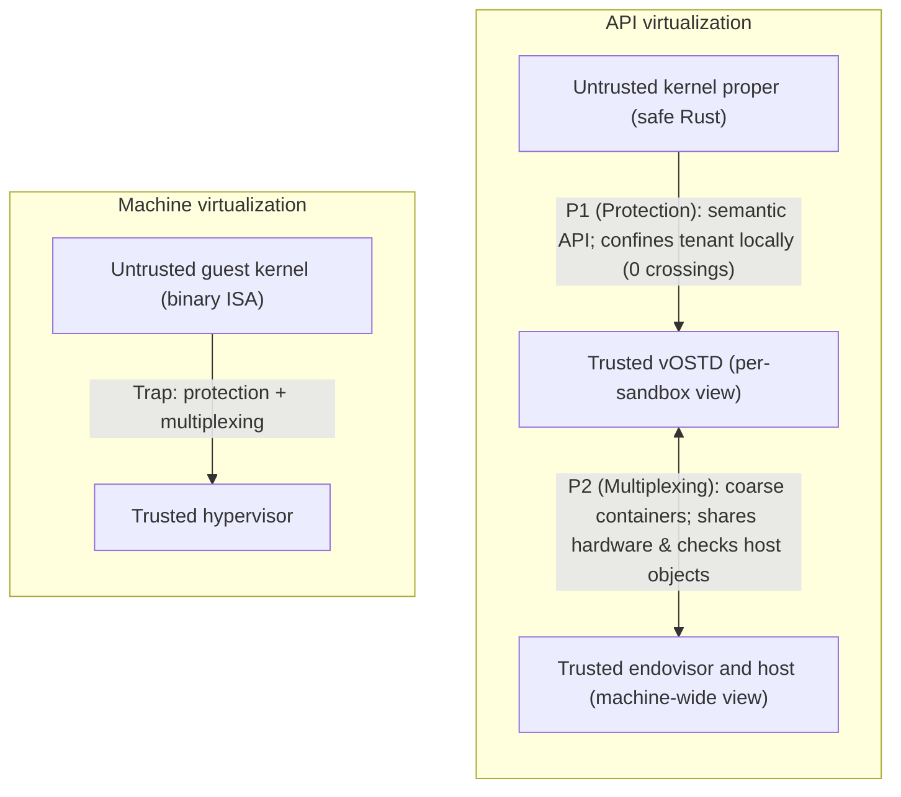

# 2026-11-16 Principles of API virtualization

- Status: Draft
- Author(s): Plucky923
- Discussion: No public review opened yet.
- Affected chapters: [Why a kernel of your own](../accepted-design/why-a-kernel-of-your-own.md), [The kernelet ABI](../accepted-design/the-kernelet-abi.md), [Stopping a kernelet](../accepted-design/stopping-a-kernelet.md), [Tenant memory on Linux's page tables](../accepted-design/tenant-memory-on-linux-page-tables.md), [What vOSTD adds on top](../accepted-design/what-vostd-adds-on-top.md), and [What it costs](../accepted-design/what-it-costs.md).
- Implementation or experiments: No standalone implementation. This document synthesizes the accepted design, audits all 24 service-table entries, and generalizes six companion proposals ([Reduce syscall overhead](2026-10-31-reduce-syscall-overhead.md), [Coordinate the two schedulers](https://github.com/tatetian/kernelet/blob/cd92aad9d195736cec1daf49d403315add0bab4c/book/src/design-proposals/2026-11-04-coordinate-the-two-schedulers.md), [TypedIO](2026-11-08-typed-io.md), [FPU state management](2026-11-09-fpu-state-management.md), [Direct page-table updates in vOSTD](2026-11-13-direct-page-table-updates-in-vostd.md), and [Allocate the kernelet heap from the grant](2026-11-16-allocate-the-kernelet-heap-from-the-grant.md)). The [LMbench measurements](#lmbench-measurements) cover the integrated prototype.

## Summary

API virtualization turns `OSTD` into `vOSTD` for multi-tenant sandboxes on a shared host kernel. Unlike a machine hypervisor that combines protection and multiplexing at one trap boundary, a kernelet splits them by resource ownership. `vOSTD` confines `kernel proper` at the upper API boundary without crossing, and the endovisor checks only the host-owned objects it multiplexes. Two principles define these boundaries:

1. **Principle 1 (`kernel proper → vOSTD`): virtualize tenant OS semantics.** Strip machine-global authority, keep tenant-scoped OS contracts, and replace hardware-coupled or unchecked signatures with safe OS abstractions.
2. **Principle 2 (`vOSTD ↔ host`): delegate coarse containers to the host; keep tenant confinement and fine-grained state local.** Cross the host boundary only for whole-reclaimable containers, host-owned CPU/MMU/privilege control, or peer fault domains.

Applied to OSTD and the 24-entry service table, these principles derive the six companion proposals and leave 13 multiplexing and cross-domain services.

## Problem and motivation

**Virtualization: protection vs. multiplexing.** A multi-tenant system performs two distinct jobs. *Protection* confines each tenant to its own resources so it cannot read, corrupt, or crash the host or sibling tenants. *Multiplexing* shares scarce physical hardware and global kernel state across tenants, including CPU time, physical memory quotas, MMU/TLB contexts, interrupt gates, and shared devices. In classical machine virtualization ([Popek and Goldberg, 1974](https://dl.acm.org/doi/10.1145/361011.361073)), the guest kernel is an untrusted binary, so the hypervisor enforces both protection and multiplexing at one expensive hardware trap boundary.

### Why a cheap boundary still fails when protection and multiplexing stay coupled

In a classical VM, trapping across the hypervisor boundary is expensive, so it is natural to assume that replacing that trap with a cheap call would remove the overhead. In a kernelet, a null service call switches stacks in only 36 cycles ([What it costs](../accepted-design/what-it-costs.md#the-crossing)). Following that intuition, a design can keep single-machine `OSTD` unchanged above and forward every privileged or hardware-facing operation across the [service table](../accepted-design/the-kernelet-abi.md#the-three-tables) to the endovisor, which validates each request and executes it inside Linux's shared kernel subsystems.

Making the jump cheap removes only the 36-cycle call cost. Pushing `OSTD` semantics across the host multiplexing boundary still fails in two ways:

1. **Duplicate structures and host paths inflate latency.** Because `vOSTD` cannot touch host internals yet must preserve `OSTD` semantics, while the host loses Rust type and ownership guarantees across C calls, both sides duplicate locks, tracking tables, and side structures. Every forwarded call also runs boundary checks, staging copies, and Linux subsystem paths instead of updating memory directly. Thus a 64 MiB `fork` slows to 7.85 ms vs. 0.34 ms natively ([Direct page-table updates in vOSTD](2026-11-13-direct-page-table-updates-in-vostd.md#what-that-choice-costs)), 64-byte `mem_alloc`/`mem_free` pairs take 449 cycles ([Allocate the kernelet heap from the grant](2026-11-16-allocate-the-kernelet-heap-from-the-grant.md#how-the-accepted-host-heap-works-and-what-it-costs)), and FPU staging adds ~330–340 ns per syscall ([FPU state management](2026-11-09-fpu-state-management.md#problem-and-motivation)).
2. **Conflicting OS and host semantics force extra bridging mechanisms.** Host subsystems enforce their own rules for concurrency, object lifetimes, and state representation, which often conflict with `OSTD`'s single-OS contracts. Reconciling those mismatches requires extra cross-boundary shims and restrictions, such as host waiting helpers (`vm_wait`) and lock aborts when sleepable host paths meet kernelet spin locks, deferred queues and per-object scans where abrupt kill demands whole-container teardown ([What vOSTD adds on top](../accepted-design/what-vostd-adds-on-top.md#the-rule-about-sleeping)), or software side-maps where host formats cannot encode an `OSTD` permission state.

### How API virtualization decouples them

Unlike a binary VM, a kernelet moves the virtualization boundary up to `OSTD`'s safe-Rust API on Linux. Three structural conditions let it separate protection from multiplexing:

1. **Safe Rust splits the VM's single boundary into two.** Safe Rust forces untrusted `kernel proper` through `vOSTD`, which sits inside the TCB ([Why a kernel of your own](../accepted-design/why-a-kernel-of-your-own.md#the-same-kernel-a-different-framework)). `vOSTD` can therefore enforce tenant protection locally at `kernel proper → vOSTD` with zero crossings, leaving `vOSTD ↔ host` for host multiplexing.
2. **The upper boundary is a source-level Rust API.** Because kernelets compile both layers from source, `vOSTD` can reshape bare-metal assumptions (such as `UserMode::execute`, unchecked `FpuContext`, and `IoMem`) into host-friendly Rust abstractions.
3. **`vOSTD` stays decoupled from Linux internals below.** Unlike a Linux kernel module, `vOSTD` compiles as a PIE image with zero host symbol imports and cannot touch Linux runqueues, `mm_struct` lists, or IDT gates ([The kernelet ABI](../accepted-design/the-kernelet-abi.md)). Because the host can also kill a sandbox immediately without running `Drop` destructors ([Stopping a kernelet](../accepted-design/stopping-a-kernelet.md#the-shape-of-a-death)), Linux hands out coarse containers that the host multiplexer schedules and reclaims whole.

Earlier [`kernelet-book`](https://github.com/tatetian/kernelet-book/blob/main/src/blueprint/asterinas-mode/virtualizing-ostd/README.md) blueprints observe that 22 of 38 virtualized OSTD items do not call the host, without stating the underlying rule. Separating protection from multiplexing supplies that rule.

## Proposed change

### Core thesis: decouple protection from multiplexing

API virtualization places tenant protection at `kernel proper → vOSTD` and host multiplexing at `vOSTD ↔ host`, splitting them by resource ownership:

Two principles define these boundaries:

### Principle 1: Virtualize tenant OS semantics

At the `kernel proper → vOSTD` boundary, `vOSTD` enforces tenant confinement while keeping `kernel proper` portable:

1. **Strip machine-global authority.** `vOSTD` omits APIs over physical hardware topology or host-global kernel state (`Absent`) so unauthorized calls fail at compile time.
2. **Keep tenant-scoped OS contracts.** `vOSTD` keeps safe-Rust contracts for single-OS abstractions, reshaping a signature only when a single-machine assumption conflicts with running on a host.

As a result, pure-software abstractions built over lower `vOSTD` primitives compile unchanged (`Identical`), while `vOSTD` reimplements the underlying primitives (`Virtualized`) under Principle 2.

### Principle 2: Delegate coarse containers to the host; keep tenant confinement and fine-grained state local

At the `vOSTD ↔ host` boundary, resource ownership sets placement, crossings, and checks:

1. **Delegate coarse containers; keep fine-grained state local.** Because Linux must reclaim sandbox resources whole on abrupt kill without running `Drop` destructors, the host provides only coarse containers, while `vOSTD` handles all fine-grained updates locally inside them to avoid Linux paths and locks.
2. **Cross only for external ownership.** `vOSTD` and the host cross the runtime boundary *if and only if* an operation touches a host container, host-controlled CPU/MMU/privilege multiplexing, or another fault domain.

Each side checks only what it owns: `vOSTD` confines the tenant over sandbox state locally, and the endovisor checks host-owned objects during required crossings.

### Resulting taxonomy of `vOSTD`

The table below classifies Asterinas's `OSTD` (`ab9a4cfdc`) using both principles. Principle 1 separates items into `Absent`, `Identical`, and `Virtualized` (marking reshaped upper signatures with `\*`), and Principle 2 splits `Virtualized` paths into local `Not crossing` operations and `Crossing` host transfers (`Services`, `EntryTable`, and `BootArgs`). Compound primitives split by execution path: common fast paths stay inside `vOSTD`, while contention, cross-CPU TLB shootdowns, and instance teardown cross into the host multiplexer.

| Subsystem | Absent | Identical | Virtualized: Not crossing *(local in `vOSTD`)* | Virtualized: Crossing *(host multiplexer & ABI)* |
|---|---|---|---|---|
| **Tasks, Sync & Time** | `smp::inter_processor_call` | `Scheduler`, `WaitQueue`, `Mutex`, `RwMutex` | `Task`, `TaskOptions`, `disable_preempt()`, `SpinLock` *(fast path; slow path calls `vcpu_on_spin`)*, `disable_local()`, `cpu_local!`, `CpuId`, `Jiffies` | Physical CPU multiplexing: carrier scheduling, preemption timers & cgroup quotas (`vcpu_boot`/`idle`/`kick`/`yield`/`on_spin`, `vcpu_entry`, `virq_entry`) |
| **Memory & Heap** | None | `Infallible` `VmReader`/`VmWriter` | `Frame<M>`, `UniqueFrame<M>`, `Segment<M>`, `FrameAllocOptions`, `#[global_allocator]`, `Fallible` `VmReader`/`VmWriter`, `VmIo` | Memory quota multiplexing: startup `grant` provisioning & whole-grant reclaim (`BootArgs`) |
| **Address Spaces** | None | `PageProperty`, `PageFlags` | `VmSpace`, `Cursor`, `CursorMut` (`map`, `protect_next`, `unmap` on grant PT), `TlbFlusher` *(triggers `vm_flush`)* | MMU multiplexing: `mm_struct` & `CR3` switching, cross-CPU TLB shootdowns (`vm_create`/`activate`/`flush`/`destroy`) |
| **User Mode & FPU** | None | `GeneralRegs`, `CpuException` | `UserEventHandler`\*, `UserEvent`\* *(replace `UserMode::execute`, `ReturnReason`)*, `FpuContext` (`read_from`\*, intra-carrier `XSAVE`/`XRSTOR`) | Shared hardware Ring-3 / trap gate (`user_run`, `user_event_entry`, `on_exception`) |
| **Devices & IPC** | `IoPort`, `IRQ_CHIP`, `BootloaderAcpiArg` *(and `IoMem` under `TypedIO`)* | None | `TypedIO` (`Protocol`/`Message`\*), `DmaStream`/`DmaCoherent` *(alloc & sync)*, `IrqLine` *(dispatch)* | Device/IPC multiplexing: attachments, queue/buffer leases, cross-sandbox pipes & virtual IRQs (`discover`, `try_submit`, `reserve`/`commit`, `bind_irq`/`rearm_irq`) |
| **Boot, Log & Panic** | `DEVICE_TREE`, `SERIAL_PORT` | `catch_unwind()`, `Error`, `Result`, `ExitCode`, `util` | `boot_info()` (`BootInfo`), `tsc_freq()`, `read_tsc()`, `early_print!` / `log` *(formatting)*, `poweroff()` / `abort()` *(call `stop`)* | Startup entry (`BootArgs`, `kernelet_entry`), shared host output sinks (`console_write`, `log_write`), & instance teardown (`stop`) |

### Changes relative to the Accepted Design

This taxonomy retires 11 entries from the 24-entry `Services` table in [The kernelet ABI](../accepted-design/the-kernelet-abi.md#the-three-tables). Heap blocks (`mem_alloc`, `mem_free`), single-page PTE updates (`vm_map`, `vm_unmap`, `vm_protect`, `vm_wait`, `vm_wake`), FPU switches (`fpu_save`, `fpu_load`), and task stacks (`kstack_alloc`, `kstack_free`) do not manage host multiplexer units, so they move into local grant memory and intra-carrier `XSAVE`/`XRSTOR`, leaving 13 host-multiplexing and cross-domain calls (`vcpu_*`, `vm_create`/`destroy`/`activate`/`flush`, `user_run`, `console_write`, `log_write`, `stop`).

## Alternatives and tradeoffs

| Alternative | Benefits | Costs and limits |
|---|---|---|
| **Document subsystem mechanisms without unifying principles** | Leaves existing chapter structure untouched | Gives contributors no predictive rule for new OSTD subsystems or alternative host kernels |
| **Mediate fine-grained ops on sandbox-owned state at the service table** *(accepted v1 paths)* | Catches certain `vOSTD` bugs inside endovisor C checks | Adds host locks, per-object teardown tables, and sleeping host calls under spin locks without shrinking the TCB |
| **Preserve bare-metal OSTD signatures unconditionally** | Zero source diff in OSTD traits and drivers | Suspends kernel stacks across `UserMode::execute`, skips `FpuContext` validation, and forces untyped `IoMem` emulation |

## Implementation and integration

This proposal introduces no standalone code. The six companion proposals implement all runtime, ABI, and subsystem changes:

- **Upper-boundary changes (Principle 1):** [Reduce syscall overhead](2026-10-31-reduce-syscall-overhead.md), [TypedIO](2026-11-08-typed-io.md), and [FPU state management](2026-11-09-fpu-state-management.md).
- **Lower-boundary changes (Principle 2):** [Coordinate the two schedulers](https://github.com/tatetian/kernelet/blob/cd92aad9d195736cec1daf49d403315add0bab4c/book/src/design-proposals/2026-11-04-coordinate-the-two-schedulers.md), [FPU state management](2026-11-09-fpu-state-management.md), [Direct page-table updates in vOSTD](2026-11-13-direct-page-table-updates-in-vostd.md), and [Allocate the kernelet heap from the grant](2026-11-16-allocate-the-kernelet-heap-from-the-grant.md).

Once those companion proposals are accepted, this framework updates [Why a kernel of your own](../accepted-design/why-a-kernel-of-your-own.md#the-same-kernel-a-different-framework) (protection vs. multiplexing, Principle 1, and the `vOSTD` taxonomy) and [The kernelet ABI](../accepted-design/the-kernelet-abi.md#the-three-tables) (Principle 2, the 13-entry service table, and ownership-based endovisor checks).

## Validation and evidence

### LMbench measurements

On 2026-11-18, Linux, native Asterinas, and Kernelet ran the same 19 LMbench workloads, with five accepted measurements per workload and system. All three used the same payload from the Asterinas LMbench fork at `afb47eddaf10` with the timing and resource-use patch.

Each VM used QEMU 10.2.1 with KVM, two pinned vCPUs, and 2 GiB of preallocated memory on one Intel Xeon Platinum 8259CL host. We set both frequency limits to 3.2 GHz on the assigned host CPUs and accepted per-boot effective VM execution frequencies of 3.168–3.232 GHz.

Linux and Kernelet shared the Linux 6.12 kernel binary. Kernelet ran in a separate campaign with Direct page tables and a fresh sandbox with a 512 MiB memory grant for each workload. Native Asterinas used an earlier source snapshot.

The table gives median end-to-end latencies for six workloads.

| Workload | Unit | Linux | Native Asterinas | Kernelet |
|---|---|---:|---:|---:|
| `getppid` | ns/op | 57.6 | 75.7 | 77.4 |
| Read 1 byte from `/dev/zero` | ns/op | 81.6 | 136.6 | 186.2 |
| Pipe round trip | µs/op | 9.17 | 9.56 | 23.44 |
| `fork`, child exit, and `waitpid` | ms/op | 0.0848 | 0.1346 | 15.99 |
| `fork` + `exec` | µs/op | 241.7 | 341.0 | 450.8 |
| File-mapping page fault | ns/fault | 174.2 | 138.3 | 229.0 |

Across the four 64 MiB memory bandwidth workloads, Kernelet's median bandwidth was 92.8–95.9% of the corresponding Linux medians and 94.9–98.8% of the native Asterinas medians.

The local archive at `research/evaluation-plan/results/20261118-kernelet-lmbench-3p2ghz/` contains full summaries, all 285 samples, workload settings, frequency logs, and build manifests.

## Decision and follow-up

Status remains Draft pending review alongside the companion proposals.
