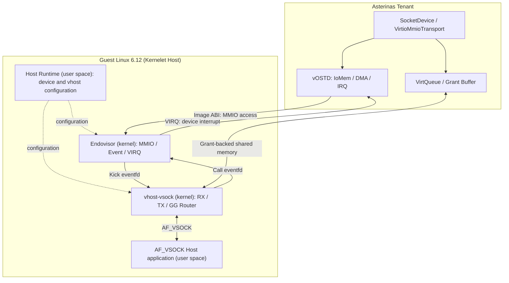
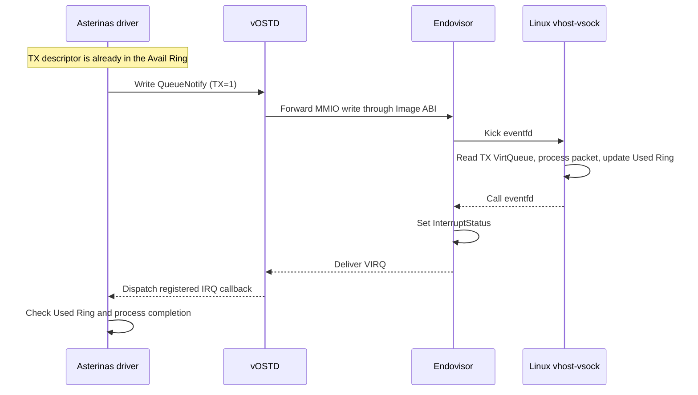

# 2026-11-25 Kernelet VirtIO-MMIO Vsock

- **Status:** Under review
- **Scope:** Tenant ↔ Guest Linux Host (GH); Tenant ↔ Tenant (GG)
- **Affected components:** [Asterinas VirtIO-MMIO](https://github.com/asterinas/asterinas/blob/ab9a4cfdc726263b3f41ccea0337633e24b443fc/kernel/core/comps/virtio/src/transport/mmio/device.rs)/[Vsock](https://github.com/asterinas/asterinas/tree/ab9a4cfdc726263b3f41ccea0337633e24b443fc/kernel/core/comps/virtio/src/device/socket), [vOSTD](https://github.com/tatetian/kernelet/blob/main/prototype/vostd/src/lib.rs), [Image ABI](https://github.com/tatetian/kernelet/blob/main/prototype/vostd/src/abi.rs), [Endovisor](https://github.com/tatetian/kernelet/tree/main/prototype/linux/endovisor), [Host Runtime](https://github.com/tatetian/kernelet/tree/main/prototype/host/runtime), [Linux 6.12 vhost-vsock](https://github.com/torvalds/linux/blob/v6.12/drivers/vhost/vsock.c)
- **Implementation:** Design proposal

This proposal provides a VirtIO-MMIO Vsock device to Kernelet tenants, reusing Asterinas's existing VirtIO-Vsock frontend and the Linux kernel's vhost-vsock backend to establish GH/GG communication paths for comparison with TypedIO-Vsock. It distributes the device emulation and vhost configuration responsibilities previously handled by QEMU among vOSTD, the Endovisor, and the Host Runtime, while Linux vhost-vsock continues to process RX/TX data.

## Motivation and Problem

In a conventional VirtIO-MMIO + vhost-vsock setup, the guest driver allocates VirtQueues and packet buffers; QEMU emulates device registers, bridges notifications and interrupts, and configures vhost; and the Linux kernel's vhost-vsock directly processes RX/TX queues.

Asterinas running in Kernelet already has a VirtIO-MMIO driver, VirtQueues, and a Vsock protocol stack. However, vOSTD still lacks software MMIO, Grant-backed DMA, and device IRQ dispatch; the host side also lacks shared-memory mappings and notification channels connecting it to vhost.

This design therefore addresses three problems:

- **Register emulation:** QEMU previously emulated MMIO registers. Now, vOSTD forwards accesses through the Image ABI, and the Endovisor maintains the registers and device behavior.
- **Interrupts and notifications:** QEMU previously bridged eventfd notifications and guest interrupts. Now, the Endovisor converts `QueueNotify` into a Kick eventfd notification and converts a Call eventfd notification into a tenant VIRQ.
- **Shared memory and VirtQueues:** The guest driver previously created the queues and buffers, while QEMU helped configure vhost mappings. Now, the tenant allocates shared buffers from its Grant, the Endovisor manages access authorization, and the Host Runtime maps memory and configures vhost.

## VirtIO-MMIO Vsock design

### Overview

The design has three parts: **register emulation, interrupts and notifications, and shared memory and VirtQueues**. It uses the modern VirtIO-MMIO interface, with the MMIO `Version` register set to `2`.

| Previous responsibility | Responsibility in Kernelet |
|---|---|
| QEMU handled guest MMIO accesses and emulated device registers | vOSTD forwards accesses through the Image ABI; the Endovisor maintains register state and performs device operations |
| QEMU bridged vhost eventfd notifications and guest device interrupts | The Endovisor connects Kick/Call eventfds to VIRQ; vOSTD dispatches device VIRQs to the Asterinas driver |
| QEMU helped establish guest RAM-to-vhost mappings and configured VirtQueues | The tenant driver allocates shared queues and buffers from its Grant; the Endovisor manages sharing authorization; the Host Runtime configures mappings and vhost |
| The guest driver managed VirtQueues; Linux vhost-vsock processed RX/TX | Both reuse the existing protocol and queue-processing logic |

At runtime, control and data paths are separate: MMIO register accesses go through vOSTD and the Endovisor; packets reach Linux vhost-vsock through shared VirtQueues in the Grant, without per-packet forwarding by the Host Runtime.

**Figure 1. Overall architecture and communication paths.**




### MMIO register emulation

Asterinas's `VirtioMmioTransport` accesses device registers through `SafePtr<VirtioMmioLayout, IoMem>`: `VirtioMmioLayout` defines the register layout, `IoMem` represents a device I/O address resource, and `SafePtr` accesses registers by type and offset. The underlying reads and writes are implemented through the `VmIoOnce` interface (`read_once`/`write_once`).

In the conventional setup, these registers are emulated by QEMU's VirtIO-MMIO device model. In the proposed setup, vOSTD provides a compatible `IoMem` implementation that forwards register reads and writes to the Endovisor through the Image ABI; **the Endovisor emulates the registers and their behavior**. The Endovisor maintains register state including `DeviceID` (19 for Vsock), feature negotiation, queue indices and addresses, `QueueReady`, `Status`, and `InterruptStatus/ACK`; the Vsock `guest_cid` is exposed through device-specific configuration space. When `QueueNotify` is written, the Endovisor triggers the corresponding queue's Kick notification.

Asterinas's existing `VirtQueue::notify()` implementation notifies the device by writing the queue index:

```rust
pub fn notify(&mut self) {
    if self.notify_config.is_modern() {
        self.notify_config
            .write_once::<u32>(0, self.queue_idx)
            .unwrap();
    } else {
        self.notify_config
            .write_once::<u16>(0, self.queue_idx as u16)
            .unwrap();
    }
}
```

*Source: [Asterinas `queue.rs`](https://github.com/asterinas/asterinas/blob/ab9a4cfdc726263b3f41ccea0337633e24b443fc/kernel/core/comps/virtio/src/queue.rs#L496-L506).*


MMIO addresses here identify a device and register offsets; they need not correspond to a physical region of register RAM. vOSTD forwards reads and writes directly through Host Services, and the Endovisor can store register state in kernel data structures without relying on KVM MMIO exits. Device discovery uses device descriptors and virtual IRQ resources provided during Kernelet startup to integrate with Asterinas's existing VirtIO-MMIO Transport.

### Notification and interrupts

VirtIO-Vsock uses three VirtQueues: `RX=0` receives packets, `TX=1` sends packets, and `Event=2` receives device-level events such as Transport Reset. Queue 2 is simply the index of the third queue, not an eventfd. Linux 6.12 vhost-vsock handles the RX and TX queues; **the Endovisor implements the Event Queue**.

**Kick (Tenant → vhost):** Asterinas submits descriptors to the Avail Ring and writes the MMIO `QueueNotify` register. vOSTD forwards the write to the Endovisor, which signals the Kick eventfd, waking a vhost worker in the Linux kernel to read the queue.

**Call (vhost → Tenant):** After processing the queue and updating the Used Ring, vhost signals the Call eventfd. The Endovisor receives the notification through Linux kernel event wait/wakeup mechanisms, sets the virtual device's `InterruptStatus`, and delivers a VIRQ to the tenant. vOSTD dispatches the device VIRQ to the `IrqLine` callback registered by Asterinas; the existing `MultiplexIrq` reads and acknowledges the interrupt status, then handles completion events for the corresponding VirtQueue.

Kernelet's existing VIRQ mechanism already supports basic virtual-CPU notifications, but device IRQ lines are not yet fully connected to the `IrqLine` handling path. This proposal extends device VIRQ dispatch in vOSTD so that Endovisor notifications invoke the existing Asterinas driver callbacks. The Host Runtime creates and registers Kick/Call eventfds during initialization; normal notifications do not pass through the user-space Host Runtime.

**Figure 2. Kick/Call notification sequence for a TX request.**




### Grant-backed VirtQueues

A Grant is Kernelet's existing memory allocation authorized by the host for a tenant to use. The Endovisor allocates it and informs vOSTD through `grant_paddr` and `grant_len` in `BootArgs`. The new design reserves a dedicated shared I/O pool within the Grant for VirtQueues and packet buffers; the Endovisor does not construct VirtQueues on behalf of the tenant.

The Asterinas VirtIO driver continues to allocate and manage the Descriptor Table, Avail/Used Rings, and RX/TX/Event Buffers. vOSTD backs the existing DMA abstractions with shared Grant pages: `DmaCoherent` is used for queue structures requiring coherent access, while `DmaStream` is used for packet buffers with direction and synchronization requirements. Here, DMA denotes the memory interface through which the driver exposes buffers to a device backend; the actual accessor is Linux kernel vhost-vsock.

**Logical MMIO addresses and DMA addresses serve different purposes.** The former identify virtual device registers and are interpreted by the Endovisor; the latter identify queues or data buffers in the shared Grant pool and must be mappable to memory accessible to vhost. These are two distinct addressing semantics, not necessarily two physically separate memory regions.

The Host Runtime maps the shared pool into the Guest Linux user-space address space, then configures the backend through Linux vhost `ioctl` commands:

| vhost configuration command | Purpose |
|---|---|
| `VHOST_SET_MEM_TABLE` | Registers memory regions mapping device-visible addresses to host user-space addresses |
| `VHOST_SET_VRING_NUM` | Sets the number of descriptors in a queue |
| `VHOST_SET_VRING_ADDR` | Supplies the host user-space addresses of the Descriptor Table, Avail Ring, and Used Ring |
| `VHOST_SET_VRING_KICK/CALL` | Binds a queue to its Kick/Call eventfds |

The Host Runtime uses the following `ioctl` calls to configure shared memory, VirtQueues, and notification endpoints:

```c
/* Selected vhost configuration calls; arguments omitted. */
ioctl(vhost_fd, VHOST_SET_MEM_TABLE, &memory);
ioctl(vhost_fd, VHOST_SET_VRING_NUM, &ring_num);
ioctl(vhost_fd, VHOST_SET_VRING_ADDR, &ring_addr);
ioctl(vhost_fd, VHOST_SET_VRING_KICK, &kick);
ioctl(vhost_fd, VHOST_SET_VRING_CALL, &call);
```

*Interface definitions: [Linux 6.12 `vhost.h`](https://github.com/torvalds/linux/blob/v6.12/include/uapi/linux/vhost.h).*


Once configured, vhost can locate packet buffers in the Grant through descriptors; the Host Runtime need not copy or forward individual packets.

### Initialization and data paths

Initialization proceeds in the following order:

1. **Create the device.** The Host Runtime uses an extended device Attach interface to create a Vsock device for the tenant, allocate a CID, and create a vhost instance; the Endovisor creates the software MMIO register model and device VIRQ resources.
2. **Establish shared queues.** After tenant startup, vOSTD allocates VirtQueues and buffers from the Grant; the Host Runtime maps the shared pool and registers the vhost memory table. Asterinas negotiates features, writes queue addresses, and sets `QueueReady`.
3. **Start the backend.** Based on the negotiated configuration, the Host Runtime configures vhost queues, the CID, and eventfds. After the frontend enters `DRIVER_OK`, it starts vhost RX/TX processing. Subsequent MMIO accesses and notifications use kernel paths and do not require per-packet Runtime involvement.

**GH (Tenant ↔ Guest Linux Host).** The host CID is 2, and each tenant uses a distinct CID. For example, when Tenant A sends data to the host:

```text
Tenant A Socket → Asterinas Vsock → TX VirtQueue
       → QueueNotify → vOSTD → Endovisor → Kick eventfd
       → Guest Linux vhost-vsock → Host AF_VSOCK application
```

For traffic in the reverse direction, vhost fills the tenant's RX Buffer, updates the Used Ring, and then notifies Asterinas via Call eventfd → Endovisor → VIRQ.

**GG (Tenant A ↔ Tenant B).** The VirtIO-Vsock protocol distinguishes endpoints by CID, but the TX path in Linux 6.12's existing vhost-vsock accepts only packets addressed to the local host CID. Therefore, vhost-vsock is extended with CID routing: it validates the source tenant's CID, locates Tenant B's vhost instance by destination CID, delivers the packet to its RX queue, and notifies Tenant B using the existing Call/VIRQ mechanism. This extension reuses the existing packet format, VirtQueues, frontend, and RX/TX notification interfaces; it also handles inter-tenant authorization, destination RX backpressure, and instance termination. GG does not relay traffic through a host application.

### Device lifecycle

On device Reset, Detach, or tenant termination, the system first stops accepting new device requests, stops vhost and waits for already queued worker tasks to complete, then unbinds eventfds, revokes shared-memory mappings, and reclaims the Grant. This ensures vhost no longer accesses released queues or buffers. The Event Queue notifies device-level events and works together with the device resource reclamation process.

## Integration and Evaluation

Asterinas reuses `VirtioMmioTransport`, `SocketDevice`, VirtQueues, and the Vsock protocol, adapting only device discovery and IRQ integration for the Kernelet platform. Kernelet adds software `IoMem`, Grant-backed DMA, and device VIRQ support to vOSTD; the Endovisor implements register emulation and notification bridging; and the Host Runtime initializes vhost and sets up mappings. Linux 6.12 vhost-vsock retains the GH RX/TX path and adds CID routing for GG.

The comparative experiments use the same Guest Linux, tenant configuration, Echo/Streaming service logic, CPU affinity, and concurrency conditions to compare TypedIO GH, VirtIO GH, TypedIO GG, and VirtIO GG. They measure throughput, RTT p50/p95/p99, CPU cycles/byte, copied bytes, notification and interrupt counts, and shared-memory usage to assess the additional overhead of the two interfaces.

## References

- [Kernelet TypedIO Design Proposal](https://tatetian.github.io/kernelet/design-proposals/2026-11-08-typed-io.html)
- [VirtIO 1.2 Specification](https://docs.oasis-open.org/virtio/virtio/v1.2/virtio-v1.2.html)
- [Asterinas VirtIO-MMIO Transport](https://github.com/asterinas/asterinas/blob/ab9a4cfdc726263b3f41ccea0337633e24b443fc/kernel/core/comps/virtio/src/transport/mmio/device.rs)
- [Kernelet vOSTD Image ABI](https://github.com/tatetian/kernelet/blob/main/prototype/vostd/src/abi.rs)
- [Linux 6.12 vhost-vsock](https://github.com/torvalds/linux/blob/v6.12/drivers/vhost/vsock.c)
- [Linux 6.12 vhost ioctl interface](https://github.com/torvalds/linux/blob/v6.12/include/uapi/linux/vhost.h)
